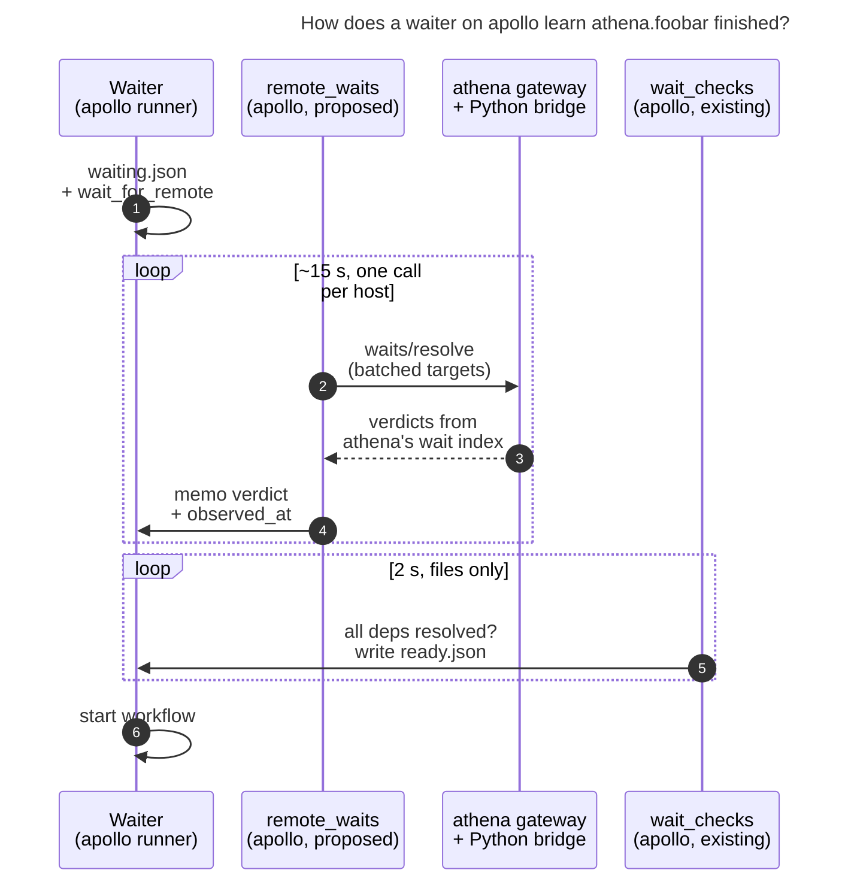

# Waiting on agents that run on other machines (`%wait:athena.foobar`)

**Date:** 2026-11-07 · **Researcher:** cld · **Status:** research and design
recommendation; no product changes.

**Inspected:** sase `master` at `0ba9cfc9f1`; linked sase-core at `317ea6a1` (v0.44.0).
I also ran live read-only checks from apollo. I could not execute the wait binder
locally because the workspace venv has a stale `sase_core_rs` wheel, so I traced that
path by reading the code. Those claims are marked as code-reading below.

## Summary

The feature is worth building. Most of the plumbing already exists: enrollment, an
authenticated gateway on every machine, a federation worker that can target one host by
installation ID, and an `athena.`-prefixed name namespace that sase already reserves for
the machine `athena`. The hard part is not transport. It is keeping **one meaning of
"done"** across machines and **failing safe** when a machine is unreachable.

My recommendation, in brief:

1. **Ask the owner, don't infer.** Add a small read-only fleet endpoint on the target's
   gateway, `POST /fleet/v1/waits/resolve`. The owner (athena) answers it with its own
   existing wait resolver. The controller (apollo) never rebuilds wait semantics from
   display rows.
2. **Pull, batched, off the hot path.** Add a new AXE job on the waiter's machine,
   `remote_waits`, that runs about every 15 seconds and makes one batched call per host.
   It memoizes each verdict into the waiter's `waiting.json`. The existing 2-second
   `wait_checks` job stays filesystem-only and still writes `ready.json` only when every
   dependency, local and remote, is satisfied.
3. **Same release rule as local `%wait`.** A remote wait releases only after a
   successful completion of the newest run, with session and clan aggregation. A remote
   failure parks the waiter and raises the existing "can never self-resolve"
   notification.
4. **Unreachable never releases.** A remote wait is a correctness barrier, so it fails
   closed. That is the opposite of `%hold`, which is a scheduling courtesy and fails open.
5. **Keep the dotted syntax, but pin its meaning.** In `athena.foobar`, `athena` is an
   enrolled `sase machine` alias that resolves to a pinned installation ID, never a
   hostname guess. There is also an explicit keyword form,
   `%wait(foobar, machine=athena)`, for aliases that are not valid hood segments.
6. **Ship a quick win first.** Today `%wait:athena.foobar` parks silently forever (from
   code reading). Make it a clear launch error until the real feature lands.

One prerequisite: **apollo currently has no enrolled machines** (`sase machine list`
prints "No remote machines are configured"). Both gateways are healthy, so this is a
one-time `sase machine bootstrap` on athena plus `sase machine init -B` on apollo. The
feature cannot work until that is done.

## 1. What exists today

### 1.1 How local `%wait` works

- **Binding.** At launch, `bind_wait_target` in `src/sase/agent/wait_target_binding.py`
  classifies a reference as clan, tribe, exact member, proc, bare agent, or unresolved.
  When it can, it pins an identity record. An unresolved name becomes a by-name wait
  for an agent that may not exist yet.
- **Barrier.** The runner writes `waiting.json`, then polls for `ready.json`
  (`src/sase/axe/run_agent_wait.py`). It also falls back every 60 seconds to resolving
  the dependencies itself, so a scheduler outage cannot strand it.
- **Release.** The `wait_checks` AXE job (`agent_waits` chop, 2-second interval,
  triggered by filesystem changes) scans live waiting markers. It resolves them against
  a `WaitDependencyIndex` and writes `ready.json`. Already-satisfied identity
  dependencies are memoized in `resolved_deps`.
- **Semantics.** A wait releases only when the **newest** matching run has a success
  outcome: `completed`, `noop`, `epic_approved`, or `plan_committed`. Clans need every
  member of the newest generation; sessions and workflows need every member. Waits also
  follow resolved hijack successors. A failed blocker parks the waiter and posts one
  red "Wait dependency can never self-resolve" notification
  (`docs/reference/macros/directive-launch.md`;
  `src/sase/core/wait_dependency_resolution/_index_candidate_queries.py`).
- **Names are permanent IDs.** A normal `%id:<name>` cannot reuse a name that has
  existing state. Reuse needs the explicit `%id:!<name>` wipe. This makes a by-name
  wait on another machine well-defined: there is at most one live `foobar` on athena.
- **Where the code lives.** Wait resolution is **Python**
  (`src/sase/core/wait_dependency_resolution/`). Only the wait-target vocabulary is in
  Rust (`parse_wait_target`, `effective_wait_target`).

### 1.2 Remote plumbing that can be reused

| Piece | Where | Why it matters |
| --- | --- | --- |
| Enrollment record per alias (`endpoint`, `credential_ref`, `pinned_installation_id`, quarantine) | `src/sase/dispatch/models.py` `MachineRecord` | Maps the `athena` in `athena.foobar` to a pinned, authenticated identity |
| Gateway fleet routes `/catalog`, `/batch`, `/detail`, `/events`, `/launch`, `/mutate` | sase-core `crates/sase_gateway/src/routes/router.rs` | A new read route fits the existing auth and contract pattern |
| Federation worker with per-host targeting (`catalog_hosts` keyed by installation ID), deadlines, caching | sase-core `federation_worker/imp/state.rs`; Python `FederationFacade` | Lets the controller make one bounded call per host |
| Gateway → Python bridge (`sase mobile agent-bridge list-agents/launch-text/kill-agent/...`) | `src/sase/main/parser_mobile.py` | The owner can answer with its **existing** Python wait resolver, so nothing is reimplemented |
| Host capability lists in hello (`CapabilitySetWire.host: Vec<String>`) | sase-core `fleet_contract/content.rs` | Feature-gate the new endpoint without a contract-wide version bump |
| Hello reports the remote's `machine_selector` | sase-core `sase_gateway/src/wire.rs` | Lets the controller learn alias → owner machine name (they differ for the Mac, see 1.4) |
| Dispatch receipts with `logical_locator`, plus a provisional locator before submit | `src/sase/dispatch/launch_submit.py`, `launch_admission_runtime.py` | A wait on an agent dispatched in the same swarm can bind to the exact locator instead of a name |
| Fleet `events` stream with cursor replay and invalidation | sase-core `fleet_contract/cursors.rs` | Later optimization: wake up early instead of waiting for the next poll |
| History catalog scope (full index, not the 7-day / 200-row presentation window) | sase-core `fleet_reads/snapshot.rs` | A presentation-window approach would miss old or busy-host completions |

### 1.3 The `athena.` namespace is already reserved

sase-core's `machine_hood.rs` defines a *machine agent hood*: a `<machine_name>.`
prefix that makes agent names globally unique. The identity facade enforces it.
`foreign_agent_owner_root(name)` recognizes known owner roots, and launch validation
refuses to create local agents or clans named `athena.*`:

> "Agent name '…' belongs to known machine '…' and cannot be launched on local machine
> '…'" (`src/sase/agent/launch_validation.py`)

On apollo, this check returns:

```text
known roots ('bbugyi200.apollo', 'bbugyi200.athena', 'bbugyi200.kellys_mbp', 'apollo', 'athena', 'kellys_mbp')
athena.foobar -> foreign root: athena
apollo.foobar -> foreign root: None      # local machine: normalizes to bare 'foobar'
mac.foobar    -> foreign root: None      # 'mac' is an SSH alias, not an owner machine name
```

So your proposed spelling matches the house identity model. `athena.foobar` *is*
foobar's global name, and no local agent can be called that. One wrinkle: the reserved
roots are **owner machine names** from config overlays and the name registry, while
`%dispatch:<alias>` uses **enrollment aliases**. They match for athena but differ for
the Mac (`kellys_mbp` versus `mac`). Machine names must match `^[a-z_]+$`. Dispatch
aliases may contain `.` and `-` (`validate_machine_alias`), so an alias such as `a.b`
would make the dotted form ambiguous.

### 1.4 Live state of the machines (read-only probes, 2026-11-07)

- `sase machine list` on apollo: **no remote machines configured**.
- `https://athena.tail297af1.ts.net/api/v1/health` and the apollo equivalent both
  return `status: ok`, `sase_gateway 0.44.0`, `fleet.supported_protocol_versions: [3]`.
  So the gateways are up behind Tailscale Serve, and only the enrollment step is
  missing.

### 1.5 What `%wait:athena.foobar` does today (code reading, not executed)

1. `_classify_reference` finds no local clan, tribe, member, proc, session, or named
   agent, so the reference is `unresolved`.
2. The waiter parks on the name `athena.foobar`.
3. Name lookups return the name unchanged for foreign roots
   (`current_owner_agent_name_lookup_candidates`), so no candidate ever matches.
4. Launch guards forbid creating that name locally, so the wait can never release.
5. The terminal-blocker alert only fires for a dependency that *ended unsuccessfully*,
   so nothing flags a target that will never exist.

The result is a silent, permanent park. That justifies the quick win in §7.

## 2. Is this a good idea?

**Yes, with conditions.** The motivating workflows are real. For example: a heavy build
or refactor runs on athena (home server, more capacity), then a review, publish, or
notify agent runs on apollo (rendezvous server). Or a Mac-only task gates an apollo
follow-up. Today the only cross-machine coordination is a human watching rows, or the
indirect bead route described below. A first-class remote `%wait` also composes with
things that already work remotely, such as remote retry (`R`) on a failed remote row:
a later successful run releases the parked waiter exactly as it does locally.

There are real risks, and the design must address each one:

- **Distributed partial failure.** The remote can be off (the Mac usually is),
  quarantined, version-skewed, or re-enrolled under a new credential. A local wait
  cannot hit any of these failure classes.
- **Semantic drift.** "Done" in sase is subtle: newest run, success outcomes only,
  session and clan aggregation, hijack successors, planner-row aliases. Any approach
  that rebuilds "done" on the controller from the fleet's display fields (`status`,
  `status_bucket`, `lifecycle`) will diverge. This is the main reason to have the
  owner answer.
- **It is a correctness barrier.** The project chose fail-open for `%hold` because a
  hold is a courtesy (decision `hold-pull-fail-open`). A wait is the opposite: releasing
  early is the harmful failure. Remote waits must fail closed and be loudly diagnosable.
- **Avoid the deleted import leg.** The decision `agents-sync-publish-only` deleted
  machinery that synced remote agent state onto local disk. It warns that any future
  need for remote state must be "a new design exercise" that avoids multi-leg special
  cases. A live, stateless question to the owner meets that bar. Mirroring remote agents
  locally, or creating proxy agents, does not.

**Cheaper alternatives may already cover some cases.** These are worth knowing before
building:

1. **Bead waits already cross machines.** `%wait(bead=<id>)` resolves against bead state
   that the beads sidecar syncs over git (`mark_bead_wait_sync_hint` →
   `sidecar_auto_sync`). If foobar's job is "close bead X", an apollo agent can wait on
   the bead today. The latency is minutes rather than seconds, and both machines must
   share the project.
2. **Move the waiter to the owner.** If the follow-up agent may run on athena,
   `%dispatch:athena %wait:foobar …` needs no distributed wait at all. The target
   processes the remaining directives locally. It is blocked only by a conservative
   V1 guard in `src/sase/macro/_directive_scan.py` ("%dispatch cannot be combined with
   %wait, %queue, %clan, or %hold").
3. **Compose with `%proc`.** A polling script plus a local `%wait` on that proc works
   with a CLI primitive (see A8 below), but it loses integrated presentation.

None of these replaces the requested feature in general. They shape what V1 must do
and what can wait.

## 3. Adjustments to the requirements (called out explicitly)

- **A1. The qualifier is an enrolled machine alias, resolved to a pinned
  installation.**
  - `athena.foobar` means: the alias `athena` in `dispatch.machines`, with its
    `pinned_installation_id`, and the agent `foobar` as named on that owner.
  - Also accept the owner's machine name (learned from hello's `machine_selector` and
    recorded at enrollment) when it maps to exactly one enrollment. This makes
    `%wait:kellys_mbp.x` and `%wait:mac.x` equivalent.
  - The dotted form requires a hood-safe qualifier (`^[a-z_]+$`). Any other alias uses
    the keyword form.
  - *Why:* names are labels and installation IDs are identity, which is the fleet
    contract's own rule (`fleet_contract/mod.rs`). This also removes the alias-versus-
    machine-name ambiguity found in 1.3.
- **A2. Add a canonical keyword form,** `%wait(foobar, machine=athena)`, alongside the
  dotted sugar.
  - *Why:* aliases with dots or dashes, programmatic generation, and an unambiguous
    round-trip for `format_wait_spec`.
- **A3. Reserve enrolled aliases as foreign owner roots.** Extend the known-roots set
  with enrolled aliases, so a local clan named `mac` can never shadow the machine `mac`.
  - *Why:* the dotted form must never be ambiguous between a local clan member and a
    remote agent.
  - *Edge case:* if a local clan already uses the name when an alias is enrolled, error
    at enrollment or at wait parse, and require the keyword form.
- **A4. "Complete" means the local rule, computed by the owner.** The wait releases on
  the success outcome of the newest run, with session and clan aggregation.
  - It does **not** mean "reached any terminal state". A failed foobar parks the waiter
    and alerts, just like a local wait.
- **A5. Unreachable machines never release a wait. Launch stays network-free.**
  - **Launch checks local data only:** the alias is enrolled, not quarantined, and its
    cached capability is not known-missing. This matches how the Launch Target picker
    and `%tab` preflight avoid network probes.
  - **The first successful poll pins the binding.** When the owner reports a matching
    logical locator, it is pinned.
  - **Outages are shown, not hidden.** While the owner is unreachable, the waiter shows
    "athena unreachable since …, last verdict: RUNNING". After a configurable threshold
    it also raises a notification.
- **A6. Keep V1 small.** Support agent, session, and clan names with the default
  session target.
  - Reject these with explicit errors: `target=turn`, `hood=`, `bead=` with a machine
    qualifier (bead waits already work through sync), and `@tribe` waits.
  - Also reject remote-qualified waits inside `%dispatch` prompts. That reverse
    direction needs the *target* to have enrolled the controller.
  - *Why:* turn binding needs an owner-side "current turn" snapshot taken at bind time.
    Tribes and hoods need more owner-side query surface. Each can be added later
    without changing the V1 contract.
- **A7. Waits on agents dispatched in the same swarm bind to the dispatch locator, not
  the name.** Example: `%dispatch:athena %id:foobar …` followed by
  `--- %wait:athena.foobar …`.
  - *Why:* this mirrors how local swarms pin siblings by artifact identity, and it
    removes any race with an older `foobar` on the owner.
- **A8. Ship a CLI alongside the directive:** `sase agent wait athena.foobar`, or
  `sase machine agent wait ATHENA foobar`.
  - *Why:* scripts and monitors get the same primitive, and it is the easiest way to
    test the owner endpoint end to end.
- **A9. Direction is part of the contract.** A waiter on machine X can wait on machine
  Y only when X has enrolled Y. Document this, and make the error name
  `sase machine init` as the fix.

## 4. Design options compared

| Option | How it works | Verdict |
| --- | --- | --- |
| **A. Controller infers from catalog rows** | apollo polls athena's `/catalog` with `query=foobar`, `include_terminal` and treats `status_bucket=done` as success | **Reject as the main path.** Rebuilds "done" from display fields, so it diverges on sessions, clans, hijacks, and `plan_rejected`. `query` is a case-insensitive *substring* match over project, status, model, intent, and labels (`summary_matches_catalog_query`), so exact names need client filtering and paging. The presentation window is 7 days and at most 200 completed rows. Dismissed rows disappear. Its only advantage is that it works against today's gateways. |
| **B. Owner-computed verdict endpoint (pull)** | apollo asks athena "is the wait on `foobar` satisfied?" and athena answers from its own `WaitDependencyIndex` | **Recommend.** One implementation of the semantics, run where the data lives. Covers archived and dismissed completions, sessions, clans, and hijacks. Small, exact, stateless on the owner, and capability-gated. Costs an owner upgrade and a Python bridge call per batched poll. |
| **C. Push or subscription** | apollo registers interest on athena; athena calls back on completion | **Defer.** Needs athena → apollo credentials (two-way enrollment) and leaves durable interest records on the owner that must be cleaned up when waiters die. Use the existing `events` stream later as a *wake-up hint* only, and confirm by pull. |
| **D. Sync remote completions to local disk** | git-sidecar import of remote done records | **Reject.** This is the deleted agents-sync import leg (decision `agents-sync-publish-only`), with git-sync latency on top. |
| **E. Local proxy or shadow agent** | a local placeholder named `athena.foobar` mirrors remote state | **Reject.** Collides with the foreign-root launch guard, and it is import-by-another-name. |
| **F. `%proc` + polling CLI** | `%proc("sase machine agent wait athena foobar")`, then a local `%wait` on the proc | **Useful stopgap or test harness, not the product.** One process per wait, no integrated WAITING presentation, and failures look like proc failures. |
| **G. Move the waiter (`%dispatch:athena %wait:foobar`)** | run the follow-up on the owner | **Complementary.** Lift the V1 guard for owner-local names. It covers "the follow-up can run anywhere" without any distributed wait. |

## 5. Recommended design



*Figure: the only new network hop is a batched, owner-answered verdict call. Release
still goes through the existing filesystem-only `wait_checks` job, so local and remote
dependencies combine in one barrier.*

### 5.1 Grammar and launch validation

- **Parsing (sase-core, beside the existing wait-target vocabulary).** A wait reference
  is remote when its first dot-segment is an enrolled alias, or an owner machine name
  mapped to exactly one enrollment, and it is not the local machine. `apollo.foo` on
  apollo still normalizes to local `foo`. Add `machine=` as a keyword on
  `%wait(...)` and as a wait-spec entry (`machine:athena/foobar` or similar) for
  `parse_wait_spec` / `format_wait_spec`, which gate and CLI paths use.
- **Launch checks (local data only):**
  - the alias is enrolled and not quarantined;
  - the qualifier is hood-safe for the dotted form;
  - every A6 restriction holds;
  - the cached hello capabilities do not show `wait.resolve.v1` as known-missing.
    Unknown capability warns and proceeds, as the `%tab` preflight does.
- **Swarm binding (A7).** When the same launch plan contains
  `%dispatch:<alias> %id:<name>`, bind the remote wait to that dispatch's provisional
  or receipt locator.

### 5.2 Persisted shape

Add a sibling field to `waiting.json`, next to `waiting_for`:

```json
"wait_for_remote": [
  {
    "alias": "athena",
    "installation_id": "inst_…",
    "name": "foobar",
    "target": "session",
    "pinned_logical_key": null,
    "dispatch_operation_key": null
  }
]
```

`wait_checks`' `_load_live_waiter` must treat a marker with only `wait_for_remote` as a
valid waiter. Today it returns `None` when all the local lists are empty.

Remote verdicts are memoized in the existing `resolved_deps` list as
`{"remote": {installation_id, logical_key, outcome, settled_at_unix}}`. A remote
dependency that has resolved stays resolved even if the owner later goes offline or
prunes the row. This is the same memo pattern already used for identity dependencies.

### 5.3 The owner endpoint (sase-core + sase)

- **Wire types (new `fleet_contract/waits.rs`).**
  - The request carries
    `targets: [{name, target, pinned_logical_key?}]`.
  - Each response entry carries
    `state: resolved | waiting | failed | missing`, plus `outcome`, `blocking_label`,
    `logical_locator`, owner `settled_at_unix`, and `diagnostics`. The response also
    carries the store `cursor` and `freshness`.
  - No paths are returned. Reject secret-looking input, as the catalog does.
- **Route.** `POST /fleet/v1/waits/resolve` under the existing fleet read scope.
  Register it in `router.rs` and `contract.rs`, refresh the fleet contract snapshot,
  and advertise the host capability `wait.resolve.v1`. Being capability-gated, this is
  an additive change.
- **Answering.** The gateway runs a new bridge subcommand,
  `sase mobile agent-bridge wait-status`. It builds the owner's `WaitDependencyIndex`
  and calls the same `is_resolved` / `dependency_resolution_status` code that local
  waits use, plus the terminal-blocker classification for `failed`.
  - The gateway caches the verdict set keyed by the fleet store cursor. An unchanged
    cursor reuses the previous answer without spawning Python.
- **Federation worker.** Add a `wait_resolve` operation targeted by installation ID,
  like `catalog_hosts`. It is uncached (or cache-validated by cursor) and uses the
  normal 5-second deadline.

### 5.4 The controller job

- **New AXE job `remote_waits`.** Put it in the `agent_waits` chop with an interval of
  about 15 seconds and a short job timeout, and add the keys to
  `src/sase/default_config.yml`.
  - Each tick scans live markers that have `wait_for_remote`, groups targets by
    installation ID, and makes **one** call per host.
  - It writes memos and a small `remote_wait_state` block (last verdict, `observed_at`,
    host health, consecutive failures) back into the marker, through the same marker
    mutation and index update path.
  - Hosts that keep failing get exponential backoff, capped at a few minutes.
- **`wait_checks` stays network-free.** A remote dependency counts as satisfied only
  through its memo.
- **The runner's 60-second fallback** reads the memo too. Optionally it can call the
  resolver itself at a slow cadence (every 5 minutes or more) so a dead scheduler cannot
  strand remote waiters. That mirrors the local fallback design.

### 5.5 Failure handling

| Situation | Behavior |
| --- | --- |
| Owner reports `failed` (killed, crashed, `failed`) | Waiter stays parked; the same red "Wait dependency can never self-resolve" notification, naming `athena.foobar` and pointing to remote `R` (retry). A later successful run releases it. |
| Owner unreachable, offline, or version-skewed | Waiter stays parked; the WAITING detail shows "athena unreachable since … (last verdict …)"; one notification after a threshold (for example 30 minutes); never released. |
| Alias quarantined or removed | Terminal-blocker notification with `sase machine repair` / `init` guidance. |
| Owner reports `missing` | Parks, like a local by-name wait, but shows "no agent named foobar on athena yet". Optionally add owner-side difflib suggestions, as `sase agent wait` already does locally. |
| Manual override | Existing `unwait` still works. Remote dependencies need no special case. |

Never compare the controller's clock with owner timestamps. Verdicts carry the owner's
times, and `observed_at` is controller-local.

### 5.6 Presentation

- The WAITING row's blocked-on text names `athena.foobar` with its machine chip and the
  freshness of the last verdict.
- The remote row for foobar already appears in apollo's Agents tab once athena is
  enrolled. A follow-up could add a relation jump from the waiter to that remote row.

### 5.7 Where each part belongs (Rust core boundary)

- **Rust (sase-core):** wire types, route, capability, federation operation,
  reference parsing, and the machine-qualifier rules. Another frontend would need these
  to match, so they belong in the core.
- **Python adapter:** the bridge subcommand calls the existing Python wait resolver, so
  nothing is reimplemented.
- **Existing debt, made more visible:** wait resolution itself is still Python. Two
  machines now consume the same semantics, which meets the core-boundary litmus test.
  File a follow-up to port the verdict computation to sase-core. That would also let
  the gateway answer without a Python spawn.

## 6. Phased plan (rough sizes)

- **P0, now:**
  - *Ops:* enroll athena from apollo.
  - *Quick win:* foreign-root `%wait` targets fail fast at launch with "remote waits are
    not supported yet; see …", instead of parking forever.
  - *Small fix:* filter `sase machine agent` lookups by host (§7).
  - *Size:* small, about a day of work in total.
- **P1, sase-core:** wire types, gateway route, capability, federation operation, and
  machine-qualified wait-reference parsing, with contract-snapshot and binding tests.
  Medium.
- **P2, sase owner side:** the `agent-bridge wait-status` subcommand over the existing
  index, plus gateway cursor caching. Small to medium.
- **P3, sase controller side:**
  - directive and wait-spec grammar, and launch validation;
  - `wait_for_remote` in markers;
  - the `remote_waits` job and its config defaults;
  - `wait_checks` memo handling and `_load_live_waiter` acceptance;
  - notifications and TUI blocked-on text;
  - docs: `directive-launch.md`, `remote-dispatch.md`, and the `macros.md` /
    `dispatch.md` memory notes, through the memory-write procedure.
  - *Size:* medium to large. This is most of the work.
- **P4:** swarm binding to dispatch locators (A7) and the `sase agent wait athena.foobar`
  CLI (A8). Medium.
- **P5, later and evidence-driven:** event-stream wake-ups; `target=turn`; remote
  hoods, clans, and tribes; lifting the `%dispatch` + `%wait` guard for owner-local
  names (option G); the reverse direction once two-way enrollment exists.

Consider landing P3 behind a feature flag, following the project's flag conventions,
until a live two-machine acceptance run passes.

## 7. Adjacent problems found while researching

- **`sase machine agent stop|retry|fork ALIAS AGENT` does not filter by host.**
  `_lookup_snapshots` in `src/sase/ops/commands/machine.py` calls the all-host
  `catalog_sync`, then labels every matching row from *any* enrolled host with
  `ALIAS` and that alias's installation pin. Two consequences:
  - With two hosts that both have an agent named `foo`, the command builds a mutation
    target for the wrong host. The target gateway will most likely refuse the foreign
    locator, so this probably fails safe, but confusingly.
  - It also uses the substring `query` with `limit: 100` and no paging, so on a busy
    host an exact name can fall off the page.
  - **Fix:** use `catalog_hosts` with the alias's installation ID, and page until the
    exact match is found or the pages run out.
- **Silent permanent park for foreign-root waits** (§1.5).
- **Two machine namespaces.** Owner machine names and dispatch aliases are separate,
  and only the first is reserved (§1.3). This matters beyond waits: any future
  `athena.`-qualified reference (fork, resume, artifact refs) hits the same ambiguity.
  A1 and A3 settle it once.

## 8. Open questions for you

1. Should the dotted form accept owner machine names (`kellys_mbp.x`), aliases
   (`mac.x`), or both? I recommend both, mapped through one enrollment, and an error
   when they would conflict.
2. Is a 15-second poll acceptable latency for your workflows, or do you want the
   event-stream wake-up in V1?
3. Do you want the reverse direction (athena waiting on apollo) soon? If so, plan
   two-way enrollment as part of the rollout.
4. For a remote dependency that is unreachable for a long time, should there be an
   optional `timeout=` that turns into a terminal blocker? Local waits have none today.

## 9. Recommended solution

Implement remote waits as **owner-answered, controller-pulled, memoized dependencies**:

- `%wait:athena.foobar` (and `%wait(foobar, machine=athena)`) resolves `athena` through
  `sase machine` enrollment to a pinned installation ID.
- The waiter persists a `wait_for_remote` entry.
- A new ~15-second `remote_waits` AXE job asks each owner's gateway, in one batched
  `POST /fleet/v1/waits/resolve` per host, for verdicts computed by the owner's own
  wait resolver. Resolved verdicts are memoized in `resolved_deps`.
- The existing filesystem-only `wait_checks` job releases the waiter only when every
  local and remote dependency is satisfied.
- Release semantics match local `%wait` exactly: success of the newest run, with
  session and clan aggregation.
- Failures park the waiter with the existing blocker notification. Unreachable machines
  never release a waiter; they produce visible staleness and, after a threshold, a
  notification.

Start with the P0 quick wins: enroll athena from apollo, fail fast on foreign-root waits
instead of parking silently, and fix the host-unfiltered remote lookup. Then build
P1–P3. Keep option G (`%dispatch:athena %wait:foobar`) and bead waits in mind as
cheaper answers when the follow-up can run on the owner or the handoff is really a
bead.
