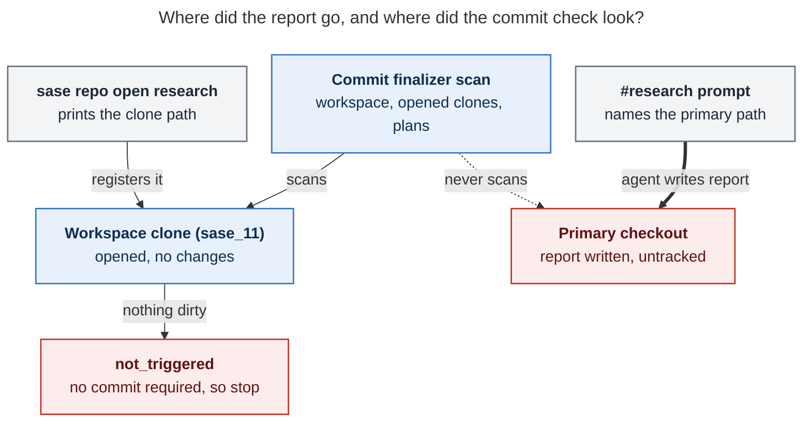
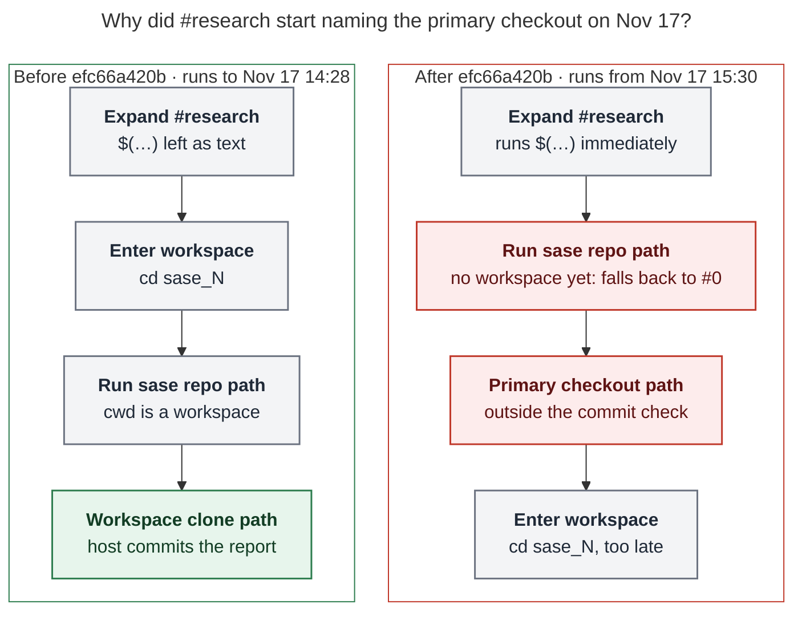

# Why the Epic-Chain Audit Report Was Never Committed

_Question: how did agent `ex` finish its turn without committing
`202611/overnight_backlog_epic_chains_audit.md` to the research sidecar repo? Snapshot
from 2026-11-18, about 10:40 EST. All times are EST. Evidence comes from `ex`'s run
artifacts (finalizer plan, baseline, context and result; opened repos), its Claude
transcript, sase source at `8ccf98fd7e`, the `#research` macro in
sase-research-artifacts, and the run artifacts of 120 `#research` runs on apollo since
Nov 15._

## Bottom line

- **Nothing let the agent skip the commit. The host never asked for one.** The commit
  finalizer only looks for changes in repos it knows about: the workspace, repos the
  agent opened, and the plans and agents stores. The report went into the research
  repo's **primary checkout** (`~/projects/github/sase-org/sase/sase/repos/research`),
  which is not on that list. The host saw no changes and marked the commit step
  `not_triggered`. `/sase_final` then told the agent to stop, and the finalizer logged
  **"success" with no commit**.
- **The prompt named the wrong checkout.** `#research` builds its path with
  `$(sase repo path research --ensure)`. Since **`efc66a420b`** (a sase-chain cmdsub
  phase, landed Nov 17 15:12), that command runs while the macro is expanded, before the
  runner enters the workspace. With no workspace yet, it falls back to the primary
  checkout.
- **The agent opened the right copy but wrote to the other one.** `sase repo open
  research` gave it the workspace clone, which the host watches. It then wrote to the
  path in the prompt instead. The watched clone stayed clean.
- **This is not a one-off.** Every `#research` run on apollo since Nov 17 15:30 got a
  primary-checkout path: 24 runs across sase, bob-cli and tailnet. Before the change,
  0 of 96 did.
- **The report is not lost.** It is an untracked file in the primary checkout, plus an
  artifact snapshot (`file:explicit:75607fe5d0fd3b77d6647352`). It is just not in git.

## How the commit check missed it

At finalize time the host builds a list of changed repos
(`collect_dirty_state`, `src/sase/llm_provider/commit_finalizer_state/__init__.py:72`).
It scans the workspace, each repo at the path the agent opened it, and the plans and
agents stores. `ex` had opened research at `sase_11/sase/repos/research`, and that clone
had no changes. The empty list gives `trigger: not_triggered` and
`submission_required: false` (`src/sase/finalizers/declaration_store.py:290`).



_The report and the commit check pointed at two different copies of the same repo, so
the host found nothing to commit._

### The turn, step by step

| Time  | Step                                                                                     | Record                     |
| ----- | ---------------------------------------------------------------------------------------- | -------------------------- |
| 09:56 | Launch with no workspace yet (scratch key `ws0`). `#research` resolves to the primary path | main prompt               |
| 09:57 | Workspace #11 claimed. Baseline lists main, sase-core, plans and the agents store        | `finalizer_baseline.json`  |
| 09:59 | `sase repo open research` prints `sase_11/sase/repos/research`: clean, at `fdf821ce`     | `opened_siblings.json`     |
| 10:13 | `Write` puts the report in the **primary** checkout                                      | transcript                 |
| 10:14 | `sase artifact create` succeeds. `vcs_repo` and `vcs_sha` are empty, and no warning      | artifact record            |
| 10:14 | `sase final context`: `obligations: []`, `submission_required: false`                    | `final_context.json`       |
| 10:14 | Skill step 2: _"If `submission_required` is false, stop here and return."_               | `sase_final.md:155`        |
| 10:15 | Commit finalizer: `status: success`, `evidence: []`. Run outcome `completed`             | `finalizer_result.json`    |
| now   | Primary checkout: `?? 202611/overnight_backlog_epic_chains_audit.md`                     | `git status`               |

### Five checks, none of which caught it

| Check                          | What it looks at                                     | Why it passed                                                    |
| ------------------------------ | ---------------------------------------------------- | ---------------------------------------------------------------- |
| `#research` macro              | `sase repo path research --ensure`                   | Ran before the workspace existed, so it returned workspace #0     |
| `/sase_repo` skill             | "Use that printed path as the only path"             | The prompt's explicit path won over the skill rule               |
| Commit finalizer               | Workspace, opened clones, plans, agents store        | The primary checkout is not scanned, so there were no obligations |
| `/sase_final` skill            | `submission_required`                                | It was false, so the skill said stop                             |
| `sase artifact create`         | Copies the file into the artifact store              | It never checks whether the file is tracked by git               |

Each check behaved as written. The failure is the gap between them: no step compares
where the agent wrote with where the host looks.

## Why it started on Nov 17

The `#research` macro body
(`src/sase_research_artifacts/xprompts/research.md:39` in sase-research-artifacts)
says to write under `$(sase repo path research --ensure)/$(date +%Y%m)/`. That
command infers the workspace from the current directory. With no workspace marker it
returns workspace #0, the primary checkout (`src/sase/main/repo_handler_common.py:87-89`).
Run today from `sase_11`, it prints the clone. Run from the primary checkout or `$HOME`,
it prints the primary path.

The runner expands macros (`src/sase/axe/run_agent_runner_bootstrap.py:442`) before it
enters the workspace (`:448`). Until Nov 17 that order did not matter, because macro
expansion left `$(…)` as text. It ran later, at the provider call, inside the workspace.
`efc66a420b` ("evaluate authored commands before interpolating data", phase
`sase-1tc.1.1.2`) made macro bodies run their own commands during expansion
(`src/sase/macro/_processor_render.py:123`; the file had 0 such calls before). The
change was meant to stop generated text from running commands. A side effect is that
authored commands now run before the workspace exists.



_Moving `$(…)` into macro expansion moved it ahead of the workspace, so the same command
now returns the primary checkout._

Same workspace, same launch type, two days apart: on Nov 16, agent `ef` also ran in
`sase_11` from a `ws0` launch. Its prompt named `sase_11/sase/repos/research/202611/`,
and the host committed its report as `da780d15`.

```text
#research runs on apollo, by the path their prompt named
■ resolved inside the workspace (host commits)   □ primary checkout

Nov 15  ■■■■■■■■■■■■■■■■■■■■■■■■■■■■■■■■■■■■■■■■  40
Nov 16  ■■■■■■■■■■■■■■■■■■■■■■■■■■■■■■■■■■■■      36
Nov 17  ■■■■■■■■■■■■■■■■■■■■□□□□□□□□□□□□□□□□□   20 + 17
Nov 18  □□□□□□□                                    7 (includes this run)
                     ▲ efc66a420b lands 15:12 (last clone path 14:28, first primary 15:30)
```

## Who else is affected

Of the 24 runs since the change, a run committed its report only when the agent wrote
into a checkout it had opened. Most often that came down to the model's habit: follow the
prompt's path, or the path `sase repo open` printed.

| Agent family                          | Runs | Got a research commit | Notes                                                            |
| ------------------------------------- | ---: | --------------------: | ---------------------------------------------------------------- |
| Codex (`cdx`)                         |    3 |                     3 | `5b.cdx` used its clone. Tailnet `5a.cdx` opened the primary itself |
| Grok (`grk`)                          |    3 |                     3 |                                                                  |
| Muse (`mus`)                          |    3 |                     1 |                                                                  |
| Claude (`cld`, plus `ex`)             |    4 |                     0 | Followed the prompt's primary path                               |
| Gemini (`gem`)                        |    3 |                     0 | Followed the prompt's primary path                               |
| Other bob-cli runs (`eo`, `eo.f0--plan`) |    2 |                     0 |                                                                  |
| `research.58` swarm                   |    5 |                     — | Never reached finalize (the 6-of-8 swarm)                        |
| This run (`ex.f0`)                    |    1 |               pending | Writes to its opened clone                                       |

I checked only the sase primary checkout, where `ex`'s report is the one untracked file.
The bob-cli and tailnet primary checkouts likely hold similar files: chats show
`research.5b.cld`, `research.5b.gem` and `research.5a.cld` naming primary paths.

## What would close the gap

1. **Fix the path (root cause).** Resolve `#research`'s path after the workspace is
   claimed. Either run launch-time macro commands from inside the claimed workspace, or
   have `sase repo path` take the runner's workspace number rather than the current
   directory. The `sase-1tc` epic that made the change is still running.
2. **Add a safety net at finalize.** Flag files this run wrote, or registered with
   `sase artifact create -p`, that are untracked in a repo checkout the run never opened.
   Today those writes are invisible to the host.
3. **Settle the rule conflict.** `/sase_repo` says to write only to the printed path. The
   prompt said otherwise, and Claude and Gemini followed the prompt. The skill could say
   that a prompt path inside another checkout of an opened repo means "write to the
   opened path".
4. **Clean up.** Commit `202611/overnight_backlog_epic_chains_audit.md`, and check the
   bob-cli and tailnet primary research checkouts for untracked reports.

_This report itself was written to the research workspace clone that `sase repo open
research` printed, not the primary path in its prompt, so the host's commit check can
see it._
