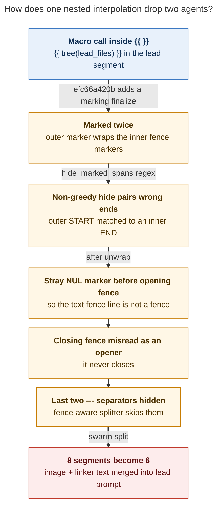
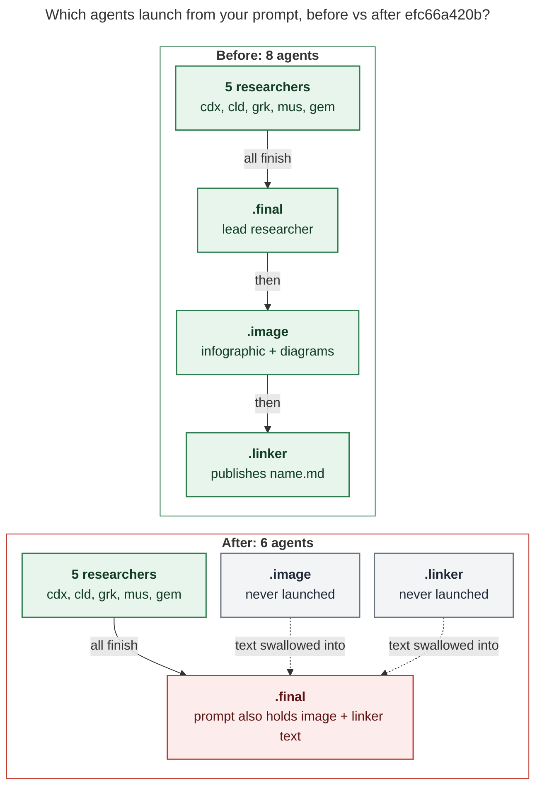

# Why the Research Swarm Launched 6 Agents Instead of 8

_Research report · 2026-11-17 · hosts: apollo (where the swarm ran), athena (reproduction)_

> **Research query:** I ran `#research_swarm(... image=true ...)` from
> `~/tmp/research_prompt.txt`, and only 6 agents launched instead of 8. Why were the image
> and linker agents never launched?

## Bottom line

- **Your prompt was fine.** The cause is a regression in the macro engine, introduced by
  commit `efc66a420b` ("feat(macro): evaluate authored commands before interpolating
  data"). It was committed today at 15:12 and reached apollo's `sase` checkout at 15:23.
- **The image and linker agents weren't skipped. They were merged into the lead's
  prompt.** A leaked internal marker broke a Markdown code fence in the lead segment. That
  fence then swallowed the last two `---` separators, so 8 segments were split as 6.
- **This hit both of your launches.** `research.58` (15:30) and `research.59` (15:37) each
  got 6 agents. Your earlier swarm, `research.57` (14:27, launched before apollo updated),
  got all 8.
- **The fix is a tested one-liner** in `src/sase/macro/_jinja.py` (see [Fix](#fix)). The
  same commit also breaks `sase macro expand` on this prompt, which is a second, separate
  bug.

## Timeline on apollo (local time)

| Time  | Event                                                         | Agents |
| ----- | ------------------------------------------------------------- | :----: |
| 14:27 | `research.57` launched (a different bob-cli research prompt)  | **8**  |
| 15:12 | `efc66a420b` committed to sase master                         |   –    |
| 15:23 | apollo's `sase` checkout fast-forwards to `efc66a420b`        |   –    |
| 15:30 | `research.58` launched with your prompt                       | **6**  |
| 15:37 | `research.59` launched with your prompt (a second launch)     | **6**  |

## What went wrong



_Figure 1. One Jinja macro call inside `{{ }}` gets marked twice. The leftover marker
breaks the opening code fence, so the splitter can no longer see the separators that
start the image and linker segments._

In detail:

1. **The new marking step.** `efc66a420b` renders macro templates with a Jinja `finalize`
   hook (`_marking_finalize`). The hook wraps every `{{ }}` output in NUL-byte
   `SJSMARK` start and end markers. `GeneratedTextGuard.hide_marked_spans` then swaps each
   `START(.*?)END` span for a data token, so data can never run as a `$(command)`.
2. **The nested call.** `#research_swarm` prints its file-layout tree with
   `{{ tree(lead_files) }}`. `tree` is a Jinja macro whose body also uses `{{ "```text" }}`
   and `{{ "```" }}`, so its output is already marked when the outer `{{ }}` marks it again.
   The lazy regex pairs the outer START with the first inner END. That leaves an orphaned
   START in front of the opening fence and an orphaned END after the closing fence.
3. **The broken fence.** Here are the actual lines from `research.58.final`'s
   `raw_prompt.md` on apollo. `␀MARK_S␀` and `␀MARK_E␀` stand for the leaked NUL markers.

   ```text
    91 | ␀MARK_S␀```text          <- not at line start, so not a fence opener
    98 | └── <name>__final.md
    99 | ```␀MARK_E␀              <- read as a NEW fence (info string = marker)
   100 | ---                      <- separator hidden inside that fence
   101 | %id(image, clan=research.{@1}) %m:gpt-6-astra
   ...
   111 | ---                      <- separator hidden inside that fence
   ...   (linker segment)
   ```

   The fence scanner sees exactly one fence: it starts at the stray closing ` ``` ` on line
   99 and runs to the end of the prompt. Both `---` separators fall inside it.

**The `%if` gating is not the cause.** I traced it. `%if(should_run=True)` was evaluated
correctly for both the image and linker segments, and the conditional filter returned 8
survivors (it correctly dropped only `audio`). The 2 segments disappear in the next step,
when the fence-aware splitter (`split_segments_protecting_fences`) turns 7 separators
into 6 segments.



_Figure 2. With the commit, the image and linker segments still exist, but only as dead
text at the end of the lead researcher's prompt._

## Evidence

| Check | Result |
| --- | --- |
| Expand your exact prompt with the parent commit `71f0060927` | 8 segments: `cdx cld grk mus gem final image linker` |
| Expand it with `efc66a420b` | 6 segments: `cdx cld grk mus gem final` |
| Minimal Jinja case with the guard: a macro that prints a code fence through `{{ }}`, called as `{{ t() }}` | Output keeps the stray `SJSMARK` start and end markers (the same fence printed by a plain `{{ }}` stays clean) |
| apollo `research.58.final` and `research.59.final` `raw_prompt.md` | Each contains `You are the linker agent`, `%id(image`, and 4 stray markers |
| apollo checkout reflog | `efc66a420b` fast-forward at 15:23, between the 8-agent run (14:27) and the 6-agent runs (15:30, 15:37) |

## Impact on the runs in flight

- **Two duplicate swarms are running for the same prompt.** `research.59.final` was
  already running when I checked (it started 15:54). `research.58.final` was still
  waiting on its researchers.
- **No infographic and no published `<name>.md` will appear.** You asked for the linker,
  so each lead writes `<name>/<name>__final.md` and leaves `<name>.md` for a linker that
  will never run. The image and linker instructions do appear at the end of the lead's
  prompt, but as text inside a code block. Whether the lead ignores them or tries to act
  on them is unpredictable.
- **Suggested cleanup (your call):** kill one of the duplicate swarms. Once the fix
  lands, re-run, or launch the image and linker steps by hand.

## Fix

**Recommended change (tested).** In `_render_jinja2_template`
(`src/sase/macro/_jinja.py`), strip the inner markers before wrapping, so a nested macro
call becomes one balanced data span:

```python
def _marking_finalize(value: Any) -> str:
    text = str(value).replace(start, "").replace(end, "")
    return f"{start}{text}{end}"
```

I applied this to a scratch copy of the `efc66a420b` source and expanded your exact
prompt. Result: **8 segments, 0 stray markers, 0 NUL bytes.** This is safe because the
whole call output is still treated as data; the change only removes the broken nesting.

**Also recommended:**

- **Regression tests.** Expanding `#research_swarm(image=true)` should yield 8 segments
  ending in `image` and `linker`, and a Jinja macro called inside `{{ }}` should round-trip
  with no markers.
- **Fail loudly.** Raise an error if any `SJSMARK` or `SASEDATA` text survives
  `guard.unwrap()`. This launch silently lost two agents instead of failing.

## Second bug from the same commit

`sase macro expand < ~/tmp/research_prompt.txt` now fails:

```text
Macro '#research' argument error: Argument 'suffix' expects word (no spaces)
matching [A-Za-z0-9._-]+, got '\x00SASEDATA_<nonce>_18\x00'
```

In `#research(suffix={{ r.short }})`, the argument value is still a guard token when the
typed-argument check (`validate_and_convert_args`) runs. The parent commit expands this
prompt fine. Swarm launches avoid the bug because they unwrap tokens before the
per-agent expansion. The one-line fix above does not cover it. That check should
validate the unwrapped value, since validation never runs commands.
