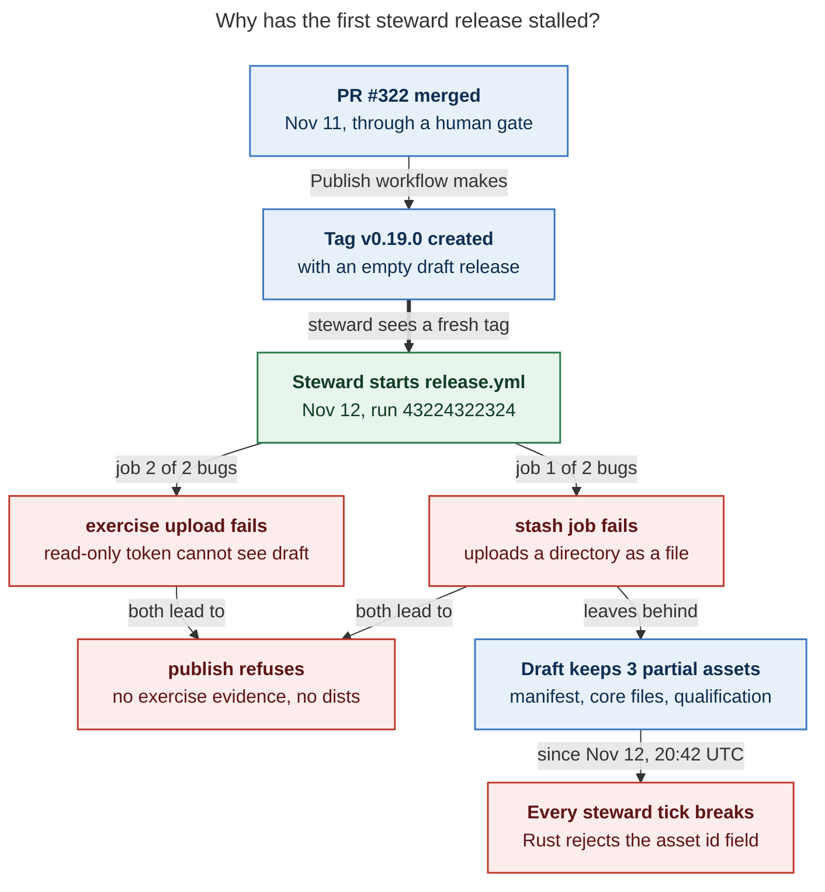
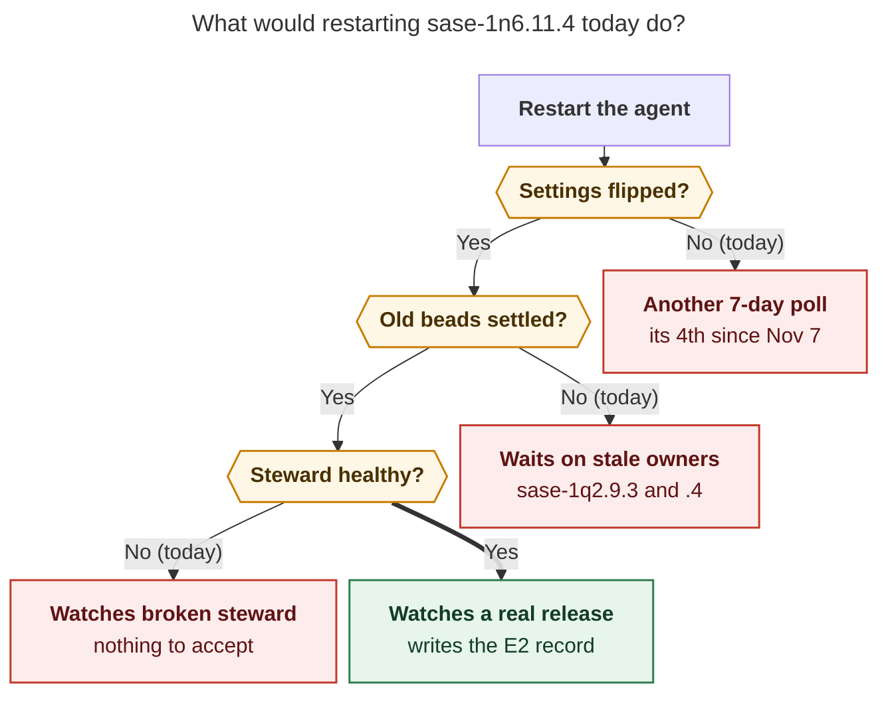

# Before You Restart `sase-1n6.11.4`

_Research report · 2026-11-14 · host: athena_

## Short answer

**Yes, you need to change two GitHub settings, but don't change them first and don't
restart yet.** Settings are only one of three blockers:

| #   | Blocker                                                      | Who fixes it      |
| --- | ------------------------------------------------------------ | ----------------- |
| 1   | 🐛 **3 code bugs** stalled the first steward release (v0.19.0) | an agent (no owner yet) |
| 2   | 🧟 **2 stale prerequisite beads** the agent is told to wait on | you               |
| 3   | 🔒 **2 human-only GitHub settings** (the release cutover)      | you               |

If you restart today, the agent finds the settings unchanged, writes a "still pending"
note, and stages its **fourth** 7-day poll.

## Why the agent stopped

On Nov 7, its last turn staged a 7-day poll that waits for the GitHub settings (monitor
`3af6yk90tvss`). The athena reboot at **04:44 on Nov 14** killed that poll. SASE records
a monitor killed by a reboot as `lost`, and a lost monitor never starts its follow-up
(`"follow-up not launched because the monitor command outcome is unknown"`). Nothing will
wake the agent, so a manual restart is the right recovery. Just clear the blockers
first.

## Where things stand (live reads, 2026-11-14)

| Item                                                  | Needs to be                    | Today                                                                  |     |
| ----------------------------------------------------- | ------------------------------ | ---------------------------------------------------------------------- | --- |
| Repo variable `RELEASE_STEWARD_MERGE_ENABLED`         | `true`                         | not set                                                                | ❌  |
| `pypi` environment deployment rules                   | `v*` tag only                  | `master` branch (id `51457521`) **and** `v*` tag (id `63746823`)       | ❌  |
| `ci_watch` config (athena overlay)                    | sase-org/sase off merge lists  | already done                                                           | ✅  |
| Release steward workflow                              | healthy decisions              | `watcher_broken` on **every run since Nov 12, 20:42 UTC** (7 of 7)     | ❌  |
| sase 0.19.0                                           | on PyPI                        | PyPI 404 (latest is 0.18.1); GitHub release is a draft with 3 partial assets | ❌  |
| Release PRs                                           | n/a                            | #322 (0.19.0) merged Nov 11; #327 (0.19.1) open                        | ℹ️  |
| `sase-1q2.9.3` (rehearsal)                            | closed                         | in progress, but its accepted rehearsal was recorded Nov 11; no agent  | ⚠️  |
| `sase-1q2.9.4` (release watch)                        | evidence recorded              | in progress, watcher never started; no agent                           | ⚠️  |

## What went wrong with v0.19.0



_The steward started the first release train by itself (green box). Two `release.yml`
jobs that rehearsals never run then failed, and the half-stashed draft now crashes every
steward run._

The bugs, all still present on `origin/master` (`cf7a09f15b`):

- **Bug A: the steward crashes on any release asset.**
  - `tools/_release_watch_facts.py:839-844` sends each asset as
    `{name, kind, generation, id}`.
  - sase-core's `AssetFactsWire` (`crates/sase_core/src/release_steward/facts.rs:224`)
    uses `deny_unknown_fields` and accepts only `name, kind, generation`.
  - It surfaced as soon as the v0.19.0 draft had assets. I reproduced it locally with the
    published `sase-core-rs` 0.44.2: `unknown field 'id', expected one of 'name', 'kind',
    'generation'`.
  - The steward's suggested remedy ("build or install sase-core-rs from the pinned
    revision") is misleading. Rebuilding the core won't help; the fix is a code change.
- **Bug B: `stash` uploads a directory.** `.github/workflows/release.yml:331` runs
  `gh release upload "${TAG}" candidate/* --clobber`. `candidate/` contains a `dist/`
  directory, so the upload fails with `read candidate/dist: is a directory`. The manifest
  got uploaded; the wheel and sdist did not.
- **Bug C: `exercise` cannot post its evidence.** All 4 exercise legs **passed**. But the
  `exercise` job (`release.yml:484`, upload step at `:551`) has no
  `permissions: contents: write`. Its token is read-only (the log shows `Contents: read`),
  so it cannot see the draft and the upload fails with `release not found`.
- **Why rehearsals missed B and C:** both steps run only in `mode=release`.
- **Latent bug D: the fresh-tag check uses the wrong SHA.**
  - `tools/_release_watch_facts.py:2077-2084` compares the tag with the merged PR's
    **head** SHA, but a merge commit never equals the PR head.
  - This broke the steward on Nov 11 (sase-1n6 note #16).
  - It passed on Nov 12 only because release-please opened #327, which left no merged
    release PR to compare against.
  - The next merged release PR can trip it again.

**Nobody owns these fixes.** No bead tracks A, B, or C. D is recorded only as a
DISCOVERED ISSUE note on `sase-1n6`.

**v0.19.0 probably can't be finished by the train.**

- A dispatch at `v0.19.0` runs the tag's own copy of `release.yml`, which is identical to
  master's and has bugs B and C.
- A second `mode=release` run is refused because a sealed generation already exists, and
  a `rebuild: true` run would use the same buggy copy.
- The release-train docs' fallback is to burn the version (`[ABANDONED]` draft plus an
  abandoned observation) and ship the next one from release-please. Here that is
  **0.19.1 via PR #327**. Someone should make this call on purpose.

## What would a restart do today?



_All three checks fail today, so a restart only produces another wait. The agent can do
its real job (watch a release and write the E2 decision record) only after all three
pass._

## What to do, in order

1. **🐛 Get bugs A, B, and C fixed on master; D is recommended.** File a task bead or ask
   an agent, and point it at this report.
   - For A, a Python-side fix avoids a core release: stop sending `id` to Rust. The
     reader gets the manifest asset id from the raw GitHub data, not from this field.
2. **🔥 Decide v0.19.0's fate.** The most likely answer is to burn it and let PR #327 ship
   0.19.1, whose tag will contain the fixed `release.yml`.
3. **🔒 Flip the two GitHub settings, but only after step 1 lands.**
   - **Why wait:** with merge authority on, the steward can merge #327 by itself. If B and
     C aren't on master yet, the 0.19.1 tag inherits the broken `release.yml` and that
     version gets burned too.
   - **The `pypi` rule is safe to change any time:** only `release.yml` at `v*` tags uses
     that environment now. `publish.yml` no longer does.

   ```bash
   gh variable set RELEASE_STEWARD_MERGE_ENABLED --body true -R sase-org/sase
   gh api -X DELETE repos/sase-org/sase/environments/pypi/deployment-branch-policies/51457521
   # verify: only {"name":"v*","type":"tag"} should remain
   gh api repos/sase-org/sase/environments/pypi/deployment-branch-policies --jq '.branch_policies'
   ```

   - UI equivalent: **Settings → Secrets and variables → Actions → Variables**, then
     **Settings → Environments → pypi → Deployment branches and tags** (remove `master`).
   - Side effect: merge authority also lets the steward dispatch at most **one sase-core
     cut per UTC day** (sase-1oe.4 note #6).
   - Nothing else needs changing: no branch protection (the steward reads its merge gate
     from `.github/release-qualification.json`), and the `ci_watch` overlay is already
     done.
4. **🧟 Settle the stale beads.**
   - `sase-1q2.9.3`: close it. Its accepted rehearsal (run `42992733019`) is recorded in
     note #2.
   - `sase-1q2.9.4`: close it as superseded, or tell the restarted agent that it owns the
     release watch.
   - Also pick one owner for the release itself: `sase-1s7.7.3` (open) claims the same
     v0.19.x proof. `sase-1oe.4`'s handover gate becomes moot once you flip the settings
     by hand.
5. **✅ Check that the steward is healthy.** Run
   `gh workflow run release-steward.yml -R sase-org/sase` (observe-only by default) or
   wait for the next scheduled run. Its primary state should no longer be
   `watcher_broken`.
6. **▶️ Restart `sase-1n6.11.4`** with a one-line note: settings flipped, fixes landed at
   `<sha>`, v0.19.0 burned (if so), target 0.19.1, and `sase-1q2.9.x` settled. Without
   that note, it spends its turn rediscovering ten days of history.

## Sources

- **Bead notes:** `sase-1n6.11.4` #1–#5, `sase-1n6` #14–#16, `sase-1oe.4` #6/#15/#18,
  `sase-1s7` #3, `sase-1s7.7` #2, `sase-1q2.9.3` #2.
- **Lost monitor:**
  `~/.sase/projects/gh_sase-org__sase/artifacts/ace-run/202611/07/20261107135713/`. In
  `done.json`, `monitor_state` is `lost`; in `.proc_settled.json`,
  `termination_reason` is `reboot`.
- **GitHub Actions runs:**
  - steward dispatch run `43220910461` (Nov 12, 13:07 UTC)
  - `watcher_broken` steward runs `43302976270` through `43580663650`
  - failed `release.yml` run `43224322324`
- **Local reproduction:** `tools/release_watch --once --json` (read-only) with
  `sase-core-rs` 0.44.2 gave the same `unknown field 'id'` error.
- **Live reads (2026-11-14):** `gh variable get`, the `pypi` deployment-branch-policies
  API, the v0.19.0 draft's assets, and the PyPI JSON API.
