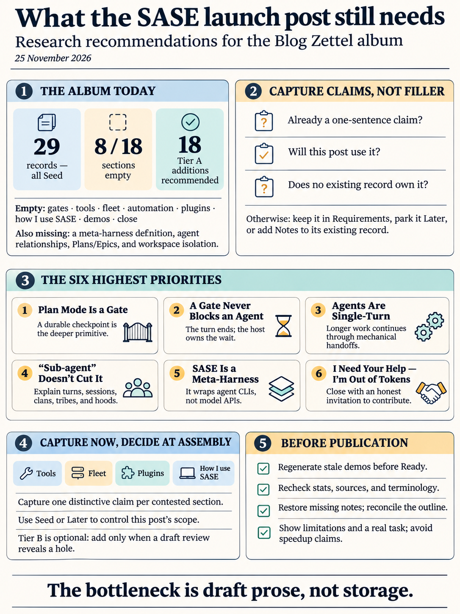

# New records for the SASE Blog Zettel album — consolidated recommendations

> **Research query:** Which records should be added to the `~/bob/sase_blog_zettel.md`
> Obsidian album note, which is being filled in preparation for writing the blog post
> that introduces SASE to the world? Help find or think of candidates, and end with a
> ranked list of recommended new records to consider adding.

## Bottom line

All five researchers independently found the same structural fact: the album holds **29
records, all 🌱 Seed**, and **8 of its 18 required `section` values are empty** —
`gate`, `tools`, `fleet`, `automation`, `plugins`, `how_i_use_sase`, `demos`, and
`close`. Four populated sections are also missing the claim their own heading promises
(nothing defines *meta-harness*, nothing explains Turn < Session < Clan < Tribe, the
Artifacts section never covers Plans/Epics themselves, and VCS omits the
workspace-per-agent isolation that `host_owned_completion` depends on).

The swarm converged hard on a small core: **every report that looked at the `gate`
section put ["Plan mode is a gate"](#tier-a-ranked-records-to-capture-before-wave-1-drafting)
at or near #1**, and four of five independently proposed "A gate never blocks an agent",
the turn/session/clan/tribe definition record, and the "I need your help — I'm out of
tokens" close. Those are as close to a sure thing as this swarm can produce: the claims
are already written in your own notes, the evidence (decision records, glossary,
screenshots) already exists, and they fill empty load-bearing sections.

The one real disagreement is **how many of the eight empty sections deserve this-post
seeds**. grk (backed by cdx's "don't turn an introduction into a reference manual"
warning) argues `tools`, `fleet`, `plugins`, and `how_i_use_sase` should be parked
`⏭️ Later` or have their keys deleted, since later posts already exist in draft for
several of them; cld, mus, and gem recommend one seed each. Resolution below: capture
the one distinctive claim per contested section (each passes
[grk's own triage test](#the-capture-rule) of "already a claim, no record owns it"), and
let the *status* — `seed` vs `later` — be the knob, not the record's existence. The
Base's "By section" view already filters `later`, so the chips stay honest either way.

**Recommended capture budget:
[the ranked Tier A below](#tier-a-ranked-records-to-capture-before-wave-1-drafting) (18
records) before Wave 1 drafting, [Tier B](#tier-b-strong-candidates) only when a wave
review still feels a hole.** The bottleneck is words in `## Draft`, not storage — only
`skills_should_be_procedural_memories` has any draft prose today.

## The capture rule

Consensus, worth keeping in view.

grk distilled the album's own prior research (2026-11-12 unit rule + 2026-11-15
targeting rule) into a triage test that the whole consolidated list below respects. A
missing idea becomes a **new** zettel only when all three hold:

1. It is already a one-sentence claim (ideally in your words) — otherwise leave it in
   `sase_blog.md` Requirements.
2. This post will actually use it — otherwise park `later` or delete the section key.
3. No existing record owns that sentence — otherwise append dated `## Notes` to that
   record.

Do **not** mint one filler record per empty chip. Every
[Tier A item below](#tier-a-ranked-records-to-capture-before-wave-1-drafting) passes
tests 1 and 3; for the four contested sections, test 2 is explicitly flagged as "decide
at assembly."

## Tier A ranked records to capture before Wave 1 drafting

Format: **Title** (`stem`) · section · who proposed it. Claims are drafting prompts in
your register, to be rewritten in your voice; all records get `status: seed` unless
marked otherwise.

1. **Plan Mode Is a Gate** (`plan_mode_is_a_gate`) · `gate` · cld, grk, mus, gem; cdx
   equivalent.
   **Claim:** Plan mode is one instance of a deeper primitive — a durable,
   command-backed gate that pauses work until a human or rule answers — and gates grow
   into plans and then epics.
   **Why #1:** The only candidate every relevant report ranked at/near the top. It is
   your own quote ("Plan mode is the canonical or best example of some deeper
   primitive. I know it. Interrupts?"), it fills the emptiest load-bearing section,
   contents §1.3 is still `TODO`, and the October outline made it one of four body
   generalizations. A paste-ready seed from 2026-11-15 was never created.
   **Evidence:** glossary `sase-gate` (one bundle under `~/.sase/interaction_requests/`,
   answered identically from TUI/Telegram/mobile/CLI; 12 gate kinds); your
   `sase_gate.md` note that plans and questions are special cases of the same primitive;
   your CRP highlight on the Hassan paper ("This is a LOT like gates!"); screenshot
   `img/20260824_141701.png` (agent read four related plans).

2. **A Gate Never Blocks an Agent** (`a_gate_never_blocks_an_agent`) · `gate` · cld,
   grk, mus, gem.
   **Claim:** Creating a gate ends the agent's turn; the host owns the wait, so a human
   checkpoint never holds a live model or a runner slot hostage.
   **Why distinct from #1:** #1 says what a gate *is*; this says what it *does not do* —
   the operational surprise that differentiates SASE gates from "the agent sits in plan
   mode." mus ranked it #1 outright ("directly contradicts what every agent-harness
   reader assumes").
   **Evidence:** decision records `gates-never-block` (with a real failure story: a gate
   stuck on a `.response.lock`) and `handoffs-end-through-host-completion`; answer from
   Telegram hours later with the laptop closed. gem's `/sase_sudo` material ("my agents
   have to ask permission to reinstall themselves" — `global-install-is-human-only`)
   fits here as a note or a Tier B record.

3. **Agents Are Single-Turn** (`agents_are_single_turn`) · `turn` · cld #1, gem #3;
   implied by grk/mus pairings.
   **Claim:** A SASE agent run is exactly one provider turn; anything longer — waiting,
   monitoring, planning, asking me a question — is a mechanical handoff to a new turn,
   never an agent promising to resume.
   **Why:** The invariant beneath finalizers, gates, and monitors; without it they look
   like arbitrary complexity. Has a genuine reversal story (cld):
   `feat(cli)!: make run detached-only` (2026-07-02) →
   `feat(cli)!: retire detached proc mode` (2026-08-15).
   **Evidence:** decision records `single-turn-agents`,
   `handoffs-end-through-host-completion`, `helpers-return-roots-declare`.

4. **"Sub-agent" Doesn't Cut It** (`sub_agent_doesnt_cut_it`) · `turn` · all five in
   some form.
   **Claim:** Turn, session, clan, and tribe (and hoods) are the vocabulary for agents
   that other agents run; "sub-agent" collapses four different relationships into one
   wrong word.
   **Why:** The section is literally named after a hierarchy no record explains; your
   2026-08-01 note supplies the claim verbatim. gem adds the useful gloss: sequential
   chains (sessions), parallel groups (clans), shared-namespace lineage (hoods),
   organizational labels (tribes).
   **Evidence:** glossary clan/tribe/hood/clan-wave;
   `docs/reference/agents/{agent-sessions,agent-clans,agent-tribes}.md`; the agents
   observability tape.

5. **SASE Is a Meta-Harness** (`meta_harness`) · `what` · cld #3, gem #2
   (`wrap_agent_clis_not_apis`), grk #6 (`one_cli_behind_every_provider`) — three
   wordings of one thesis; capture **one** record.
   **Claim:** Claude Code, Codex, and the rest are harnesses around a model; SASE is a
   harness around those harnesses — it wraps agent CLIs, not model APIs, inheriting
   every lab's auth, tools, and harness velocity while owning the control plane above
   them.
   **Why:** "Meta-harness" is in the second sentence of `sase_blog_contents.md` with
   footnote `[2]: TODO: Link to Omnigent`, and no record defines it. The [00] draft
   already has a "SASE Wraps Agents, Not Models" section.
   **Before drafting (cld):** skim the Omnigent post (in your library, *dropped*) and
   arXiv 2611.06946 ("Beyond the Agent Harness," a single-operator case study close to
   your situation) so the term matches 2026 usage; don't conflate Omnigent with the Lee
   et al. Meta-Harness paper. Honest trade-off paragraph (gem): less control over token
   accounting, exposed to provider pricing/policy churn.

6. **I Need Your Help — I'm Out of Tokens** (`i_need_your_help`) · `close` · cld, grk,
   gem; cdx's close variant asks for workflow/failure reports.
   **Claim:** SASE has about one user and I'm out of tokens; I'm opening its biggest
   design questions as `type:poll` GitHub issues — break it, steal the ideas, or help
   shape v2.
   **Why:** Your own quote; fills the empty conclusion; the `type:poll` ask has been in
   your notes since 2026-08-07 and you commented "Yes!" on it in the October outline.
   Optional add-ons: the legacy sign-off "No weasels; just work" (gem wanted it as its
   own record; one close record can carry both), cdx's concrete feedback prompt ("where
   does *your* agent workflow become hard to supervise?"), a Getting Started link —
   explicitly not an install walkthrough.

7. **A Prototype Gone Wild** (`prototype_gone_wild`) · `not_ready` · cld, grk, gem;
   cdx's `who_sase_is_for_today` folds in.
   **Claim:** SASE is a prototype gone wild with about one user, so expect sharp edges:
   alpha, POSIX-only, a moving vocabulary, broken hijack and remote machines, no
   security audit yet, stale demos, and an Agents tab that is still the buggiest part of
   the TUI.
   **Why:** You asked for a limitations list three times (first 2026-06-07); `ai_slop`
   and `sase_is_too_complex` diagnose costs, not adoption honesty. Fold in cdx's
   positive-fit sentence: current fit is developers who already run coding-agent CLIs
   and want an opinionated way to supervise them.

8. **Research Swarms Are How I Decide** (`research_swarms`) · `how_i_use_sase` · cld,
   gem (podcast loop), mus (adjacent); cdx's "one ordinary task" is the companion.
   **Claim:** I don't make a hard SASE decision without a research swarm: five agents
   from five labs investigate independently, a lead synthesizes, `sase-listen` turns the
   report into a private podcast, and my PDF highlights feed the next epic.
   **Why:** The single most memorable real workflow, with real numbers (cld: the
   research sidecar holds ~1,770 reports; 758 in October 2026 alone) and a meta-hook:
   this very album was filled by one. grk would delete the `how_i_use_sase` key; this
   claim is strong enough to earn the section — decide at assembly.

9. **Deterministic Scripts Propose; the Scheduler Launches**
   (`scheduler_routines_and_jobs`) · `automation` · cld, grk, mus, gem.
   **Claim:** Background automation shouldn't be an always-on LLM burning tokens in a
   loop; cheap deterministic job scripts watch files, commits, and trackers and emit
   launch proposals that the scheduler guards, dedupes, and dispatches.
   **Why:** Fills an empty section with your sharpest architectural contrast (and your
   own Gas Town critique: interweave deterministic code with LLM calls). Keep it one
   seed; AXE depth belongs to draft post `[03]`. Concrete examples: `refresh_docs`
   every 25 commits, `toobig_split`, `bead_task_triage`, the CLI-update routine that
   `agent_cli_installs_and_updates` already describes. The AXE → scheduler,
   Lumberjack → routine, Chop → job renames feed the naming record (#17).

10. **Every Command Is a Record (ToolRuns)** (`every_command_is_a_record`) · `tools` ·
    cld, mus, gem, cdx; grk parks `later`.
    **Claim:** Agents run tests constantly, so test runs should be data, not
    scrollback: every expensive command is a ToolRun with owner, fingerprints, and
    output, and triage labels failures NEW/KNOWN/FLAKY/UNKNOWN without ever changing an
    exit code.
    **Why:** Four of five found this distinctive enough to rank; it answers the trust
    question ("when an agent says a check passed, show me what ran" — cdx) and
    disambiguates SASE Tools from MCP (gem). The hook (cld): agents inherit a red
    master all the time and need to know which failures are theirs.
    **Evidence:** `docs/reference/automation/tools.md`; decisions `guarded-recipes`,
    `triage-annotates-does-not-change-exit-codes` ("KNOWN requires an independent
    witness"), `record-before-admit`. If the post ends up not using it, flip to
    `later` rather than deleting.

11. **Every Agent Gets Its Own Workspace** (`every_agent_gets_a_workspace`) ·
    `project` · grk, mus, gem; cld Tier 3.
    **Claim:** Every agent runs in its own pooled numbered clone (`sase_<N>`), so
    parallel agents never share a working tree — and the host, not the agent, owns the
    commit.
    **Why:** The physical isolation half of the story `host_owned_completion` only
    tells the completion half of; concepts doc noun #2. gem's engineering detail for
    `## Notes`: git alternates, self-healing dirty checkouts, rescue snapshots before
    eviction, audited `sase repo open` for multi-repo work. cdx's boundary caveat
    belongs in the same notes: working-tree separation is not a security/process
    sandbox — say which one you mean (that distinction may save you a bad HN thread).

12. **The Core Doesn't Know GitHub Exists** (`the_core_doesnt_know_github`) ·
    `plugins` · cld, mus, gem; grk parks `later`.
    **Claim:** GitHub, Telegram, Neovim, my research library, and even my podcast feed
    are plugins; the core knows about agents, turns, and artifacts.
    **Why:** One crisp record opens the section without becoming an entry-point
    inventory. Verified: the docs state exactly **thirteen** entry-point groups; gem's
    zero-infra catalog trick (GitHub `topic:sase--plugin` as the live plugin registry)
    and the `plugin-commands` decision are the two best supporting details. Telegram as
    "pocket cockpit" sets up the mobile future-work story; keep draft post `[05]` as
    the depth home.

13. **One Fleet, Three Machines** (`one_fleet_three_machines`) · `fleet` · cld, mus
    (two variants), gem; grk parks `later`.
    **Claim:** My agents run on more machines than I do: one TUI launches, observes,
    and answers gates across apollo, athena, and the Mac over Tailscale with
    `%dispatch` — and a meta-harness should treat machines as a pool the way model
    aliases treat models.
    **Why:** Pays off the fleet clause already inside `why_a_tui`. Keep it honest
    (cld): "Fix remote machines!" and "%wait for remote agents" are still open tasks —
    "and it half works" is a fine closing line. gem's depth (bootstrap credentials,
    "tailnet membership is not authorization") goes in notes, not the claim.

14. **The Demos Are the Proof** (`the_demos_are_the_proof`) · `demos` · all five in
    some form.
    **Claim:** The GIFs are not a product tour; each one is a scripted, re-runnable VHS
    tape proving a generalization the post argues.
    **Why:** Fills the empty section with the October outline's own rule (proof, not
    tour; no install section). One record mapping clip → claim beats one record per
    tape. **[Verified](#lead-verification) warning for `## Notes`:** tapes last
    generated 2026-09-15 and still carry pre-rename names — regenerate before this
    record is ✅ Ready. gem's assembly note: decide at paste time whether clips embed
    inside their matching sections instead of a late Demos section.

15. **Motion Isn't Progress** (`motion_isnt_progress`) · `intro` (grk) or `close`
    (mus) — pick one at capture.
    **Claim:** SASE's commit and line counts are a lot of motion, and motion isn't
    progress.
    **Why:** The stats undercut the lede already promises (footnote `[b]` is still
    "update commit/line counts"); `what_came_before` is the ladder, not this. Re-derive
    all numbers on publish day (17,235 commits / ~3.39M Python lines at this
    checkout); confirm the Latent Space attribution (Akshay Nathan, 2026-07-28) before
    crediting.

16. **Mayor vs. Cockpit** (`gas_town`) · `what` · cld, gem (`no_mayor`), grk
    (`neighbors_not_a_fatal_flaw`).
    **Claim:** Gas Town puts an LLM Mayor in charge of dispatch; SASE pushes everything
    that *can* be deterministic — waits, queues, gates, finalizers, triggers — into
    boring code and reserves models for judgment and creation.
    **Why:** You flagged the Gas Town comparison high-priority twice; `beads_and_birds`
    covers only beads. **Resolve the tone disagreement first:** the legacy "fatal flaw"
    framing is exactly what the October outline told you not to publish (grk); write
    the generous one-paragraph version (neighbors: Codex app, Symphony, Gas Town,
    Omnigent), keep the term map in Requirements. grk notes the Codex app may be the
    real competitor — a sentence here, not a record.

17. **Naming Things** (`naming_things`) · `not_ready` (cld) or `what` (grk) · also
    carries cdx's attribution record.
    **Claim:** I'm bad at naming things, and I worry that points to a deeper problem
    with the design.
    **Why:** Contents footnote `[1]` (pronunciation "sassy", the Gartner Secure Access
    Service Edge collision) is still TODO, and the rename ledger is the proof: gai →
    sase, xprompts → macros, ChangeSpec → Patches, AXE → scheduler, Lumberjacks →
    routines, Chops → jobs, gate shell → gate turn, prompt input widget → prompt
    composer. Fold in cdx's lineage point: name and direction come from Hassan et
    al.'s SASE paper (credit it explicitly; note one concept you adopted and one you
    built differently). That attribution matters for intellectual honesty whether or
    not this record ships.

18. **Mechanism Follows Corpus** (`mechanism_follows_corpus`) · `memory` · cld, mus,
    gem.
    **Claim:** I built memory retrieval three times before anything needed it and
    deleted all three; now SASE ships no retrieval mechanism until a real corpus
    demands it.
    **Why:** The dated evidence behind your "I've implemented memory every wrong way"
    joke (keyword memory built 2026-04-12, removed 2026-05-31; episode recall built
    2026-05-23, removed 2026-06-15; `keywords:` metadata removed 2026-07-13). mus/gem's
    constructive half — memory webs, core vs. reference notes, per-invocation bundles —
    fits in this record's notes or as the Tier B `memory_webs` record.

## Tier B strong candidates

Capture these only when a wave review feels the hole.

- **Optimal Experience, Not Optimal Performance** (`optimal_experience`, `what` or
  `close`) — cld, gem; grk folded it into the meta-harness claim. Your positioning
  line; heads off the "where are your evals?" objection that the `evals` record
  concedes. Promote if
  [#5](#tier-a-ranked-records-to-capture-before-wave-1-drafting) doesn't absorb it.
- **An Outage Is a Non-Event** (`outages_are_non_events`, `the_agent_cli`) — cld, gem,
  cdx. The <30-min Claude outage with retry screenshot
  (`~/tmp/screenshots/20260616_140429.png`, flagged "Definitely mention this!") plus
  `||` fallback chains; makes the Nadella record concrete. cdx caution: recovery is
  not universal — provider errors, kills, and post-turn deaths aren't all auto-retried.
- **Fighting Slop Mechanically** (`fighting_slop_mechanically`, `not_ready`) — gem
  only, but the strongest unique find in the swarm: sunset feature-flag beads with
  `FlagTriage` gates, `toobig`/`symvision`, and the `sase footprint` usage census. It
  upgrades `ai_slop` from confession to cure. Verify `docs/reference/footprint.md`
  claims before drafting.
- **Plans That Outlive the Chat** (`plans_epics_and_plan_decisions`, `plan`) — gem
  only, but it's the Artifacts section's literal namesake: schema-validated tales and
  epics with typed `decisions:` frontmatter and quote-verified provenance for memory
  edits. Your own paper annotation ("is plan frontmatter missing the *why*?") is the
  bridge.
- **Reviewed Sudo Without Passwordless Root** (`reviewed_sudo_gates`, `gate`) — gem;
  cld as a one-liner. Showstopper for systems engineers; may be too deep for the intro.
- **Forks, Not Multi-Turn Chats** (`forks_not_chats`, `turn`) — cld; prose exists in
  the [00] draft.
- **Monitors Own the Long Tail** (`waiting_without_a_live_model`, `automation` or
  `tools`) — mus, cdx, gem's inline-then-escalate. Pairs with #3; the `%wait`
  screenshot lead (`20260616_115015.png`) is adjacent but a different mechanism (cdx).
- **Decision Records Are Memory** (`decision_records`, `memory`) — cld; 31 immutable
  records with Claim/Why/Cost/Reopens-when.
- **My Reviewers Were Too Noisy** (`mentors_too_noisy`, `project`) — cld; your own
  highlight on the Anthropic code-review post; honest lesson.
- **One Ordinary Task, End to End** (`one_ordinary_task`, `how_i_use_sase`) — cdx's
  signature recommendation: follow one modest real task from request through gate,
  diff, validation, and your disposition, with human minutes and elapsed time recorded
  and missing measurements labeled. cdx's METR grounding is the reason to do this
  **instead of any speedup claim**: the July 2025 study measured a 19% slowdown and
  the February 2026 follow-up says concurrent-agent timing is unreliable — neither
  measures SASE, so a transparent case study beats a causal number.
- **Spending Different Types of Tokens** (`different_types_of_tokens`,
  `how_i_use_sase`) — gem, cld (`token_scarcity`). Your note "Explain how you use the
  different types of tokens!" plus the size-alias effort ladder; overlaps
  `usage_limits_and_api_costs` — merge rather than duplicate.
- **Agent Hijack** (`agent_hijack`, `turn` or `not_ready`) — cld, gem. Great UX story
  (freeze at a safe boundary, keep the workspace, continue on a stronger model), but
  "Fix agent hijacking!" is your top open task — for the launch post it's a limitation
  bullet in [#7](#tier-a-ranked-records-to-capture-before-wave-1-drafting), not a brag.
- **Live Fleet Over RPC, History Over Git** (`fleet_live_vs_publish_only_archive`,
  `fleet`) — gem; honest deletion story (`agents-sync-publish-only`). Better for a
  later engineering post.
- **Telegram as Zero-UI Mobile** / **Rust Core Boundary** / **Mobile & Web** — gem,
  cld, mus variants; all have in-tree later-post drafts ([07], whats-next) — park
  `later`.
- **Vibe Evals** (`vibe_evals`, `macros`) — cld as a record; grk/gem as a note on
  `agent_control_flow`. The note is enough unless `evals` drafting wants the
  screenshot (`20260619_214831.png`) front and center.

## Notes to existing records

Not new records: consensus items the swarm says belong in `## Notes` on records you
already have:

- **Recover the Vim-mode joke** ([verified lost](#lead-verification)) — note on
  `the_prompt_composer` or inside the close record; not both.
- **`model_alias_pools`:** add the size-alias effort ladder (`@xlarge` → first
  appearance at xhigh, one rung lower per reappearance) and one concrete
  selection/tradeoff example (cdx).
- **`ai_slop`:** add the four slop categories from your November annotations and the
  cancelled `sase_back_policy` project as a concrete example; keep "a failure I had"
  separate from "all agent code is slop" (cdx).
- **`layers_of_prompt_management`:** claim still says "prompt input widget" — HEAD says
  prompt composer.
- **`multi_provider_swarms`:** replace the "even labs don't have this" speculation with
  an observable claim about your workflow; cross-provider diversity is a hypothesis
  about useful disagreement, not a guarantee (cdx).
- **`evals`:** add the measurement question (does SASE reduce human effort per accepted
  outcome?) and the vibe-evals screenshot as first evidence.
- **`goals`:** recheck placement under `future` — project memory already defines
  implemented goal semantics (cdx); add the "legends group epics" note (mus).
- **`microsoft_ceo_...`:** re-section from `turn` to `the_agent_cli` (gem) — the quote
  is about model-agnostic architecture, not turns.
- **`memory` / `memory_and_docs_are_the_same`:** add one concrete stale-instruction
  example; the "docs can replace instruction files" claim still needs its underlying
  study checked before publication (cdx).

## Hygiene findings to fix alongside capture

1. **The `^at-least-one-rec-in-sect` task is closed (2026-11-24) but 8 sections are
   empty**, and its "Create one task for every empty section!" sub-bullet is
   unchecked (cld, grk, mus). This consolidation effectively supersedes it: capture
   [Tier A](#tier-a-ranked-records-to-capture-before-wave-1-drafting) or delete unused
   keys.
2. **Spine drift:** `sase_blog_contents.md` predates the album's 18-value schema (no
   Tools/Fleet/Plugins/How-I-use headings) and carries stale stats and the old
   7-CLI/5-CLI mismatch. Reconcile spine and album vocabulary in the same sitting you
   add records, or the chips keep lying (grk, mus). After each capture, add the
   `→ [[sase_blog_zettel/<stem>|Title]]` line under the matching spine heading.
3. **Section-history context** (grk): `section` was deliberately absent (Nov 12), then
   added optional with 13 values (Nov 15), and is now required with 18 — the Nov 15
   report omitted `how_i_use_sase` and `close` on purpose. Empty chips are a feature,
   not a bug; `status: later` keeps them honest because the Base view filters
   `later`/`cut`.
4. **Demos stale** ([verified](#lead-verification)): regenerate tapes against HEAD
   before any demos record goes ✅ Ready; recapture June screenshots that predate the
   macro/TUI renames.
5. **Don't revive your own cuts:** closet diagram, SWE timeline-as-zettel, hub-note
   quote, `reads`/`snips`, separate finalizer-ideas record (all five respected these).
   **AI broccoli** stays unranked until the Keep note becomes a one-sentence claim.
6. **cdx's publication-evidence cautions**, worth keeping next to the drafting bench:
   Hassan et al. is at v4 (Nov 2026) — your stored annotations predate the revision;
   Anthropic's "building effective agents" now carries a landscape-changed warning —
   use its workflow/agent distinction as background, not a vendor comparison; no
   productivity numbers without a labeled case study.

## Lead verification

What I checked myself:

- **Album state:** 29 records in `~/bob/sase_blog_zettel/`; the index confirms the 8
  empty sections. ✅ matches all five reports.
- **The lost Vim joke:** cld reported that the "never let them disable Vim mode"
  annotation's conversion task was closed 2026-11-21 but no record captured it; grk
  confirmed; mus asked to verify. Verified: `grep -ril vim ~/bob/sase_blog_zettel/`
  finds **nothing**. The joke was genuinely lost — recover it (as a note on
  `the_prompt_composer` or in the close record, not both).
- **Demo staleness:** `demos/out/last_generated_date.txt` = **2026-09-15**, and the five
  tapes still use pre-rename names (`sase_ace_prompt_input.tape` vs. today's "prompt
  composer"). Any demos record must carry a "regenerate before ✅ Ready" warning.
- **gem's numeric claims:** "thirteen entry point groups" is verbatim in
  `docs/reference/integrations/plugins.md`; the gate-kind table (incl. `task_triage`,
  `bead_snooze`, `flag_triage`) is in `docs/reference/automation/notification-gates.md`
  as cited.
- **Stats to re-derive at publish:** grk and gem measured HEAD at **17,235 commits** and
  **~3.39M tracked Python lines in sase alone** (Rust lives in `sase-core`). Do not
  recycle the spine's "~2.9M lines of Python and Rust" without a fresh `sase-core`
  count.

## Scope and sources

**Date:** 2026-11-25 · **Lead:** consolidation of five independent swarm reports
(`__cdx`, `__cld`, `__grk`, `__mus`, `__gem`, in this directory) plus the lead's own
verification pass against the album, the vault, and sase `HEAD`.

**Question:** Which records should be added to `~/bob/sase_blog_zettel.md` before
drafting the blog post that introduces SASE to the world?

### Where the five reports stand

For the record:

| Report | Angle | Distinct contribution |
| --- | --- | --- |
| `__cdx` | First-reader journey; evidence standards | One-ordinary-task case study; isolation ≠ security; METR/Anthropic sourcing discipline; strengthen-don't-duplicate table |
| `__cld` | Vault archaeology; 32 candidates | Found the lost Vim joke and the closed-but-unfinished section task; Omnigent/meta-harness reading list; dated corpus-before-mechanism evidence |
| `__grk` | Album governance; most conservative | The capture triage rule; section-schema history; park-`later` mechanism; paste-ready captures; "motion isn't progress" sourcing |
| `__mus` | Section-by-section glossary/docs grounding | Stitches record idea; monitors-own-the-long-tail; two-fleet-records split (panorama vs. dispatch) |
| `__gem` | Most expansive; 30 candidates in 3 tiers | Plans/Epics as the Artifacts namesake gap; fighting-slop-mechanically; sudo gates; inline-then-escalate; 12-gate-kinds / 13-seams specifics |

All five respected the album's one-claim-per-record rule and your prior cut decisions;
none proposed filler-per-chip. The consolidated ranking above keeps grk's discipline as
the frame and cld/mus/gem's claims as the content, with cdx supplying the evidence
standards for anything that becomes a public sentence.
