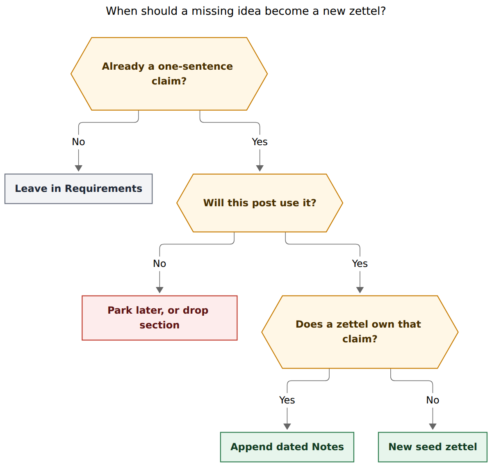
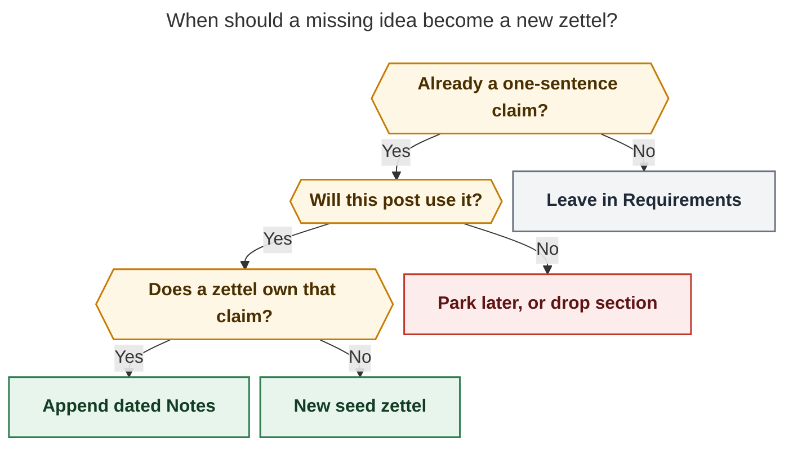

# Missing records for the SASE Blog Zettel album

**Date:** 2026-11-25
**Question:** Which claim-sized records should be added to `~/bob/sase_blog_zettel.md` before drafting the public introduction post?
**Snapshot:** album index of 29 zettels, all `status: seed`; article spine `sase_blog_contents.md`; live post `docs/blog/posts/structured-agentic-software-engineering.md` (published 2026-07-08); sase HEAD with 17,235 commits in this checkout.

---

## Bottom line

1. **The album is a claim inventory with eight empty required sections, not a finished outline.** `sase_blog_zettel.md` currently indexes **29 zettels · 🌱 29 seed**. Eight of its eighteen `section` values have **zero** records: `gate`, `tools`, `fleet`, `automation`, `plugins`, `how_i_use_sase`, `demos`, and `close`. The spine still has matching `TODO` stubs for gate, automation, demos, and conclusion. A 2026-11-24 task claimed to put at least one record in every section or remove the section; the empty chips remain, and its subtask "Create one task for every empty section!" is still unchecked.

2. **Do not mint a filler zettel just to light a section chip.** The 2026-11-12 album research is still the unit rule: one record per *claim*, never one per section. A section can draw on several records, and a record can feed one paragraph or nothing. Empty honestly means "no home yet" unless this post actually needs that claim. Several empty sections (`plugins`, `fleet`, `tools`, maybe `how_i_use_sase`) already have later-post drafts or were omitted from the November 15 section-schema recommendation on purpose.

3. **The single most important missing record is already written in your own notes and was never captured.** On 2026-11-15 the section-schema research left a paste-ready seed:

   > Plan mode is one instance of a deeper primitive: a gate that pauses an agent until a human or rule answers.

   Contents §1.3 is still `TODO`. The October launch-post outline made "Plan Mode → Gates" one of four body generalizations. `sase_blog.md` still asks "Plan mode is the canonical or best example of some deeper primitive. I know it. Interrupts?" No zettel owns that sentence.

4. **Add about a dozen seeds for this post, park four as `later`, and put the rest in `## Notes` on zettels you already have.** The ranked list at the end is the capture list. The bottleneck is still words in `## Draft`, not storage.

---

## What I treated as in-scope

The album's own contract, from its summary and schema:

- Parent project: `[[sase_blog]]`
- Unit: one claim per record, in your voice
- Required fields: `status`, `claim`, `section`
- Walk and index: by `section`
- Assembly authority: still `sase_blog_contents.md` (the spine), not the album

I looked for *missing claims*, not missing headings. A heading with no record is a coverage signal. It is not, by itself, a reason to invent a sentence.

I did not read the other swarm members' reports for this query.

---

## Method

Read, in this order:

1. The album, all 29 record files, `sase_blog_zettel.base`, and `record.md` / `album.md`.
2. The writing bench: `sase_blog.md`, `sase_blog_contents.md`, `sase_blog_drafts.md`, `sase_blog_annotations.md`, `sase_blog_0_legacy_notes.md`, `why_sase.md`, `sase_pre_blog.md`, `sase_post_blog.md`.
3. Annotation source `ref/notes/sase_blog_261116.md` (21 highlights; several conversions cancelled or absorbed).
4. Prior research in the vault's `ref/chat` sources (album guide, drafting-in-records, section schema, wave captures) and audited sidecar reads of `research:202610/sase_launch_post_outline/sase_launch_post_outline.md` and `research:202610/sase_launch_post_introduction/sase_launch_post_introduction.md`.
5. Current product nouns from `README.md`, `docs/concepts/`, `docs/reference/`, the glossary (`gate`, `tool run`, `proc`, `routine`/`job`, `required plugin`), and the draft later posts under `docs/blog/posts/`.
6. A Dataview pass over notes parented to `[[sase_blog]]`.

Library check for citations named below: 4 of 7 candidates already in your library (1 finished). Details at the end.

---

## How the album got its shape

Three research rounds already decided how this album is supposed to work. The live file has drifted from each of them, and that drift is the main source of empty sections.

| Date | Decision | Live album today |
| --- | --- | --- |
| 2026-11-12 | Album is a **workbench**. Spine owns order. **No `section` field.** One record per claim. Intro, promise, and transitions live in the article, not in records. | `section` is **required**. Index walks by section. Intro has one zettel. |
| 2026-11-15 | Add optional `section` as a *targeting* fact. **13 values.** Deliberately omit "Why I use SASE" and "Conclusion." Do not make `section` required (forces misfiling of `later`/`cut`). | **18 required values**, including the two that were omitted (`how_i_use_sase`, `close`) plus `the_agent_cli`, `tools`, `fleet`, `plugins`. `families` was folded into the `turn` label. |
| 2026-11-12 wave captures | 15 paste-ready seeds, including `gates-plans-epics`, `routines-jobs`, `limitations`, `naming`, `need-your-help`. Wave 1 was the four "generalizes" cards. | Those four cards were split and renamed. **Gates, routines, limitations-as-such, naming, and the close ask were never created.** |

The reversal of "no section field" was justified in November: Bases cannot see which *heading* links to a record, so a capture-time `section:` is the only coverage view that works. That justification does **not** extend to "every section must have a row." The November 15 report said empty chips are a feature: they show where material is missing so you can either write a claim or delete the value.

`sase_blog_contents.md` is still a thinner, older spine than the album: What is SASE? (prompt language, turn, gate, sessions/clans/tribes, memory, plan, project, automation) → Demos → Why not ready → Future → Conclusion. It does not mention Tools, Fleet, Plugins, or How I use SASE. Reconcile the spine with the album vocabulary in the same sitting you add records, or the chips will keep lying.

---

## Coverage of the 29 seeds

Every current record is still a seed. Only `skills_should_be_procedural_memories` has a `## Draft`. That is the writing bottleneck.

| Section | n | What is already claimed | Hole |
| --- | --- | --- | --- |
| 🪝 Intro | 1 | Ladder: "standard stages of progression" (`what_came_before`) | Stats / "motion isn't progress"; name/pronunciation lives nowhere |
| 🧱 What is SASE? | 3 | Recursive purpose; "many abstractions"; why a TUI | Neighbors; "optimal experience"; meta-harness / Omnigent footnote |
| 📜 Macros | 4 | Control flow; layers; model aliases; composer | Alternations / vibe evals, stash examples, Vim joke, PIW/LSP quotes are notes-not-records |
| 🤖 Agent CLIs | 2 | Installs/updates; usage limits | One-CLI-behind-every-provider; experience not performance |
| 🧠 Memory | 2 | AGENTS.md is not enough; skills as procedural memory | "Every wrong way" is already a note on `memory.md` |
| 🔁 Turn \< Session \< Clan \< Tribe | 3 | Finalizers; Nadella quote; multi-provider swarms | **The hierarchy itself is the section title and has no zettel** |
| 🚦 Gates | **0** | — | **Contents §1.3; the load-bearing generalization** |
| 🎨 Artifacts | 5 | Links; audited reads; bead lifecycle; beads/birds; repos vs directories | Workspace-per-agent is adjacent, not the same claim |
| 💾 VCS | 2 | Host-owned completion; monorepo tools | Isolated workspaces; stitches/Patches depth is a later post |
| 🛠️ Tools | **0** | — | ToolRuns are a README "Why sase" bullet |
| 💥 Fleet | **0** | — | Mentioned in `why_a_tui`; `sase_remote` is post-blog |
| ⚙️ Services | **0** | — | Routines/jobs; contents §1.8; scheduler in README |
| 🔌 Plugins | **0** | — | Draft later post already exists |
| 🔍 How I use SASE | **0** | — | November 15 omitted this on purpose |
| 🎬 The Demos | **0** | — | Contents §2; README already ships three GIFs |
| 🛑 Why not ready | 2 | AI slop; too complex | Limitations list; 1-user / prototype-gone-wild; Agents tab is buggiest |
| 🔮 Future | 5 | Bob events; evals; non-VCS files; goals; memory=docs | Fine for this post; don't add more future until these draft |
| 🏁 Conclusion | **0** | — | Contents §5; "I'm out of tokens"; "No weasels; just work" |

The drafts project (`sase_blog_drafts.md`) only schedules the 29 existing seeds. Filling empty sections is out of that project's current wave graph, which is why this research is useful *before* Wave 1 review tries to invent coverage after the fact.

---

## A missing idea should become a zettel only when it is already a claim



Rendered size: 800 × 760 px; fit scale: 81.6%.



_A missing idea becomes a new zettel only when it is one claim you already wrote, this post will actually use it, and no existing record owns that sentence._

This is the November 12 unit rule plus the November 15 targeting rule, written as a capture test. It is also why I am **not** recommending eight fillers for the eight empty chips.

---

## Ideas that should not become new records

These are real, and they already have a home. Adding a zettel for them would split a claim you have already aimed.

| Idea | Home | Why not a new record |
| --- | --- | --- |
| `tmux_ai_window` / Boris ladder specifics | Notes on `what_came_before` (already) | Annotation conversion completed 2026-11-21 into that intro zettel |
| Stashed-prompt screenshots; PIW "goal one / goal two"; never-disable-Vim joke | Notes on `the_prompt_composer` | Annotation tasks marked converted; composer claim is the umbrella |
| Alternations as "vibe evals"; loop vs graph engineering | Notes on `agent_control_flow` | Same control-flow claim; Wave 1 packed them under One Prompt → Programs |
| Four AI-slop categories and prompt debt | Notes on `ai_slop` (partially there) | Highlight `^h-92ab011eb422` even has a task to *link* the zettel, not split it |
| "Implemented memory every wrong way" | Notes on `memory` (already) | Joke is evidence for the AGENTS.md claim, not a second thesis |
| `sase artifact read` four-plans screenshot | Notes on `audited_artifact_reads` (already) | |
| Hub-note vs structure-note quote | Leave cut | You cancelled the conversion: "I don't think this needs to be in the blog" |
| Closet stick-figure (models in the closet) | Media brief, not a claim | Conversion cancelled 2026-11-22; still fine as a diagram for the intro |
| `reads` / `snips` sidecar repos | Superseded by `files_not_tracked_by_a_vcs` | Explicitly superseded by `sase_blog#^file-artifacts-record` |
| AI broccoli | Notes on a limitations zettel until you write a claim | Wave 3 left it as a note on purpose; Keep still holds the meaning |
| Gas Town term map, angel/devil style, stick figures | Stay in `sase_blog.md` Requirements | Wave captures left these post-wide on purpose |
| Email the `agent_swe` authors; podcast pass | Tasks, not records | Records must not hold checkboxes |
| Hijack, rust-core boundary, feature-flag freeze | Later or not-ready notes | Too operational for the introduction; several November research threads already cover them |

Cancelled annotation conversions I am **not** reviving as records: closet diagram, SWE timeline-as-its-own-zettel (keep as infographic under intro/what), hub note, finalizer-ideas (current `finalizers` zettel covers the live claim).

---

## Empty sections: fill, park, or delete

The November 15 schema work listed 13 values and left two open questions. You later added six more keys and made `section` required. Treat each empty key as one of: *this post*, *later post*, or *delete the choice*.

| Empty key | Verdict | Why |
| --- | --- | --- |
| `gate` | **Fill for this post** | Contents §1.3; October outline §3.3; "Things that sase generalizes" item 1; paste-ready seed never created |
| `automation` | **Fill, one short seed** | Contents §1.8; README scheduler bullet; Wave 2 `routines-jobs`; depth belongs in draft `[03] AXE` |
| `demos` | **Fill, one seed** | Contents §2; README already has three GIFs; October outline said proof, not tour |
| `close` | **Fill** | Contents §5; Wave 4 `need-your-help`; "No weasels; just work" |
| `tools` | **Park `later` or delete the key** | ToolRuns are real (README + `docs/reference/automation/tools.md`) and were not in the Nov 15 set. A one-line later seed is honest; a this-post section is a tour |
| `fleet` | **Park `later` or delete** | `why_a_tui` already mentions fleet; `sase_remote` is a post-blog project; draft `[07] Telegram` exists |
| `plugins` | **Park `later` or delete** | Draft `[05] Commit Workflows — The Pluggable Path From Diff to PR` already exists |
| `how_i_use_sase` | **Delete the key, or one later seed** | Nov 15 omitted it because the move from "why I use it" to "what it is / is it ready" looked deliberate. Pride lives in the spine; recursive purpose is already a `what` zettel |

If you want the Schema Card chips to stay honest without writing this-post prose, capture the park-later seeds with `status: later` so they drop out of the Base "🧭 By section" view (it already filters `later` and `cut`).

---

## Load-bearing claims this post still does not own

These are the holes that would make the rewritten introduction dishonest or incomplete, independent of chip-filling.

**Gates.** Glossary: a sase gate is a durable, command-backed request for one user decision; creating one from inside an agent *ends the turn*. Decision `gates-never-block`: a gate never blocks an agent. Docs concept page "Automation and human checkpoints" draws scheduler → autonomy profile *or* gate. Your 2026-08-07 list starts "Gates → Plans → Epics." None of that is a zettel. `sase_gate.md` even says plan notifications and questions are special cases of the same primitive.

**The turn hierarchy.** The section label is "Turn < Session < Clan < Tribe." Existing turn zettels are finalizers, a Nadella quote, and multi-provider swarms. Your note "the term 'sub-agent' doesn't cut it when referring to agents that other agents run" has no record. Wave 1's "A Wall of Terminals → One Screen" packed this with Why a TUI?; Why a TUI? shipped as its own `what` zettel and left the hierarchy behind.

**Limitations.** `sase_blog.md` asked for a limitations list three times. Contents §3's potential first line is "And might never be… At least in its current form and name." README already says alpha, POSIX-only, interfaces evolving. The Agents tab "is the buggiest part of the TUI." `ai_slop` and `sase_is_too_complex` are categories of cost, not the honest-limits list the October outline put in §4.3.

**The name.** Contents footnote `[1]` is still `TODO`: pronunciation, acronym, collision with Gartner's Secure Access Service Edge. Wave 3 had a `naming` seed: "I'm bad at naming things, and I worry that points to a deeper problem with the design." Live post already says pronounced "sassy." No zettel.

**One CLI, not one model.** README lists seven providers (Claude Code, Codex, Antigravity, Qwen Code, OpenCode, Muse Code, Grok Build). Live post still carries a five-CLI `tmux_ai_window` menu. Wave 1 `agent-clis` seed: "SASE puts every provider's coding-agent CLI behind one harness, and it promises the best experience, not the best performance." Current agent-CLI zettels cover installs and usage meters, not that thesis. Multi-provider *swarms* is a different, already-captured claim.

**Isolated workspaces.** Concepts "How SASE works" names Workspace as noun 2 of 7. Wave 2 guessed: "Every agent gets its own workspace clone and SASE owns the commit, so parallel agents never trip over each other." `host_owned_completion` is the commit-ownership half, and it is a different sentence ("started as a hack"). The clone-isolation half is missing.

**Demos as proof.** October outline: the body is proof, not a product tour; no install section; GIFs pay off the generalizations. Contents §2 is still `TODO`. The README already has the three clips this post would reuse (multi-model fan-out, Agents observability, Patches pipeline), plus prompt-input and stash tapes under `demos/tapes/`.

**Close.** Wave 4: "I need your help: I'm out of tokens." Legacy outline close: "no weasels; just work." Poll issues with `type:poll`. Getting Started link, not an install tutorial.

---

## Later posts already drafted in-tree

Empty album sections are less empty than they look if you count the unpublished series:

| Draft post | Album section it would consume |
| --- | --- |
| `[03] AXE — The Background Daemon…` | `automation` (depth) |
| `[04] Beads and SDD` | extra beads/SDD (not a hole; `beads_and_birds` exists) |
| `[05] Commit Workflows — plugins/VCS` | `plugins` |
| `[06] Patches in Practice` | Patch lifecycle depth |
| `[07] Telegram as the Mobile Control Surface` | `fleet` / mobile |
| `macros-in-depth.md`, `prompt-widget-and-nvim.md`, `whats-next-memory-mobile-web.md` | macros/memory/future depth |

So a this-post zettel about plugins or Telegram would compete with a draft you already wrote. Point at those drafts with `status: later` if you want the chip, and keep this post's body on the four generalizations the October outline chose: one CLI, one screen, gates, one prompt → programs.

---

## Ranked list of recommended new records

Rank is "capture this before you dictate Wave 1 drafts." Status is my recommendation, not a field you must keep. Claims reuse your wording where a sentence already exists; ✏️ marks a claim I had to compress from several notes.

### This post — capture as 🌱 seed

1. **Plan mode is a gate** · section `gate` · stem `plan_mode_is_a_gate`
   - **Claim:** Plan mode is one instance of a deeper primitive: a gate that pauses an agent until a human or rule answers, and gates grow into plans and then epics.
   - **Why #1:** Empty required section, contents §1.3, October outline §3.3, 2026-08-07 "Things that sase generalizes" item 1, and a paste-ready seed from 2026-11-15 that was never created. This is the payoff for "the missing layer" in the live July opening.
   - **Notes to dump in on capture:** `sase_blog.md` "Plan mode is the canonical… Interrupts?"; `sase_gate.md` (plans and questions as cmd notifications); glossary gate + gate-turn; decision `gates-never-block` as a pointer; proof screenshot `img/20260824_141701.png` (agent read four plans).

2. **A gate never blocks an agent** · section `gate` · stem `a_gate_never_blocks_an_agent`
   - **Claim:** ✏️ Creating a gate ends the agent's turn; the host owns the wait, so a human checkpoint cannot hold a live model hostage.
   - **Why:** Distinct from #1 (what a gate *is* vs what it *does not* do). It is a named, accepted decision, and it is the surprising operational fact that makes SASE's gates different from "the agent sits in plan mode." Keep it a second record so #1 can stay about the generalization chain.
   - **Notes:** glossary "an agent observes a gate turn through the session it hands off to, never by waiting"; `handoffs-end-through-host-completion`.

3. **Sub-agent doesn't cut it** · section `turn` · stem `sub_agent_doesnt_cut_it`
   - **Claim:** ✏️ Turn < session < clan < tribe is the vocabulary for agents that other agents run; "sub-agent" is the wrong word for that.
   - **Why:** The section is named after a hierarchy that no zettel explains. Why a TUI? absorbed the screen half of Wave 1's "wall of terminals" card and left this behind. Glossary already has session, clan, tribe, hood, clan wave.
   - **Notes:** `sase_blog.md` 2026-08-01 bullet; Agents-tab bugginess can *point* at the limitations zettel rather than live here.

4. **SASE is a prototype gone wild** · section `not_ready` · stem `prototype_gone_wild`
   - **Claim:** SASE is a prototype gone wild with about one user, so expect sharp edges: alpha, POSIX-only, a moving vocabulary, and an Agents tab that is still the buggiest part of the TUI.
   - **Why:** Wave 3 `limitations` seed; contents §3 potential first line; README status paragraph; asked for a limitations list three times. `ai_slop` and `sase_is_too_complex` do not substitute for "who should not install this."
   - **Notes:** AI broccoli stays a bullet here until it has its own claim; inherit-provider-pricing/churn; "might never be ready in its current form and name."

5. **I'm bad at naming things** · section `what` · stem `im_bad_at_naming_things`
   - **Claim:** I'm bad at naming things, and I worry that points to a deeper problem with the design.
   - **Why:** Contents footnote `[1]` (pronunciation "sassy", acronym, Secure Access Service Edge collision) is still TODO. Wave 3 `naming` seed. Renames already shipped (xprompts → macros, ChangeSpec → Patches, ACE → TUI, AXE → scheduler, families → sessions) are the proof, not a second thesis.
   - **Notes:** Hassan et al. (arXiv:2509.06216) as name *inspiration*, not validation; "sassy"; Gartner SASE collision; live post still has the xprompts banner that the rewrite must kill.

6. **One CLI behind every provider** · section `the_agent_cli` · stem `one_cli_behind_every_provider`
   - **Claim:** SASE puts every provider's coding-agent CLI behind one harness, and it promises the best experience, not the best performance.
   - **Why:** Wave 1 agreed card, never captured. Current CLI zettels are operational (installs, usage meters). README lists seven providers; the July post's `tmux_ai_window` menu is already stale at five. Multi-provider *swarms* is a different zettel.
   - **Notes:** Proof: Claude outage retry screenshot `~/tmp/screenshots/20260616_140429.png`; "wrap CLIs, not models"; hooks are the thing you did *not* generalize (write down why, it still isn't).

7. **Every agent gets a workspace** · section `project` · stem `every_agent_gets_a_workspace`
   - **Claim:** ✏️ Every agent gets its own workspace clone, so parallel agents never share a working tree.
   - **Why:** Concepts noun #2; Wave 2 `vcs-workspaces` (I dropped "SASE owns the commit" because `host_owned_completion` already owns that sentence). Without this, VCS only has a hack-turned-asset and a monorepo-tools prediction.
   - **Notes:** `docs/concepts/agents.md`; isolated numbered workspaces in README.

8. **Routines and jobs keep work moving** · section `automation` · stem `routines_and_jobs`
   - **Claim:** Routines and jobs let agents work on a schedule, not only when I type a prompt.
   - **Why:** Empty section, contents §1.8, Wave 2, README scheduler bullet. Keep it one seed; AXE depth is draft `[03]`. `toobig_split` is already named on `sase_is_too_complex` as a complexity-control example, not the automation thesis.
   - **Notes:** Glossary routine/job (lumberjack/chop); nine default routines; "cheap scripts sense and the runner acts"; pointer to `[03]`.

9. **The demos are the proof** · section `demos` · stem `the_demos_are_the_proof`
   - **Claim:** ✏️ The GIFs are not a product tour; each one is proof of a generalization the rest of the post argues.
   - **Why:** Contents §2 is empty; October outline forbade an install section and wanted proof artifacts. README already has the three clips (fan-out, observability, Patches pipeline). One zettel can map clip → claim and stop.
   - **Notes:** `demos/tapes/sase_ace_multi_model_fanout.tape`, `sase_ace_agents_observability.tape`, `sase_ace_prs_pipeline.tape`; prompt-input and stash tapes as optional extras; recapture June screenshots that predate the macro/TUI/session renames.

10. **Motion isn't progress** · section `intro` · stem `motion_isnt_progress`
    - **Claim:** SASE's commit and line-count stats are a lot of motion, and motion isn't progress.
    - **Why:** `why_sase.md` and contents lede already want this beat; footnote `[b]` is still "update commit/line counts." Introduction research (2026-10-07) sourced the paraphrase to Akshay Nathan on Latent Space (2026-07-28) and told you to re-derive numbers on publish day. `what_came_before` is the ladder, not the stats undercut.
    - **Notes:** Re-derive on publish day. This checkout on 2026-11-25: **17,235** commits, **~3.39M** tracked Python lines (Rust lives in `sase-core`, so do not recycle contents' "~2.9 million lines of Python and Rust" without a fresh `sase-core` count). Agent-trailer commits: 7,818 all-time here. Confirm the Nathan episode before crediting it. "Dolla dolla bills" and whether to name Google stay your call, in the spine.

11. **I need your help. I'm out of tokens.** · section `close` · stem `i_need_your_help`
    - **Claim:** I need your help. I'm out of tokens.
    - **Why:** Empty conclusion; Wave 4; contents §5; the ask plus `type:poll` GitHub issues plus Getting Started (not an install walkthrough) plus closing line "No weasels; just work."
    - **Notes:** Series map pointing at Later Posts / in-tree drafts; Vim-mode joke can live here *or* on the composer zettel, not both.

12. **Neighbors, not a fatal flaw** · section `what` · stem `neighbors_not_a_fatal_flaw`
    - **Claim:** ✏️ Parallel agents in worktrees are table stakes; SASE's bet is the operating layer around the CLIs you already run (Claude Code, Codex, Symphony, Gas Town/Gas City, Omnigent).
    - **Why:** October outline §2.3; HN positioning; `sase_blog.md` still says "break down gastown differences" *and* "many sections should link to the analogous Gas Town term." Legacy notes' "fatal flaw of gastown" is exactly what the outline told you not to publish. One dated, generous paragraph is the record; the term map stays in Requirements.
    - **Notes:** Symphony is finished in your library; Welcome to Gas Town is queued; Omnigent URL I tried is `not_found` (confirm the live Databricks URL before citing); Maggie Appleton's Gas Town essay is `not_found` and worth a `bob ref create` if you engage the "vibecoded orchestrator" critique.

### Park as ⏭️ later (honest chips, not this post)

13. **ToolRuns record what actually ran** · section `tools` · stem `toolruns_record_what_ran`
    - **Claim:** ✏️ An agentic IDE must record the commands that actually ran — owner, outcome, and evidence — not only what the model said.
    - **Why later:** README "Why sase" already lists ToolRuns; `docs/reference/automation/tools.md` is real. The October outline and the November 15 value-set both left this out of post one. Capture as `later` *or* delete the `tools` key.

14. **One TUI across the tailnet** · section `fleet` · stem `one_tui_across_the_tailnet`
    - **Claim:** ✏️ SASE should let me supervise agents on every machine I already use from one TUI.
    - **Why later:** `why_a_tui` already uses fleet as a reason for the TUI. `sase_post_blog` / `sase_remote`, `%dispatch`, and draft `[07] Telegram` are the depth. Don't retell Telegram in the introduction.

15. **The provider, VCS, and editor are plugins** · section `plugins` · stem `provider_vcs_editor_are_plugins`
    - **Claim:** ✏️ SASE is a meta-harness because the provider, VCS, and editor surfaces are plugins, not a hard-wired product.
    - **Why later:** Contents footnote `[2]` (Omnigent as meta-harness example) can stay a one-liner in `what`. Plugin groups and `sase-github` / `sase-nvim` / `sase-telegram` / `sase-listen` belong with draft `[05]` and the nvim later post.

16. **How I actually run a day** · section `how_i_use_sase` · stem `how_i_actually_run_a_day` · **or delete the key**
    - **Claim:** ✏️ I run SASE as its only user: one TUI, agents on more than one machine, and Bob tasks that I want to become beads.
    - **Why optional:** Pride is the spine; recursive purpose is already `recursive_sase_improvement`; Bob→beads is already `bob_task_events` (future). November 15 omitted this section on purpose. Prefer deleting the key unless you truly want a "day in the life" beat.

### Optional extras (only if a Wave review still feels a hole)

17. **Mentors are gates on review** · section `automation` or `later` · Mentors appear on the same concept page as gates and the scheduler. Easy to over-tour. A dated note on #8 is probably enough.
18. **Questions are gates too** · section `gate` · `sase_gate.md` already says this. Likely Notes on #1, not a third gates zettel.
19. **Size aliases descend the effort ladder** · section `macros` · Decision `size-alias-effort-ladder` is real and adjacent to `model_alias_pools`. Fold into that zettel's Notes unless the alias pools draft gets too big.

---

## Paste-ready captures (top twelve)

Dry-run these one at a time. Rewrite any ✏️ claim that does not sound like you before dropping `--dry-run`. Stems match the live album's underscore filenames (the 2026-11-12 `^stem` hyphen rule was for Capture `^stem` tokens; you have been creating underscore files since).

```text
Plan mode is a gate @sase_blog_zettel/^plan_mode_is_a_gate
- status:: seed
- section:: gate
- claim:: Plan mode is one instance of a deeper primitive: a gate that pauses an agent until a human or rule answers, and gates grow into plans and then epics.
```

```text
A gate never blocks an agent @sase_blog_zettel/^a_gate_never_blocks_an_agent
- status:: seed
- section:: gate
- claim:: Creating a gate ends the agent's turn; the host owns the wait, so a human checkpoint cannot hold a live model hostage.
```

```text
Sub-agent doesn't cut it @sase_blog_zettel/^sub_agent_doesnt_cut_it
- status:: seed
- section:: turn
- claim:: Turn, session, clan, and tribe are the vocabulary for agents that other agents run; sub-agent is the wrong word for that.
```

```text
SASE is a prototype gone wild @sase_blog_zettel/^prototype_gone_wild
- status:: seed
- section:: not_ready
- claim:: SASE is a prototype gone wild with about one user, so expect sharp edges: alpha, POSIX-only, a moving vocabulary, and an Agents tab that is still the buggiest part of the TUI.
```

If `^underscore` stems are refused by Capture, use `bob records new zettel 'Title' --stem plan_mode_is_a_gate --set status=seed --set section=gate --set claim='…' --dry-run`, which is how the existing 29 files look.

After capturing, add `→ [[sase_blog_zettel/<stem>|Title]]` under the matching heading in `sase_blog_contents.md`. That is still the assembly mechanism. Then stop: the next work is dictating `## Draft` on Wave 1, not another schema pass.

---

## What I would not do next

- Do not add one record per remaining empty chip.
- Do not revive cancelled annotation conversions (closet, hub note, reads/snips, timeline-as-zettel).
- Do not migrate the rest of `sase_blog.md` Requirements up front. The album guide said to triage those lazily, topic by topic, into `## Notes`.
- Do not treat the 2026-11-24 "at least one record per section" completion as done. Either capture the this-post seeds above or delete the unused keys.
- Do not let the album become a second outline. If a new key is tempting (`mentors`, `hijack`, `rust`), it is almost certainly a later post or a note.

---

## Sources

**Vault:** `sase_blog_zettel.md` and all 29 records · `sase_blog.md` · `sase_blog_contents.md` · `sase_blog_drafts.md` · `sase_blog_annotations.md` · `sase_blog_0_legacy_notes.md` · `why_sase.md` · `sase_pre_blog.md` · `sase_post_blog.md` · `sase_gate.md` · `ref/notes/sase_blog_261116.md` · `.bob/ref-sources/chat/sase_blog_zettel_album_guide--0ac54b680d7e/source.md` · `.bob/ref-sources/chat/sase_blog_drafting_in_records--e489ac23f909/source.md` · `.bob/ref-sources/chat/sase_blog_zettel_section_schema--de523bacf7fa/source.md` · `.bob/ref-sources/chat/sase_blog_zettel_wave_captures--19eed7e819e5/source.md`.

**Prior research (audited):** `research:202610/sase_launch_post_outline/sase_launch_post_outline.md` · `research:202610/sase_launch_post_introduction/sase_launch_post_introduction.md`.

**Product:** `README.md` · `docs/concepts/index.md` · `docs/concepts/agents.md` · `docs/concepts/automation.md` · `docs/reference/automation/tools.md` · `docs/reference/automation/scheduler-default-routines.md` · `docs/reference/integrations/plugins.md` · `docs/reference/integrations/remote-dispatch.md` · `docs/blog/index.md` · `docs/blog/posts/structured-agentic-software-engineering.md` · draft posts `axe-background-daemon.md`, `commit-workflows-plugins.md`, `telegram-mobile-agents.md` · glossary strands `gate`, `tool-run`, `proc`, `required-plugin` · decision `gates-never-block`.

**Counts (this checkout, 2026-11-25):** `git rev-list --count HEAD` = 17,235 · tracked `*.py` physical lines ≈ 3,392,832 across 14,108 files · `git rev-list --count HEAD --grep='^SASE_AGENT='` = 7,818.

Library check: 4 of 7 candidates already in your library (1 finished: OpenAI Symphony). Queued: Hassan et al. arXiv:2509.06216, Welcome to Gas Town, Mitchell Hashimoto *My AI Adoption Journey*. Not in `ref/`: Omnigent (URL unverified), Maggie Appleton *Gas Town*, Latent Space Codex/Nathan episode. Propose `bob ref create` for Appleton and the Nathan episode if you cite them; do not treat `not_found` as unread.

---

## About this report

Independent swarm report (`__grk`). I did not read peer reports from this swarm. Recommendations are capture suggestions only; this report does not write vault records.
