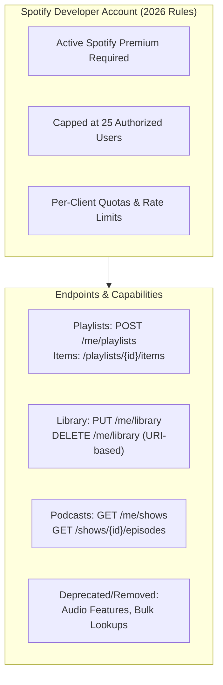
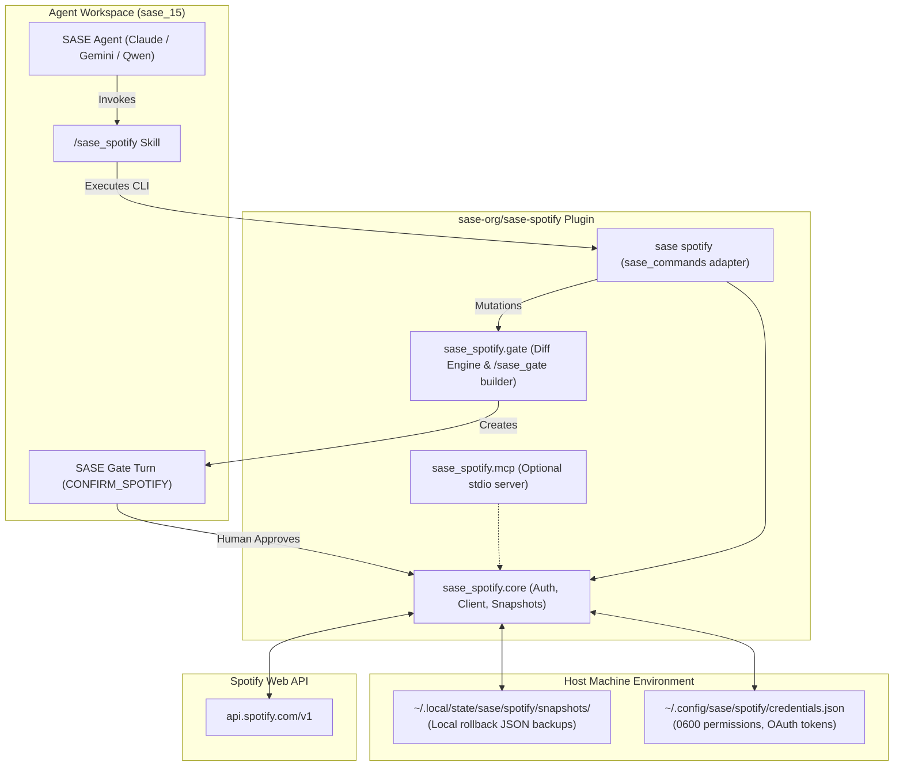
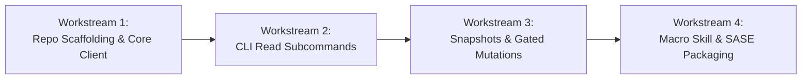

# SASE Agent Spotify Integration: Architectural Design & Research Report

> **Author**: `research.3k.gem`  
> **Date**: 2026-11-07  
> **Target Status**: Research & Proposal  
> **Topic**: SASE Agent Access to User Spotify Playlists, Library, and Podcasts  

---

## 1. Executive Summary

This report evaluates how to provide Structured Agentic Software Engineering (SASE) agents with secure, intuitive, and reliable access to a user's Spotify account. The user's primary objectives are:
1. **Read Visibility**: Enabling agents to discover existing playlists, inspect songs within playlists, and query followed podcasts/shows.
2. **Playlist Management**: Empowering agents to curate, create, add, remove, and reorder playlist items.
3. **Safety & Governance**: Protecting personal music collections via human-in-the-loop gated approval (`/sase_gate`).
4. **Architecture & Plugin Home**: Assessing whether to create a new plugin repository (`sase-org/sase-spotify`) and defining an aesthetic, ergonomic design.

### High-Level Recommendation

We strongly endorse creating an official SASE plugin repository named **`sase-org/sase-spotify`** (using standard single-hyphen plugin naming convention rather than sidecar double-hyphen `sase--spotify`), registered under the `sase--plugin` topic.

The plugin should provide a four-layer architecture:
1. **Core Client & Persistent Auth (`sase_spotify.core`)**: A resilient, rate-limit-aware HTTP client with OAuth 2.0 PKCE / Authorization Code support, managing persistent tokens stored at `~/.config/sase/spotify/credentials.json` (outside ephemeral agent workspace clones).
2. **First-Class CLI Subcommand (`sase spotify ...`)**: Mounted via the `sase_commands` entry point. It provides dual output: rich, colorized human-readable terminal output and `--json` envelopes for agents.
3. **Safety Engine with Pre-Mutation Snapshots & `/sase_gate` Integration**: Every write operation (add, remove, reorder) automatically snapshots the playlist state to local disk (`~/.local/state/sase/spotify/snapshots/`), constructs a visual diff, and yields execution to a custom SASE notification gate (`/sase_gate`). Destructive actions are never executed unapproved, and accidental changes are instantly rollable with `sase spotify playlists restore <snapshot-id>`.
4. **Agent Macro Skill (`/sase_spotify`) & Optional MCP Export**: Provides progressive disclosure guidance to all LLM providers (Claude, Gemini, Qwen, Codex), with an optional `sase spotify mcp` stdio transport for MCP-native IDE environments.

---

## 2. Critique of the Proposal & Strategic Analysis

### 2.1 Is This a Good Idea?

**Yes, with rigorous architectural guardrails.**

Integrating Spotify into an agentic workflow offers profound personal productivity and cognitive benefits:
* **Contextual Audio Curation**: Agents helping with deep research, coding sprints, or study sessions can assemble tailored audio environments (e.g. ambient drone, instrumental synth, low-tempo beats) based on the user's historical preferences.
* **Podcast & Knowledge Discovery**: Agents can cross-reference episodes from followed podcasts with active research beads or topics, identifying relevant listening material for commutes or workouts.
* **Curation & Maintenance**: Playlists easily accumulate broken/duplicate tracks, out-of-order songs, or stale tracks. Agents excel at playlist maintenance tasks that humans avoid due to time constraints.

However, treating Spotify like a generic database or file system introduces distinct perils:
* **No Native Version Control**: Unlike Git or SASE beads, Spotify has **zero native undo or commit history** for playlist edits. If an agent hallucinates, empties, or scramble-orders a 10-year-old personal playlist, the Spotify Web API does not provide a "revert" endpoint.
* **API Volatility & Lockdowns**: Spotify significantly restricted its Web API for Development Mode apps in February 2026. Automated scraping and bulk queries are strictly capped.
* **Credential Hygiene in Ephemeral Clones**: SASE agents run in numbered, ephemeral workspaces (`sase_1`, `sase_15`). Storing OAuth tokens or secrets in workspace trees risks committing credentials or breaking token refresh locks across concurrent agents.

### 2.2 Evaluation of Alternative Approaches

Before committing to a custom plugin, we evaluated four distinct implementation strategies:

| Approach | Architecture | Strengths | Fatal Flaws / Limitations | Verdict |
| :--- | :--- | :--- | :--- | :--- |
| **A. Off-the-Shelf MCP Server**<br>(e.g. `llyfn/spotify-mcp`) | External MCP server spawned via stdio or HTTP | • Prebuilt Python toolset<br>• Supports search, library, playlists | • Fails on non-MCP SASE providers (Qwen, OpenCode, Codex)<br>• Cannot generate native SASE TUI `/sase_gate` modals<br>• No automated local snapshots/undo<br>• Lacks human CLI ergonomics | **Secondary**<br>(Wrap or offer as secondary bridge, not primary substrate) |
| **B. Local OS Automation**<br>(MPRIS / D-Bus on Linux, AppleScript via SSH on Mac) | Desktop client control over D-Bus / SSH | • No OAuth developer app needed<br>• Real-time local playback control | • Cannot inspect full playlists (only current track metadata)<br>• Cannot browse followed podcasts or library<br>• Cannot create/manage playlists remotely | **Rejected for Library/Playlists**<br>(Useful only as playback companion) |
| **C. Reverse-Engineered Private Web API**<br>(`spotapi` / session tokens) | Scraping private Web Player endpoints | • Bypasses dev app quotas | • Violates Spotify ToS<br>• Account ban risk<br>• Breaks unpredictably on UI changes | **Strictly Prohibited** |
| **D. First-Class SASE Plugin & CLI**<br>(`sase-spotify` + `sase_commands` + `/sase_gate`) | Official plugin with CLI, Python API, local snapshot engine, and macro skill | • Universal compatibility across all LLM providers<br>• Integrated with SASE TUI and `/sase_gate`<br>• Automated pre-mutation backups<br>• Human-friendly CLI and agent `--json` | **Recommended Strategy** |

### 2.3 Justified Adjustments to Requirements

We recommend four essential adjustments to the original requirements:

> [!IMPORTANT]
> **Adjustment 1: Mandatory Pre-Mutation Snapshots & Instant Rollback**  
> Gated approval (`/sase_gate`) prevents unintended actions, but human reviewers can suffer from "approval fatigue" and click "Approve" prematurely. The plugin must take an automated atomic snapshot of the playlist state to disk (`~/.local/state/sase/spotify/snapshots/<playlist_id>_<timestamp>.json`) *before* executing any mutation. A simple `sase spotify playlists restore <snapshot-id>` command must guarantee 100% rollback capability.

> [!IMPORTANT]
> **Adjustment 2: Hard Pagination & Context-Protection Defaults**  
> Playlists can easily contain thousands of tracks; users often follow dozens of podcasts with hundreds of episodes. The CLI must default to paginated summaries (e.g. `--limit 20` or `--summary`) with track counts, durations, and top artists. Agents must never dump unpaginated tracklists into their context window, preventing context bloat and runaway token costs.

> [!IMPORTANT]
> **Adjustment 3: Decoupled Out-of-Band Human Authentication**  
> Agents running headlessly in ephemeral clones cannot solve browser CAPTCHAs or complete OAuth browser redirects. The initial login flow must be human-driven via `sase spotify auth login`. Once authenticated, credentials reside in persistent user storage (`~/.config/sase/spotify/credentials.json`) with `0600` permissions. Agents only execute authenticated commands.

> [!NOTE]
> **Adjustment 4: Repository Naming Standardization (`sase-spotify`)**  
> SASE follows a clean naming convention:
> * **Linked plugins & core extensions**: Single hyphen (`sase-github`, `sase-listen`, `sase-telegram`, `sase-nvim`).
> * **Project sidecars**: Double hyphen (`sase--research`, `sase--plans`).
> 
> The proposed plugin repository should be named **`sase-org/sase-spotify`** (PyPI: `sase-spotify`), carrying the `sase--plugin` GitHub topic.

---

## 3. Technical Constraints: Spotify Web API in 2026

Building on Spotify's Web API requires navigating the platform changes rolled out through the **February 2026 Migration Guide**:



### 3.1 Key API Behaviors & Changes

1. **Development Mode App Requirements**:
   * The developer account owner **must have an active Spotify Premium subscription**.
   * Development Mode is capped at 25 registered users (for Bryan's personal workflow, 1 user is needed).
   * Search results in Dev Mode are capped at 10 results per type.
2. **Library Consolidation**:
   * Previously separate endpoints (`PUT /me/tracks`, `PUT /me/albums`, `PUT /me/shows`) are consolidated into URI-based generic endpoints:
     * Add/Follow: `PUT /v1/me/library?uris=spotify:track:...,spotify:show:...`
     * Remove/Unfollow: `DELETE /v1/me/library?uris=...`
     * Check: `GET /v1/me/library/contains?uris=...`
3. **Playlist Endpoints**:
   * Playlist creation must use `POST /v1/me/playlists` (the legacy `POST /users/{id}/playlists` endpoint was removed).
   * Track modifications must target `/v1/playlists/{playlist_id}/items`.
4. **Podcast Scope & Limitations**:
   * The API provides metadata, show details, episode descriptions, release dates, and duration via `GET /v1/me/shows` and `GET /v1/shows/{id}/episodes`.
   * **Audio Stream Boundary**: Spotify Web API does **not** provide raw MP3 downloads for podcasts due to DRM. To pair with `sase-listen` (which generates spoken audio editions from markdown), agents should use Spotify to discover podcast metadata, episode titles, and show topics, while actual audio edition generation remains handled by `sase-listen`.

---

## 4. Architecture & Detailed Design

The proposed architecture cleanly separates persistent system configuration from ephemeral agent execution:



### 4.1 Repository Layout (`sase-org/sase-spotify`)

```text
sase-spotify/
├── AGENTS.md                          # SASE instructions for agents working on this repo
├── pyproject.toml                     # Hatchling build, entry points, dependencies
├── README.md                          # Comprehensive docs and setup instructions
├── Justfile                           # Development recipes (check, fix, test)
├── src/
│   └── sase_spotify/
│       ├── __init__.py
│       ├── sase_command.py            # Entry point for `sase_commands`
│       ├── client.py                  # Typed httpx client with rate-limiting & backoff
│       ├── auth.py                    # OAuth2 PKCE token manager & credential store
│       ├── snapshots.py               # Playlist snapshot & rollback engine
│       ├── gate.py                    # /sase_gate payload & visual diff generator
│       ├── cli/
│       │   ├── app.py                 # Main CLI dispatch with Rich & JSON output
│       │   ├── auth_cmd.py            # `sase spotify auth login|status|logout`
│       │   ├── playlists_cmd.py       # `sase spotify playlists list|show|create|diff`
│       │   ├── podcasts_cmd.py        # `sase spotify podcasts list|episodes`
│       │   └── library_cmd.py         # `sase spotify library tracks|albums`
│       ├── mcp/
│       │   ├── __init__.py
│       │   └── server.py              # Stdio MCP server exposing tools
│       └── macros/
│           └── skills/
│               └── sase_spotify.md    # Source template for agent skill
└── tests/
    ├── test_client.py
    ├── test_snapshots.py
    ├── test_gate.py
    └── test_cli.py
```

### 4.2 Entry Points (`pyproject.toml`)

```toml
[project]
name = "sase-spotify"
version = "0.1.0"
description = "Spotify integration for SASE: playlist curation, podcast inspection, and gated management"
readme = "README.md"
requires-python = ">=3.12"
license = "MIT"
keywords = ["spotify", "sase", "sase--plugin", "cli", "agent", "playlists"]
dependencies = [
    "httpx>=0.27.0",
    "rich>=13.7.0",
    "rich-argparse>=1.4.0",
    "pydantic>=2.6.0",
]

[project.entry-points."sase_commands"]
spotify = "sase_spotify.sase_command"

[project.entry-points."sase_macros"]
sase_spotify = "sase_spotify.macros"
```

---

## 5. User & Agent Interaction Design: Intuitive, Reliable, and Beautiful

### 5.1 CLI Ergonomics

The CLI follows SASE's standard verb-noun syntax, outputting styled Rich tables in interactive terminal sessions and clean JSON when passed `--json` or when running non-interactively.

#### 1. Discover Playlists
```bash
sase spotify playlists list --limit 10 --json
```
**JSON Output**:
```json
{
  "total": 34,
  "limit": 10,
  "offset": 0,
  "items": [
    {
      "id": "37i9dQZF1DXcBWIGoYBM5M",
      "name": "Focus & Flow",
      "owner": "Bryan Bugyi",
      "public": false,
      "collaborative": false,
      "track_count": 42,
      "snapshot_id": "AAAA...",
      "uri": "spotify:playlist:37i9dQZF1DXcBWIGoYBM5M"
    }
  ]
}
```

#### 2. Inspect Tracks in a Playlist
```bash
sase spotify playlists show 37i9dQZF1DXcBWIGoYBM5M --limit 5 --json
```
**JSON Output**:
```json
{
  "id": "37i9dQZF1DXcBWIGoYBM5M",
  "name": "Focus & Flow",
  "total_tracks": 42,
  "total_duration_ms": 10542000,
  "tracks": [
    {
      "id": "5UWzyvdBv0Xl3zG0",
      "title": "Awake",
      "artists": ["Tycho"],
      "album": "Awake",
      "duration_ms": 283000,
      "uri": "spotify:track:5UWzyvdBv0Xl3zG0"
    }
  ]
}
```

#### 3. Inspect Followed Podcasts
```bash
sase spotify podcasts list --limit 10 --json
```
**JSON Output**:
```json
{
  "total": 18,
  "items": [
    {
      "id": "4rOoJ6Egrf8K2IrywzwOMk",
      "name": "The Joe Rogan Experience",
      "publisher": "Joe Rogan",
      "total_episodes": 2180,
      "description": "Long-form conversations...",
      "latest_episode": {
        "title": "#2220 - Lex Fridman",
        "release_date": "2026-11-04",
        "duration_ms": 11400000
      }
    }
  ]
}
```

---

### 5.2 Gated Playlist Management (`/sase_gate`)

When an agent proposes modifying a playlist (e.g. creating, adding tracks, removing tracks, or reordering), it **must not** apply changes directly. Instead, it generates a custom SASE notification gate via `/sase_gate`.

#### Visual Notification in SASE TUI

The reviewer sees an elegant, formatted decision card in the SASE TUI Notification Center:

```text
╭──────────────────────────────────────────────────────────────────────────────╮
│ 🎵 SPOTIFY PLAYLIST MODIFICATION                                  PENDING ⏳ │
│ Subject: Focus & Flow (spotify:playlist:37i9dQZF1DXcBWIGoYBM5M)             │
│ Agent:   research.3k.gem                                                     │
├──────────────────────────────────────────────────────────────────────────────┤
│ Summary:                                                                     │
│ Propose adding 3 tracks and removing 1 duplicate track from "Focus & Flow".  │
│ Playlist length: 42 tracks ➔ 44 tracks (+10m 22s duration)                   │
│ Pre-mutation snapshot saved: snap_20261107_1402_focus.json                   │
│                                                                              │
│ Track Changes:                                                               │
│   [+] Tycho — "Awake" (04:43)                                                │
│   [+] Bonobo — "Cirrus" (05:52)                                              │
│   [+] Kiasmos — "Blurred" (05:10)                                            │
│   [-] Unknown Lo-Fi #12 (02:15) [Duplicate removal]                          │
│                                                                              │
│ Actions:                                                                     │
│   [Space] Toggle options   [Enter] Submit decision   [d] View Unified Diff   │
│                                                                              │
│ Decision:                                                                    │
│   (●) [✅ Apply Changes]        ( ) [✋ Reject Proposal]                      │
╰──────────────────────────────────────────────────────────────────────────────╯
```

#### Gate Request Specification

The agent constructs the gate request using the standard schema:

```json
{
  "schema_version": 3,
  "kind": "custom",
  "producer": { "agent": "research.3k.gem" },
  "presentation": {
    "icon": "🎵",
    "title": "Modify Spotify Playlist: \"Focus & Flow\"",
    "panel": "spotify",
    "panel_icon": "🎧",
    "sender": "spotify-manager",
    "chip": { "glyph": "🎵", "label": "spotify", "color": "#1DB954" },
    "notes": [
      "Add 3 focus tracks and remove 1 duplicate track.",
      "Net change: +2 tracks, +10m 22s duration.",
      "Automated snapshot saved for instant rollback."
    ]
  },
  "query": "apply OR reject",
  "primary_branch": ["apply"],
  "options": [
    {
      "id": "apply",
      "label": "Apply Playlist Changes",
      "icon": "✅",
      "command": { "argv": ["commands/apply_changes"] },
      "result_schema": {
        "type": "object",
        "required": ["status", "snapshot_id"],
        "properties": {
          "status": { "const": "applied" },
          "snapshot_id": { "type": "string" }
        }
      }
    },
    {
      "id": "reject",
      "label": "Reject Proposal",
      "icon": "✋",
      "feedback": "optional",
      "command": { "argv": ["commands/reject"] },
      "result_schema": {
        "type": "object",
        "required": ["status"],
        "properties": { "status": { "const": "rejected" } }
      }
    }
  ],
  "operations": [
    {
      "id": "diff",
      "kind": "run_command",
      "label": "Show Unified Diff",
      "icon": "🔍",
      "key": "d",
      "command": { "argv": ["commands/show_diff"] },
      "display": "text"
    }
  ],
  "turn": {
    "pending_status": "CONFIRM_SPOTIFY",
    "settled_status": "SPOTIFY_UPDATED",
    "workspace": "inherit",
    "next": {
      "prompt": "Verify playlist update and conclude task.",
      "output": ["results"],
      "fork": "session"
    }
  }
}
```

---

## 6. Security, Authentication & Credential Storage

### 6.1 Authentication Topology

Spotify uses OAuth 2.0. To maintain security across SASE's multi-workspace architecture:

1. **User Setup (One-time, human-facing)**:
   ```bash
   sase spotify auth login
   ```
   * Starts a local loopback server on `http://127.0.0.1:8888/callback`.
   * Opens the user's default browser to Spotify's authorization page.
   * Exchanges the authorization code for an `access_token` and `refresh_token`.
2. **Persistent Storage (Host level)**:
   * Tokens are written to `~/.config/sase/spotify/credentials.json`.
   * File permissions are strictly enforced to `0600` (`chmod 600`).
   * Never stored inside the workspace clone or checked into git.
3. **Agent Consumption**:
   * SASE agents call `sase spotify ...` CLI commands.
   * The CLI reads the central credentials file, checks token expiration, and automatically refreshes expired tokens using Spotify's token refresh endpoint.
   * Concurrent agent invocations are guarded by a file lock (`fcntl.flock`) on `credentials.json.lock` to prevent token refresh race conditions.
4. **Scope Boundaries**:
   * Scopes requested:
     * Read: `playlist-read-private`, `playlist-read-collaborative`, `user-library-read`, `user-follow-read`.
     * Write: `playlist-modify-public`, `playlist-modify-private`, `user-library-modify`.
   * Unrequested scopes: payment, password, email modification.

---

## 7. Implementation Plan & Agent Workstreams

The creation of `sase-org/sase-spotify` can be autonomously executed by SASE agents in four distinct workstreams:



### Workstream 1: Repository Scaffolding & Core Client
* **Deliverables**:
  * Create `sase-org/sase-spotify` repository with `AGENTS.md`, `pyproject.toml`, and `Justfile`.
  * Implement `sase_spotify.auth`: OAuth 2.0 PKCE flow, loopback callback server, credential file storage, and atomic token refresh with file locks.
  * Implement `sase_spotify.client`: Async and synchronous `httpx` client with exponential backoff on HTTP 429 (`Retry-After`).
  * Unit tests with mocked Spotify responses.

### Workstream 2: CLI Read Commands
* **Deliverables**:
  * Build CLI parser (`sase_spotify.cli`) using `argparse` and `rich-argparse`.
  * Implement `sase spotify playlists list` and `sase spotify playlists show`.
  * Implement `sase spotify podcasts list` and `sase spotify podcasts episodes`.
  * Support `--json` flag and automatic JSON mode when stdout is non-TTY.
  * Wire the entry point `spotify = "sase_spotify.sase_command"` into SASE.

### Workstream 3: Snapshot Engine & Gated Playlist Mutations
* **Deliverables**:
  * Build `sase_spotify.snapshots`: JSON serialization of playlist state before mutation, with `restore` rollback command.
  * Build `sase_spotify.gate`: Payload builder for `/sase_gate`, formatting track diffs with Rich syntax.
  * Implement `sase spotify playlists create`, `add`, `remove`, `reorder`.
  * Add integration tests verifying that mutation commands refuse to execute directly without gate authorization.

### Workstream 4: Macro Skill Generation & Packaging
* **Deliverables**:
  * Author source template `src/sase_spotify/macros/skills/sase_spotify.md`.
  * Deploy generated skill `/sase_spotify` into SASE skill catalog.
  * Add repository topics: `sase`, `sase--plugin`, `spotify`, `cli`.
  * Validate end-to-end integration with `sase plugin install spotify`.

---

## 8. Conclusion & Recommended Action

Giving SASE agents access to Spotify transforms them from purely code-centric helpers into holistic personal productivity partners. 

By avoiding pure-MCP fragility, enforcing pre-mutation local snapshots, and routing all modifications through SASE's custom notification gates (`/sase_gate`), this design achieves:
1. **Total Reliability**: No accidental playlist wipes; instant one-command rollback.
2. **Universal Compatibility**: Works across all SASE agent providers (Claude, Gemini, Qwen, Codex) via standard CLI and JSON streams.
3. **Aesthetic Excellence**: Gorgeous Rich terminal tables for the user and clear notification cards in the SASE TUI.

**Recommended Next Step**: Have a SASE agent initialize the `sase-org/sase-spotify` repository following the Workstream roadmap outlined above.
