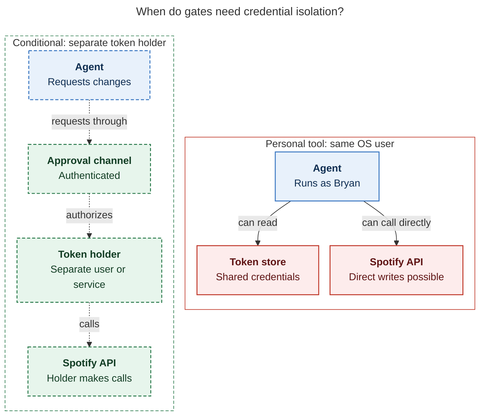
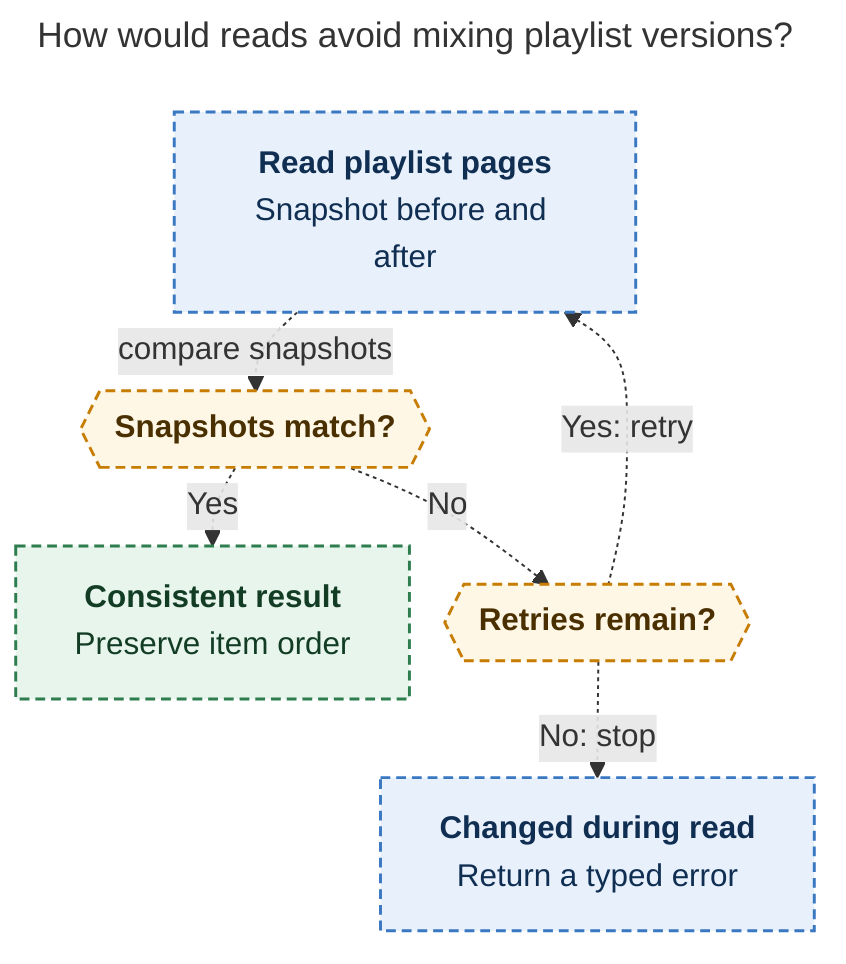

# Diagram proposals: Spotify for SASE agents

Proposals for the swarm linker, not a report. Each diagram restates only what the source
report says.

```yaml
source: research:202611/spotify_library_access_for_agents/spotify_library_access_for_agents__final.md
producer: research.3k.image
check: "mmdc 12.0.0 with the PDF-mirroring config rendered 2 of 2 Mermaid diagrams; pinned npx CLI with Puppeteer --no-sandbox"
```

## credential-isolation

```yaml
anchor: |-
  isolate a hostile agent running as Bryan's OS user, which can read the token
question: |-
  Why can a same-user agent bypass gates, and what would hard enforcement require?
illustrates: |-
  The proposed personal tool does not isolate a hostile agent running as Bryan’s OS user; a hard approval requirement would need a separate token holder behind an authenticated approval channel.
caption: In the proposed tool, same-user agents can bypass gates; hard enforcement would require a separate token holder behind authenticated approval.
review: 825.328x673 px, fit 79.1%; reader-question, source-trace and visual checks passed; 1 revision; access arrows, conditional paths dashed
```



## playlist-read-consistency

```yaml
anchor: |-
  Content reads compare the playlist snapshot before and after pagination.
question: |-
  How does a content read avoid mixing playlist versions?
illustrates: |-
  Content reads compare the playlist snapshot before and after pagination, retry a bounded number of times, then return changed_during_read rather than mix versions.
caption: The proposed read protocol checks snapshots around pagination and retries only within a bound; continued changes return changed_during_read.
review: 474.730x786 px, fit 100.0%; reader-question, source-trace and visual checks passed; 1 revision; arrows show proposed control flow
```


