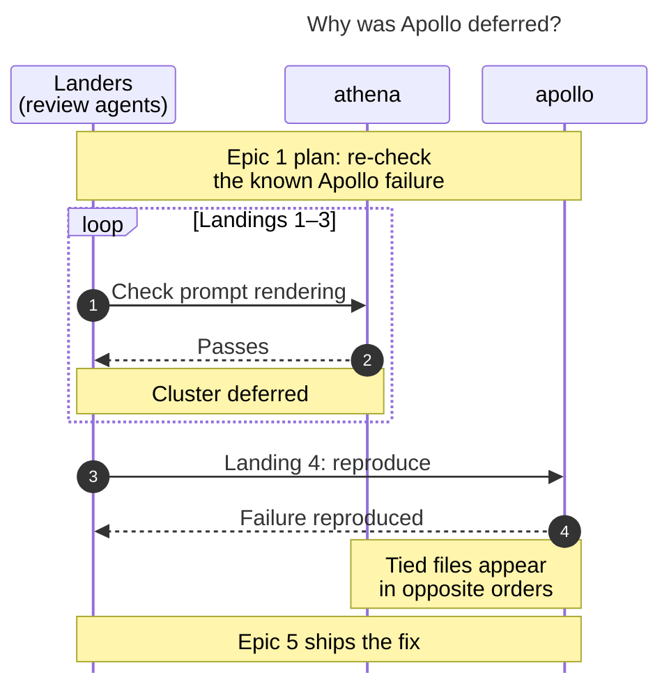

# Diagram proposals: The Five-Epic Task-Backlog Cleanup Chain

Proposals for the swarm linker, not a report. Each diagram restates only what the source
report says.

```yaml
source: research:202611/task_backlog_cleanup_chain_review/task_backlog_cleanup_chain_review__final.md
producer: research.30.image
check: "mmdc 12.0.0 with Puppeteer --no-sandbox and the PDF-mirroring config rendered 1 of 1 Mermaid diagrams"
```

## host-specific-deferral

```yaml
anchor: |-
  Landers for epics 1–3 deferred it because it passed on athena.
question: |-
  How did a known Apollo failure wait until epic 5 for a fix?
illustrates: |-
  Landers for epics 1–3 deferred the known Apollo prompt-render failure because it passed on athena, until epic 4 reproduced it on Apollo and epic 5 shipped the fix.
caption: "Passing on athena delayed a known Apollo failure across three landings; epic 4 reproduced it, and epic 5 shipped the fix."
review: "531.5×531 px, fit 100.0%; question, source trace, labels, arrowheads, and visual checks passed; 1 revision after the initial title clipped"
```


