# The Five-Epic Task-Backlog Cleanup Chain (sase-1pm → sase-1qt): What Happened and What to Change

_Consolidated report, 2026-11-02. It merges five independent researcher reports (`__cdx`,
`__cld`, `__grk`, `__mus`, `__gem`, in this directory) with new checks by the lead
researcher against the bead store, the plans sidecar, sase and sase-core git history, and
the feature-flag registry. Claims that only one researcher could check are attributed to
that researcher._

## Bottom Line

**The chain was a productive reliability campaign, not a backlog drain. Its continuation
rule lost work twice, not once.**

- **The fixes were real and mostly held.** Five epics closed 23 distinct seed tasks
  (sase-1ic and sase-o7 were each selected twice, so there were 25 slots). The chain also
  made 11 duplicate, obsolete, or already-fixed closures. Every seed is still closed. In
  athena's full-run records (checked by cld), the flake seeds with data show zero or
  near-zero recurrence since their fixes, for example sase-1mv: 54 hits in the 14 days
  before, 0 in 106 runs after. Independent landers caught real defects that phase workers
  had reported as done.
- **The backlog barely moved:** 398 non-closed tasks at the start, 382 now (−16 in 4.4
  days). During the chain window the fleet filed 34 new tasks; the chain itself filed only
  5. The prompt's stop condition ("until all task beads in this project are closed") can
  never be met: the chain's own rules never select the 130 feature and memory beads.
- **New finding: epic 2's landing repairs never landed.** Every report found that epic 5
  lost its landing repairs when its final turn proposed epic 6. None noticed that epic 2
  lost its repairs the same way, four days earlier and silently:
  - Epic 2's closeout says slot-refusal policy and baseline-aware epic-symbol
    reconciliation moved behind Rust bindings. Neither change exists in sase or
    sase-core.
  - The unrepaired epic-symbol defect then held a finished epic-3 phase unclosable for
    about 53 hours.
  - Both landing turns that carried code edits into a plan proposal lost them (2 of 2).
  - Every lander that proposed a successor lost its plan-status edits.
  - I filed **sase-1qv** to re-land the Rust work, and added a DISCOVERED ISSUE note to
    sase-1pj.7.1, the epic that owns retaining stranded handoff workspaces.
- **Only epic 1 had human review.** Epics 2–5 were auto-approved
  (`decided_by: auto`). That includes epic 2's real product change (removing several
  vendor tools from every SASE Claude agent). Epics 3–5 each carried only a boilerplate
  opt-out decision, which nobody ever saw.

**Recommendation:** Run the cleanup again soon, but as a **bounded campaign** (at most 3
epics). Make four changes first:

1. Landers finish through `/sase_final` and leave the next epic as a validated draft for
   you to propose.
2. Seeds are defects only, and each must be phase-sized.
3. Reopened beads get a recurrence protocol.
4. Ranking counts failures on every fleet host.

Do the housekeeping in §8.2 first. The replacement prompt is in §8.3.

---

## 1. What Ran

### 1.1 The Prompt and the Rule It Became

On 2026-10-29 you sent agent `15r` (on athena, at `%m:@xlarge`) this prompt. The text is
as cld quoted it from that agent's transcript; this consolidation did not reread the
transcript:

> You are responsible for working through all open task beads in this project. Follow the
> steps below:
>
> - Close the ones that you can verify are duplicates or are obsolete … then plan a
>   5-phase maximum epic to work any open task beads in this project.
> - This epic should be responsible for at most 5 task beads (the 5 most important ones).
>   … the epic lander of that epic MUST be responsible for creating a new epic to work the
>   remaining beads, 5 at a time, using the same epic rules, until all task beads in this
>   project are closed.
> - Each epic plan should specify decisions if necessary. Keep these to a minimum … give
>   the user the option to opt-out of feature work or memory changes …

The prompt did not say how a lander should "create a new epic." Epic 1's planner turned it
into a **"Mandatory: continue the backlog chain"** block in `plan:202610/task_backlog_epic_1.md`
(verified). Each lander had to copy the block verbatim into the next plan:

1. Re-list every non-closed task.
2. Close only proven duplicates or obsolete tasks.
3. Rank by fleet-wide cost, then by cost to fix.
4. Write an epic of at most 5 phases and 5 beads.
5. Carry the rule forward "until no non-closed task beads remain."
6. **"Propose it with `/sase_plan`. Proposing ends the land agent's turn, so do it
   last."**

That last sentence was the planner's choice, not yours, and it caused the chain's worst
failures (§5.1).

The block drifted, mostly for the better (cld):

- Epic 4 added "Rules for every phase."
- Epic 5 added ranking from selection-health full-run records and "on any fleet host."
- Epic 3's planner (on codex) dropped the "MUST" and the seed-lead list.
- The epic-6 draft (23 KB, per cld) is the largest plan yet, mostly from carried-forward
  rejected-candidate context. The approved plans ranged from 13 to 20 KB (verified), so
  growth was not steady.

The contract lived only inside generated plans and changed with every lander.

### 1.2 The Chain

Times are UTC, verified from the epic beads. Two reports (mus, gem) mixed EDT/EST and UTC
and overstated epics 1 and 4.

| #   | Epic     | Seeds                         | Created → closed                       | Elapsed              | Approval     |
| --- | -------- | ----------------------------- | -------------------------------------- | -------------------- | ------------ |
| 1   | sase-1pm | 1nh, 1ll, 1p5, 1ic, 1cb       | 10-29 05:44 → 10-29 14:33              | 8h49m                | **reviewer** |
| 2   | sase-1pn | 163, 1p9, o7, 1cs + vr        | 10-29 14:44 → 10-29 23:08              | 8h24m                | auto         |
| 3   | sase-1pu | 1os, 12v, 1mv, 120, 1cc       | 10-29 23:19 → 11-01 19:23              | **68h04m**           | auto         |
| 4   | sase-1qn | o7↺, 1ic↺, 1gz, 13a, 19m      | 11-01 19:34 → 11-01 22:50              | **3h16m**            | auto         |
| 5   | sase-1qt | 1ia + 1l3 + 1hy, xo, 15h (+1i9) | 11-01 23:08 → 11-02 03:39, reopened 11:52 → closed 14:28 | 15h20m | auto |
| (6) | —        | draft: 1oy, 1em, zo, 1pw, 1ce | authored, never approved               | —                    | —            |

- **Total:** 104h44m from epic 1's creation to epic 5's final close.
- **Hidden work:** The plans declared 22 phases, but three nested epics (sase-1pm.5.1,
  sase-1pu.5.1, sase-1pu.5.1.5) added 10 more. Landing tales came on top of that.
- **Agent runs:** cld counted 160 runs published to the agents sidecar.
- **Precursor chain:** The same mechanism had already run as sase-1oh → sase-1ou from
  10-26 (grk, cld, mus). Its ancestor was an August "repeat this prompt" monitor loop
  (`plan:202608/task_backlog_top5.md`).
- **Two chains at once:** sase-1ou was still open when `15r` started this one. On 10-30
  its lander explicitly merged its continuation into sase-1pu "to avoid a second parallel
  backlog chain" (sase-1pu note, verified).

---

## 2. Did the Fixes Work?

**Seed outcomes.** All 23 unique seeds and the related sase-1i9 are closed `done`, each
with commit and test evidence. The 11 extra closures were:

- 8 at the initial triage: 6 obsolete, 2 duplicates.
- sase-1pg, closed as already fixed.
- sase-rh, closed as a duplicate of sase-o7 by epic 3's lander at 19:29 UTC, between
  epics 3 and 4.
- sase-1i9, closed as obsolete.

**Recurrence after the fix** (cld, athena selection-health records, runs with ≤5
failures; post-fix windows are only 1–4 days):

| Seed     | Hits in the 14 days before close | Hits after close | Runs after |
| -------- | -------------------------------: | ---------------: | ---------: |
| sase-1p5 |                               24 |                0 |        311 |
| sase-1mv |                               54 |                0 |        106 |
| sase-xo  |                                9 |                0 |         76 |
| sase-13a |                                6 |                0 |         83 |
| sase-1ic |                              105 |               3¹ |         83 |

¹ From epic 5 overrunning epic 4's cap; the epic-5 redo repaired it. Apollo's local
records end on 10-28, so this evidence covers athena only.

**Two first fixes did not hold** (all reports; close histories verified):

- **sase-1ic**: Epic 1 changed the import budget to a first-party module _count_.
  Mechanical module splits broke that. Epic 4 changed it to a source-byte _footprint_.
  This is the bead's third close.
- **sase-o7**: Epic 2 made the close guard union the upstream Justfile rows. Stale rows
  still reached master. Epic 4 added a freshness preflight. This is the bead's sixth
  close.
- **sase-xo** had been "fixed" twice before epic 5 took it.

Epic 4 spent two of its five slots on epic 1's and epic 2's incomplete fixes.

**Independent landers were the real quality gate.** They found:

- **Epic 1 (nested rebase-gate lander):** stale bytecode accepted, deadline overruns, a
  surviving child process, and swallowed cancellation.
- **Epic 2:** quarantine policy decided in Python, contrary to the Rust core boundary;
  the epic-symbol upstream-union deadlock; and a contract-manifest collision.
- **Epic 3 (nested landers):** tests fed preclassified fake inventory and never exercised
  real marker reads. Even 47 passing focused tests left production-shaped probes failing.
- **Epic 5:** a Python fallback that violated the required Rust boundary, a fixture lock
  held through child waits, and a startup-budget overrun.

Phase acceptance tests often exercised the new helper rather than the real path (cdx).

---

## 3. Did the Backlog Shrink?

| Checkpoint                | Non-closed tasks |
| ------------------------- | ---------------: |
| Initial triage, 10-29     |              398 |
| After epic 1              |              384 |
| After epic 2              |              385 |
| After epic 3 (before rh)  |              388 |
| After epic 4              |              387 |
| **Now (verified 11-02)**  |          **382** |

The 382 non-closed tasks are 368 ready, 10 open, 3 snoozed, and 1 in progress. By type:
139 bug, 100 feature, 89 flake, 30 memory, 12 ci, 7 flag, and 5 untyped. gem's 378 is
wrong.

**Inflow and outflow in the chain window, verified:**

- **Created:** 34 tasks (14 flake, 9 ci, 7 bug, 3 feature, 1 memory). Chain landers filed
  5 of them: sase-1po, 1pp, 1pq, 1pr, and 1qu.
- **Closed:** 44 (33 done, 10 canceled, 1 superseded). Most cancellations came from the
  _other_ chain's dormant-flake sweep, under sase-1ou's `dormant_flakes = close`
  decision. This chain's rule kept dormant tasks open.

gem's claim that the cleanup "generated almost as many beads as it resolved" is wrong. The
treadmill is fleet-wide inflow, not something the chain caused.

**The shape of what remains matters more than the count** (verified):

- 305 of 382 non-closed tasks have **zero** +1 corroboration. Only **19** non-closed
  defects have ≥3 +1s.
- 208 are sized large. Only 50 are small or xsmall ready defects.
- 130 are feature or memory beads that the chain's scope never selects.

At 5 seeds per epic, the high-signal pool is a few epics deep. The long tail is
low-signal, large, and mostly dormant. **A five-at-a-time serial chain can work through
the head of the backlog but will never reach the tail.** The tail needs a different tool:
a dormant sweep or owner triage.

**A stale claim hides the most-corroborated defect.** sase-j0, "check-full is red on
master" (+38, large), is the only `in_progress` task. Its holder was recorded as "no
longer running" on 10-26, and epic 1's plan called it "in_progress since August with no
live holder." Even so, epics 3–5 skipped it as "claimed by its own holder." The rules had
no way to handle a stale claim.

---

## 4. Where the Time Went

- **Phases are fast.** Non-nested phases took 0.2–3.1 hours each.
- **Design-shaped seeds set the pace.** sase-1cb (a new pre-push gate) and sase-1cc (a
  run-state convergence subsystem) each became nested epics. Because the chain is serial,
  each one set the whole chain's pace. Epic 3 took 68 of the chain's 105 hours.
- **Epic 4 is the model round.** It had five phase-sized seeds, explicit phase rules,
  and an 18-minute landing.
- **Epic 3 includes a self-inflicted stall** (new link, verified):
  - Phase sase-1pu.5.1.4 finished at 10-30 09:01Z, and its commit b1618348d4 landed at
    10:04Z.
  - Its close was then refused, because the guard unions local and upstream
    `--epic-symbol` rows. It stayed open until a recovery agent closed it at 11-01 14:51Z,
    about 53 hours after the commit landed.
  - This is exactly the "upstream row union blocks same-turn local cleanup" defect that
    epic 2's lander reproduced and its closeout claimed to have fixed. That repair never
    landed (§5.1).

---

## 5. What Went Wrong, Ranked

### 5.1 The Continuation Rule Loses Work (Severity: High)

Without the `staged_handoffs` flag, `sase plan propose` is an **immediate** handoff: it
ends the turn before host finalization commits anything (see
`docs/reference/agents/agent-sessions.md`, "Handoff completion"). Anything the landing
turn changed but had not committed is stranded in the workspace, and the next launch into
that workspace resets it.

```mermaid
---
title: "Where does a chain landing's final work go?"
accTitle: "Landing continuation today versus proposed"
accDescr: "Today the landing turn proposes the next epic, which ends the turn before host finalization, so uncommitted repairs are lost when the workspace is reused. The proposal finishes the turn through host finalization first, then the owner proposes the validated draft."
config:
  flowchart:
    rankSpacing: 18
    nodeSpacing: 18
    wrappingWidth: 260
---
flowchart TB
  subgraph PROPOSED["Proposed: owner proposes next epic"]
    L2["`**Landing turn**<br/>repairs, closes beads`"]
    D2["`**Next-epic draft**<br/>validated, path noted`"]
    F2["`**/sase_final**<br/>host commits every repo`"]
    O2["`**Owner proposes draft**<br/>after a quick review`"]
    L2 -->|"then"| D2
    D2 -->|"then"| F2
    F2 -.->|"proposed step"| O2
  end
  subgraph TODAY["Today: lander proposes next epic"]
    L1["`**Landing turn**<br/>repairs, closes beads`"]
    P1["`**sase plan propose**<br/>ends the turn at once`"]
    X1["`**Edits never committed**<br/>no host finalizer runs`"]
    R1["`**Workspace reused**<br/>reset and re-cloned: lost`"]
    L1 -->|"last action"| P1
    P1 -->|"immediate handoff"| X1
    X1 -->|"hours later"| R1
  end
  classDef focus fill:#E8F1FB,stroke:#3B78C2,stroke-width:1.5px,color:#0F2E52
  classDef outcome fill:#E7F5EC,stroke:#2E7D4F,stroke-width:1.5px,color:#123D24
  classDef risk fill:#FDECEC,stroke:#C0392B,stroke-width:1.5px,color:#5F1414
  classDef proposed stroke-dasharray:5 3
  class L1,P1,L2,D2 focus
  class X1,R1 risk
  class F2,O2 outcome
  class O2 proposed
  style TODAY fill:none,stroke:#C0392B
  style PROPOSED fill:none,stroke:#2E7D4F
```



_Ending a landing turn with an immediate plan proposal skips host finalization. Both chain
landings whose final turn held code edits lost them. Finishing through `/sase_final`
first, then letting the owner propose the validated draft, removes that path._

| Landing                   | What was lost                                                                                                                                                                                                 | Detected?                                                                                                                                                                 |
| ------------------------- | ------------------------------------------------------------------------------------------------------------------------------------------------------------------------------------------------------------- | ------------------------------------------------------------------------------------------------------------------------------------------------------------------------- |
| Epic 1 lander             | `status: done` edits to `task_backlog_epic_1.md`, `rebased_stitch_gate.md`, `finish_rebased_stitch_gate.md`                                                                                                  | Its own note warned they "may not be committed." All three are still `wip` on origin/main (verified).                                                                    |
| **Epic 2 landing tale**   | Moving slot-refusal policy behind a Rust binding; baseline-aware epic-symbol reconciliation in Rust; the stale contract-manifest row                                                                          | **No.** `slot_refusal.py` is unchanged since phase commit 01dcc2e5f5 (448 lines of Python policy). sase-core has no slot-refusal code. `epic_symbols.py` has no commit between 8bea2e8414 and epic 4's 5585fadefd. The manifest row was noticed on 10-30 by another lander and fixed by a different epic. Filed as **sase-1qv**. |
| Epic 3 and 4 landers      | Plan-status edits, including epic 3's re-marking of epic 2's plan                                                                                                                                             | Plans 2–4 are still `wip` (verified).                                                                                                                                    |
| **Epic 5 landing tale**   | All landing repairs in sase and sase-core                                                                                                                                                                     | Yes, after about 8 hours. A lander relaunched on the closed epic found the loss; the epic was reopened at 11:52 and redone.                                               |

**A natural experiment confirms the mechanism.** The only backlog plans marked `done` on
origin are those whose landings did _not_ propose a successor: epic 5's redo
(`chain_continuation = defer_to_owner`) and sase-1ou's final landing, which refused to
propose because `staged_handoffs` was off. Every plan whose landing ended in a proposal
and was never redone is still `wip`: epics 1–4 and their tale plans.

**The lesson was learned once and then lost.** The precursor chain lost work the same way
on 10-28 (the sase-1ou landing, recovered by epic sase-1ph). Its final lander drew the
right conclusion, but nothing carried that conclusion into the copied rule.

**There is no system fix yet** (verified):

- `staged_handoffs` is still beta and off by default. It was built for exactly this case:
  plan proposals are staged and published only after host finalization succeeds.
- sase-1pj.7.1 ("Retain stranded handoff workspaces") is in progress, with phase .4
  open.
- The epic 5 lander also recorded on sase-1pj.7.1 that the gate-start refusal branch
  still writes no retention record.

Until that work lands, **the prompt must avoid the hazard rather than rely on retention.**

### 5.2 An Unbounded Goal, Rubber-Stamped

- **The goal cannot be met.** "Until all task beads … are closed" is unreachable (§3)
  and contradicts the chain's own exclusions: dormant tasks, snoozed tasks, active owners,
  and feature/memory scope.
- **The owner checkpoint vanished.** Once the lander's launch auto-approved the next plan,
  your only checkpoint was gone:
  - Epic 2's auto-approved decisions included a real product change:
    `claude_tools = inbound_and_async` denied ListAgents, Workflow, Monitor, Cron\*, and
    RemoteTrigger for every SASE Claude agent.
  - Epics 3–5 carried a boilerplate `optional_scope` decision whose two branches both
    exclude unrelated work.

### 5.3 Design-Shaped Seeds Became Nested Epics

Ranking "fleet-wide cost first, then cost to fix" let architecture work into a batch of
quick fixes (cld, gem, grk). This is §4's main time sink.

### 5.4 Recurring Beads Got the Same Class of Fix Again

The rule said "pick the 5 most important" but never asked "why did the last fix fail?"
(grk, cdx, mus). See §2.

### 5.5 The Ranking Watched One Host

The apollo-only prompt-render cluster (sase-1ia, 1l3, 1hy, 1i9) was already listed in
**epic 1's plan** as "reproduced on apollo 2026-10-27, so re-check it on apollo"
(verified). Landers for epics 1–3 deferred it because it passed on athena. Epic 4's lander
finally reproduced it on apollo. The cause was directory-enumeration order on ties:
athena's tmpfs and apollo returned files in opposite orders (cdx). The fix shipped in
epic 5.

### 5.6 Phase Work Broke Master for Other Agents

Each phase ran only its scoped checks, so cross-cutting guards failed only after merge:

- **Ruff stub vs. the pinned toolchain** (epic 2 phase .4, 995c451c38).
- **Scoped suite-gate copy list** (epic 3 phase .3, fd8882c6af). This also failed Full
  CI on Python 3.12–3.14.
- **Completion-kind coverage** for the new state-repair CLI slots (epic 3 phase .5).
- **Startup import budget** (epic 5).

cld found at least one of these nodes in 87 of 334 athena full-run records in the window.
Some of those failures predate the chain.

### 5.7 Smaller Issues

- **Two chains ran at once** (§1.2).
- **Re-triage yielded almost nothing.** The full re-list on every landing closed 8, 0, 0,
  1, and 0 tasks across the initial sweep and four landers.
- **A stale claim** kept sase-j0 out of ranking (§3).
- **Tasks were closed as done before their code landed.** Landers close task beads
  before host commits land, so a lost finalization leaves false `done` records (epics 2
  and 5).

---

## 6. What Worked (Keep It)

- **An independent xhigh lander** that refuses passing-but-inadequate work and keeps
  epic-caused failures as epic work, even when a triage tool labels them KNOWN.
- **"Rules for every phase"** (epic 4 on):
  - Reproduce first.
  - No skips, xfails, timeouts, or budget raises.
  - Keep shared backend logic in sase-core.
  - Record base, host, before/after results, and limits.
- **Ranking from selection-health full-run records** (epic 5): runs with ≤5 failures,
  ignoring failures in a run's own changed files, with recurrence on **any** fleet host
  counting.
- **Follow-up discipline.** Phase workers never file beads. Landers deduplicate,
  corroborate, or route to causal owners. For example, epic 5 merged nine failing nodes
  into one test-order issue on sase-j7 and declined a false wheel-cache defect. Only 5 new
  tasks in five epics.
- **Evidence-based hygiene.** Close only proven duplicates and obsolete tasks; respect
  snoozes, active owners, and the owner's rejection of sase-1ot.
- **Disjoint parallel phases.** Epics 1, 2, and 4 each landed within a day.

---

## 7. Where the Researchers Disagreed

| Topic                                      | Claims                                                         | Resolution                                                                                                                                                                                                                                     |
| ------------------------------------------ | -------------------------------------------------------------- | ---------------------------------------------------------------------------------------------------------------------------------------------------------------------------------------------------------------------------------------------- |
| Current non-closed count                   | gem 378; others 382                                            | **382**, verified.                                                                                                                                                                                                                             |
| Seeds closed                               | grk ~26; mus 25; cdx/cld/gem 23                                | **23 unique** in 25 slots, plus related sase-1i9.                                                                                                                                                                                              |
| Epic durations                             | mus/gem: epic 1 ~13 h, epic 4 ~8 h, epic 3 ~72 h               | Time zones were mixed. **8h49m / 3h16m / 68h04m** (UTC, verified).                                                                                                                                                                             |
| Number of lost landings                    | All five: one (epic 5) in this chain                            | **Two** (epics 2 and 5), plus plan-status edits from four landers (§5.1).                                                                                                                                                                      |
| "Every epic needed lander coding" (gem)    | —                                                              | Lander-level code repairs were needed in epics 2 and 5, plus nested landers in 1 and 3. Epic 4 landed in 18 minutes.                                                                                                                           |
| Fix for the proposal hazard                | mus: propose (or commit the plan) _before_ final verification  | **Rejected.** Proposing ends the turn sooner, and agents never commit (host-owned completion). Use `defer_to_owner`, or `propose_after_backup` as grk describes, until staged handoffs graduate.                                              |
| Filing new flake beads                     | gem: only after 3 deterministic isolated runs                  | **Rejected.** That contradicts the `flake` task type ("fails then passes on an unchanged tree"). Keep `/sase_new_task` triage, and use grk's cap of two new tasks per round, with unknown-cause flakes routed to existing umbrellas.            |
| The five-bead cap                          | gem: replace with capacity tiers; others: keep                 | **Keep ≤5 seeds, but every seed must be phase-sized.** Design-shaped defects go to a "needs its own epic" list (cld). This gets gem's goal without a new taxonomy.                                                                             |
| Dormant flakes                             | grk: restore a `close` default; cdx: keep open without proof   | Ask **once, as a real owner decision** at campaign start (cld), using sase-1ou's evidence bar.                                                                                                                                                 |
| How epic 5's loss was found                | gem: master checks showed the budget red                       | A lander relaunched on the closed epic at 11:37 found the repairs missing (note #6). An earlier check had recorded the startup-budget failure as KNOWN.                                                                                         |

---

## 8. Recommendations

### 8.1 Process Changes, in Priority Order

1. **Separate landing from continuation (required).** The lander verifies, repairs,
   closes beads, marks its plan done, and writes and validates the next epic as a draft.
   It records the draft's path on the epic, then finishes through `/sase_final`. It never
   runs `sase plan propose` or `/sase_plan`. You propose the draft, which takes minutes
   and also restores a per-epic human review. Revisit auto-proposal only after
   sase-1pj.7.1 closes and `staged_handoffs` is on by default (flag bead sase-1pk). Even
   then, propose only from a clean tree.
2. **Bound the campaign (required).** Run at most **3** epics, then a summary. Stop
   earlier if no remaining defect has recent full-run recurrence (on any host) or ≥3 +1s,
   or if the non-closed defect count fails to fall across two epics. Judge the campaign
   by recurrence removed, not by the backlog count.
3. **Seeds are defects only, and each is phase-sized (required).** Allowed types: bug,
   flake, ci, and untyped defects. A seed that needs a design decision or a multi-phase
   epic is listed under "Needs its own epic" for you, not selected. Drop the
   `optional_scope` placeholder; add decisions only for real choices.
4. **Recurrence protocol (required).** For a reopened or previously "fixed" seed:
   - Read every prior close and name the earlier fix SHA.
   - State which recurrence classes the new mechanism covers, and do not reuse the
     failed fix class.
   - Acceptance must replay the known recurrence, not just turn focused tests green.
5. **Rank across hosts (required).** A failure on any fleet host counts. Before
   deferring something as "green here," reproduce it on the other host. Epic 5's
   `git archive` + scratch venv + current wheel recipe is the model.
6. **Phases own cross-cutting guards (should).** Before closing, a phase runs the guards
   its change can affect: contract manifest, completion-kind coverage, TUI startup
   budget, scoped suite-gate copy lists, and the Rust boundary.
7. **Make re-triage cheap and add a scorecard (should).** Do one full
   duplicate/obsolete sweep at campaign start only. Landers re-verify just the candidates
   they rank. Each closeout records:
   - Fixed, obsolete, and duplicate closures, counted separately.
   - New tasks, and how follow-ups were routed.
   - Nested work and elapsed time.
   - Actual check outcomes.
   - Net non-closed defect count.
8. **Run one chain at a time, and release stale claims (should).** Before planning,
   check for an in-progress backlog epic. Treat an `in_progress` task whose holder is no
   longer running as unowned.
9. **Version the charter once (should).** Save the prompt below as a project macro and
   have each plan _reference_ it instead of copying it verbatim. Rule drift and plan
   bloat both came from copying.

### 8.2 Housekeeping Before the Next Run

1. **Fix plan statuses.** Set `status: done` on these plans in the plans sidecar; all
   are verified `wip` with closed epics:
   - `202610/task_backlog_epic_{1,2,3}.md`
   - `202611/task_backlog_epic_4.md`
   - `202610/finish_task_backlog_epic_2.md`
   - `202610/rebased_stitch_gate.md`
   - `202610/finish_rebased_stitch_gate.md`
   - `202611/redo_1qt_landing.md`
   - `202610/backlog_epic_top_five_task_beads.md`
2. **Triage sase-1qv** (new): re-land epic 2's Rust-boundary move for slot-refusal
   policy, and confirm whether the upstream-row close refusal is still live after
   5585fadefd.
3. **sase-j0** (+38, holder dead): release it into the ranking or split it.
4. **sase-1ot** (secret-history purge, whose execution gate you rejected): decide to
   cancel or keep it, so landers stop re-excluding it.
5. **The epic-6 draft** (athena `~/.sase/plans/202611/task_backlog_epic_6.md`) still
   carries the old "propose it last" step. Regenerate it under the new prompt rather than
   proposing it as is. Its seeds remain reasonable candidates once re-verified: sase-1oy,
   1em, zo, 1pw, 1ce, plus 1q3 and 1qu. Treat sase-1em (large, mechanism unknown) as a
   "needs its own epic" candidate.
6. **The long tail** is a separate, one-time owner pass, not the chain's job: the 100
   feature beads, the 30 memory beads, and the dormant zero-+1 flakes. Use a questions
   round or one triage agent proposing cancellations for you to approve.

### 8.3 Replacement Prompt

```text
Start a bounded task-bead cleanup campaign for this project: at most 3 epics, each with at
most 5 seed tasks and 5 phases.

Before planning:
- If any in-progress epic is a task-backlog epic, stop and report it instead of starting a
  second campaign.
- Do one duplicate/obsolete sweep of non-closed task beads. Close only proven duplicates
  (resolution superseded, naming the canonical bead) or obsolete beads (resolution done,
  citing the fixing commit, a grep proving absence, or a passing focused test). Never close
  a bead an active epic owns or a snoozed bead. Treat an in_progress task whose holder agent
  is no longer running as unowned.
- Ask me once, as a plan decision, whether flakes with no full-run recurrence and no +1 in
  the last 30 days should be closed as canceled (a later +1 reopens them).

Campaign charter (each epic plan must reference this charter, not copy or rewrite it):
1. Seeds are defects only: task types bug, flake, ci, or untyped beads describing a defect.
   Never seed feature, memory, or flag beads.
2. Rank by recurrence in the selection-health full-run records over the last 14 days (runs
   with at most 5 failures; ignore failures in a run's own changed files), counting
   failures on ANY fleet host; then security or data-loss risk; then +1 corroboration;
   then cost to fix. Before deferring a candidate as passing, reproduce it on the other
   host. Re-run each chosen candidate at the current tree.
3. Every seed must be fixable by one phase. A defect that needs a design decision or a
   multi-phase epic is not a seed: list it under "Needs its own epic" for me.
4. For a seed that was closed before and reopened, read every prior close, name the
   earlier fix SHA, do not reuse that fix class, and make acceptance replay the known
   recurrence.
5. Rules for every phase: reproduce first on a host and tree that show the failure; no
   skips, xfails, flake-baseline entries, timeout or budget raises; shared backend
   behavior goes in sase-core; record base, host, before/after results, and limits; run
   the cross-cutting guards the change can affect (contract manifest, completion-kind
   coverage, TUI startup budget, scoped suite-gate copy lists); do not create task beads;
   record TASK RESOLVED and PROPOSED FOLLOW-UP notes on the phase bead.
6. Add plan decisions only for real choices I might answer differently. No placeholder
   decisions.
7. Landing: verify every TASK RESOLVED claim against source and commits, integrate drift,
   repair epic-caused failures as epic work, close seeds with evidence, triage follow-ups
   through /sase_new_task (at most two new task beads; route unknown-cause flakes to
   existing owners), mark the plan done, and record a scorecard note (closures by kind,
   new tasks, nested work, check outcomes, net non-closed defect count).
8. Continuation: unless the stop rule applies, write the next epic as a draft plan,
   validate it with `sase plan validate`, and record its path on this epic. Then finish
   normally with /sase_final. Do NOT run `sase plan propose` or /sase_plan from a landing
   turn. I will review and propose the draft.
9. Stop rule: write a campaign summary instead of a next epic when this was epic 3, when no
   remaining defect has a full-run recurrence in 14 days or 3+ +1s, or when the non-closed
   defect count has not fallen over the last two epics.

Create the first epic plan with /sase_plan now. %m:@xlarge
```

The first planner may propose directly, because it holds no landing edits. Only landers
are barred from proposing.

---

## 9. Evidence and Limits

**Verified by the lead researcher:**

- Epic timestamps and decisions (`decided_by`), plus the epic-5 notes, via audited reads
  of sase-1pm, 1pn, 1pu, 1qn, 1qt, sase-1pu.5.1.4, and sase-1pj.7.1.
- The full task export (`sase bead list -t task -s all -n 0 -f json`, 1,386 tasks):
  counts, window inflow and outflow, sizes, +1 distribution, seed close histories, and
  the sase-j0 claim.
- Plan `status:` frontmatter on plans `origin/main` (07cc93c14).
- The continuation block in `plan:202610/task_backlog_epic_1.md` and
  `plan:202611/task_backlog_epic_5.md`, and the `chain_continuation` options in
  `plan:202611/redo_1qt_landing.md`.
- sase and sase-core git history for epic 2's claimed repairs.
- `sase flag list` (`staged_handoffs`: beta, default off) and the handoff-completion
  docs.

**Attributed and not re-checked:**

- cld: the original prompt text and the athena full-run recurrence and master-red
  counts. The full-run records are athena-only, and post-fix windows are 1–4 days.
- cld: the 160-agent-run count.
- grk: the precursor-chain history.
- cdx: epic 5's final committed state (sase 84e22d98be, sase-core 89a5bd8b, matching
  pin).

**Not established:**

- Token or dollar cost.
- Whether epic 2's lost edits were reset on workspace reuse (as in epic 5) or never left
  an unfinalized turn. Either way, they are not on master.
- Whether the upstream-row close refusal is still live after epic 4's preflight. That
  check is in sase-1qv's scope.
