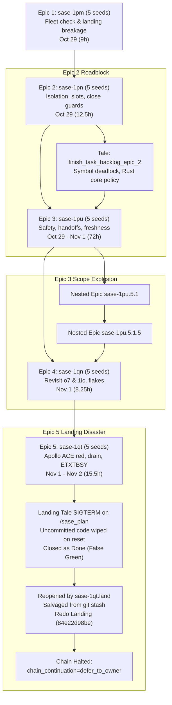
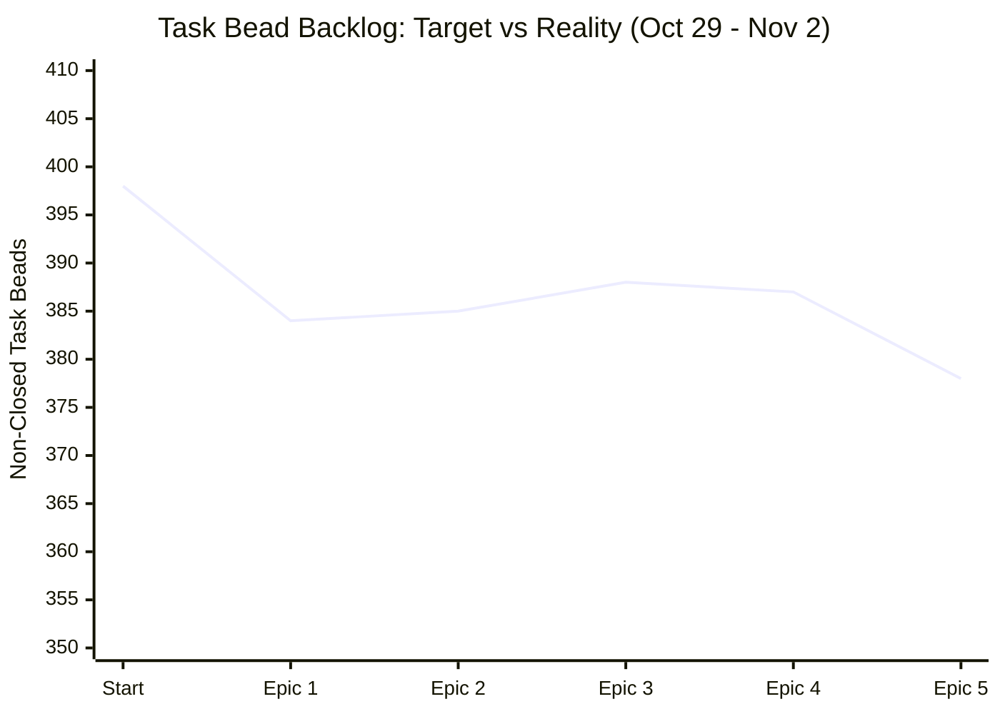

# Retrospective Analysis: The 5-Round Task Bead Backlog Epic Chain

**Author:** Researcher `gem` (Independent Swarm Investigation)  
**Date:** 2026-11-02  
**Target Subsystem:** SASE Task Backlog Triage, Epic Execution, and Landing Automation  
**Reference Breadcrumb:** Epic Bead `sase-1qt`  

---

## 1. Executive Summary

Between 2026-10-29 and 2026-11-02, a continuous, automated chain of five sequential cleanup epics (`sase-1pm`, `sase-1pn`, `sase-1pu`, `sase-1qn`, `sase-1qt`) was executed to burn down high-cost open task beads in the `sase` repository.

### Key Metrics at a Glance

| Metric | Measured Value | Notes |
| :--- | :--- | :--- |
| **Initial Non-Closed Task Beads** | 398 (385 after initial triage) | Triage on 2026-10-29 before Epic 1 |
| **Current Non-Closed Task Beads** | 378 | 359 ready, 18 open, 1 in_progress |
| **Net Bead Reduction** | **20 beads** | Across 5 epics and 5 days of multi-agent runs |
| **Nominal Seed Tasks Closed** | 23 tasks | Across epics 1 through 5 |
| **New Task Beads / Flakes Created** | 10+ new beads | Triaged during landing audits and test runs |
| **Total Calendar Duration** | ~4.5 days | Oct 29 01:44 EDT to Nov 02 14:28 UTC |
| **Longest Single Epic** | Epic 3 (`sase-1pu`) | ~72 hours (spawned 2 nested epics) |
| **Master-Red Regressions Caused** | 4 distinct incidents | Toolchain pin, scoped test helpers, import budget, symbol leak |
| **Catastrophic Failure Modes** | 1 near-total data loss | Epic 5 landing tale lost uncommitted work on `/sase_plan` |

### Core Conclusions

1. **High Qualitative Value, Low Quantitative Throughput:** The chain succeeded in fixing some of the most frustrating, long-standing, fleet-wide blockers in SASE—such as `TERM=dumb` test failures, cross-session Claude agent vulnerabilities, ETXTBSY process spawn races in `sase-core`, and Apollo-specific prompt rendering bugs. However, the raw backlog barely moved (from 398 to 378). Running massive test suites under heavy multi-agent concurrency acted as a "flake generator," surfacing new timing anomalies that agents filed as new task beads.
2. **The Landing Agent Overload Crisis:** The land agent, conceptually designed as a verification and integration gatekeeper, repeatedly devolved into an emergency coding worker. Landers had to author multi-phase repair tales (`finish_task_backlog_epic_2.md`, `finish_1qt_landing.md`), resolve Rust-Python architectural boundary violations introduced by phase workers, reconcile drift across hundreds of intervening master commits, and repair strict budget overruns.
3. **The Hazardous Autonomous Chain Prompt:** The prompt instruction mandating recursive continuation ("*After closing this epic's beads, the land agent MUST author and propose the next backlog epic... until no non-closed task beads remain... Propose it with `/sase_plan`*") was the direct catalyst for the Epic 5 landing disaster. In Epic 5, proposing Epic 6 via `/sase_plan` terminated the coder agent with SIGTERM (143) before host finalizers ran. This dropped all uncommitted fixes, reset the workspace on reuse, and led to a false-done closeout that left master red until manual intervention caught and redid the work.

---

## 2. Chronological Deep-Dive of the 5 Cleanup Epics



### Epic 1: `sase-1pm` — Fleet-Wide Check and Landing Breakage
- **Plan File:** `sase/repos/plans/202610/task_backlog_epic_1.md`
- **Execution Window:** 2026-10-29 01:44 EDT to 10:33 EDT (~9 hours)
- **Targeted Seeds:**
  1. `sase-1nh`: Stitch SHA receipts as successful commits (`45ded07c14`).
  2. `sase-1ll`: Hermetic rendering tests against ambient `TERM=dumb` (`bcddb9edb3`).
  3. `sase-1p5`: Review 5 workspace snapshot directory-operation sites (`4d22ceefa5`).
  4. `sase-1ic`: TUI import-budget guard re-breaking weekly (`24561602cc`).
  5. `sase-1cb`: Pre-push check for auto-rebased stitches (`cddea47cc6`, delegated to sub-epic `sase-1pm.5.1`).
- **What Went Well:** High-leverage fixes landed cleanly; `sase-1nh` eliminated spurious recovery successors across the entire fleet; `sase-1ll` fixed 16 rendering test failures for all agent shells.
- **Issues & Friction:**
  - `sase-1cb` was too large for a single phase and had to spin off child epic `sase-1pm.5.1`.
  - The land agent updated plan frontmatter (`status: done`) in an uncommitted tree and called `/sase_plan` for Epic 2; because legacy handoff ended the turn without finalization, those status edits failed to commit to the plans repository, creating lingering debt for Epic 2.

### Epic 2: `sase-1pn` — Agent Isolation, Poisoned Slots, Close Guards, and Toolchain Drift
- **Plan File:** `sase/repos/plans/202610/task_backlog_epic_2.md` + tale `finish_task_backlog_epic_2.md`
- **Execution Window:** 2026-10-29 10:44 EDT to 23:08 EDT (~12.5 hours)
- **Targeted Seeds:**
  1. `sase-163`: Refuse cross-session messages into Claude agents (`464125cfa6`).
  2. `sase-1p9`: Stop nested-preservation refusal from poisoning workspace slots (`01dcc2e5f5`).
  3. `sase-o7`: Epic close guard seeing upstream `--epic-symbol` rows (`8bea2e8414`).
  4. `sase-1cs` / `sase-vr`: Pin dev toolchain versions (`995c451c38`).
- **Issues & Friction:**
  - **Symbol Cleanup Deadlock:** The fix for `sase-o7` blindly unioned local and remote Justfile rows. When the landing turn removed a local row, the remote-tracking ref still held it, preventing the epic from closing until committed—a circular dependency because host completion commits *after* close.
  - **Rust Backend Boundary Violation:** Phase 2 wrote 448 lines of slot refusal policy in Python (`src/sase/workspace_provider/slot_refusal.py`), violating the core architecture rule requiring shared backend logic to reside in `sase-core`.
  - **Toolchain Pin Regression on Master:** Commit `995c451c38` pinned Ruff 0.17.3, immediately breaking `test_fix_routes_generated_docs_to_their_declared_venvs` on master for other running agents.
  - **Rescue Tale Required:** The lander could not close the epic normally; it had to write and execute a whole tale (`finish_task_backlog_epic_2.md`) to port refusal policy to Rust, fix symbol reconciliation, and resolve contract manifest collisions.
  - **Escalated Verification:** A check run escalated to full suite, consuming 108 minutes of CPU.

### Epic 3: `sase-1pu` — Publication Safety, Handoffs, Check Coverage, and State Freshness
- **Plan File:** `sase/repos/plans/202610/task_backlog_epic_3.md`
- **Execution Window:** 2026-10-29 19:19 EDT to 2026-11-01 19:23 EDT (~72 hours!)
- **Targeted Seeds:**
  1. `sase-1os`: Scan prompt migrations before public sidecar publication (`81fdd689fb`).
  2. `sase-12v`: Keep long-waiting bead agents alive on wake (`188073fe06`).
  3. `sase-1mv`: Scoped check marker audit selection (`fd8882c6af`).
  4. `sase-120`: Full-check timeout for empty-home SDD identity (`5437e0baaa`).
  5. `sase-1cc`: Publish terminal agent-run states (`1d1c46262a`, `5c14ac6a54`, `b1618348d4`, `a0b00da79b`, `0547d23ce3`).
- **Issues & Friction:**
  - **Scope Explosion:** `sase-1cc` was an architectural overhaul, not a simple bug fix. It spawned child epic `sase-1pu.5.1`, which spawned grandchild epic `sase-1pu.5.1.5`. The epic spanned 3 calendar days.
  - **Drift Accumulation:** Over 100 non-epic commits landed on master while Epic 3 was running, creating massive merge and re-verification overhead for the land agent.
  - **Worker Token Starvation:** Phase 3 timed out after 2700s (45 minutes) simply waiting for pytest execution tokens under heavy machine contention.
  - **Phase Regressions:** Phase 3 broke scoped integration tests via a miniature repo copy error, and Phase 5 broke CLI completion slots, requiring mid-flight master hotfixes (`86bec79ca4`).

### Epic 4: `sase-1qn` — Stale Whitelist Rows, Import-Budget Churn, and Recurring Check Flakes
- **Plan File:** `sase/repos/plans/202611/task_backlog_epic_4.md`
- **Execution Window:** 2026-11-01 14:34 EST to 22:50 EST (~8.25 hours)
- **Targeted Seeds:**
  1. `sase-o7`: Stop `--epic-symbol` rows outliving beads (**Repeat of Epic 2**; `5585fadefd`).
  2. `sase-1ic`: Stop module splits turning TUI import budget red (**Repeat of Epic 1**; `5d7a79c3c0`).
  3. `sase-1gz`: Sase-core federation_worker socket test flake (`02eb6961` in core).
  4. `sase-13a`: Zsh sbd alias completion PTY flake (`0760eb0100`).
  5. `sase-19m`: AGY usage-probe rate-limit timeout flake (`34a8638ee0`).
- **Issues & Friction:**
  - **The Churn Cycle:** Two out of the five seeds were re-fixes of issues worked in Epics 1 and 2. The Epic 1 fix for `sase-1ic` counted first-party modules, which immediately broke when codebase modularization ("toobig" splits) increased module count without increasing total code. Epic 4 replaced it with a raw source-byte metric (12,162,484 bytes).
  - **Cross-Host Epiphany:** Lander discovered why the prompt-render cluster (`sase-1ia`, `sase-1l3`, `sase-1hy`) had languished for weeks: it passed 100% on `athena` (tmpfs) and failed deterministically on `apollo` (ext4). Earlier landers on Athena had incorrectly assumed the bugs were stale or unreproducible.

### Epic 5: `sase-1qt` — Apollo ACE Red, Agents-Sync Drain, and sudo_runner ETXTBSY
- **Plan File:** `sase/repos/plans/202611/task_backlog_epic_5.md` + landing tale `finish_1qt_landing.md`
- **Execution Window:** 2026-11-01 18:08 EST to 2026-11-02 09:28 EST (Closed at 03:39 UTC, Reopened 11:52 UTC, Re-closed 14:28 UTC)
- **Targeted Seeds:**
  1. `sase-1ia`, `sase-1l3`, `sase-1hy`: ACE prompt render and hint failures on Apollo (`d26baecb05`).
  2. `sase-xo`: Agents-sync bounded-drain publication flake (`3e6c19ee37`).
  3. `sase-15h`: Sase-core sudo_runner ETXTBSY fixture flake (core `45c6a260`).
- **The Catastrophic Landing Failure:**
  - The three seed fixes landed in initial commits, but Phase 2 introduced an illegal Python 1.0 fallback violating the Rust boundary and overran the TUI import budget by 3,036 bytes. Phase 3 held the fixture lock across waits.
  - The land agent launched a coding tale (`sase-1qt.land--code` in workspace `sase_10`) to repair these defects.
  - The tale coder finished the edits, then obeyed the chaining rule and called `/sase_plan` to propose `task_backlog_epic_6.md`.
  - **The Crash:** Proposing the plan ended the runner process via SIGTERM 143. The associated approval gate failed with `"workspace claim is no longer owned by the creating agent"`. The runner never executed host finalizers (`builtin@commit`). All code edits remained uncommitted in workspace `sase_10` and `sase-core`!
  - **False Closeout:** The lander recorded closeout notes and closed `sase-1qt` as done.
  - **Data Loss on Reuse:** When workspace `sase_10` was reassigned hours later, a fresh checkout reset the workspace, wiping all tracked edits in both repos.
  - **Discovery and Recovery:** At 11:52 UTC on Nov 2, `sase-1qt` was reopened when master checks showed the startup budget still red. The lander had to dig into `git stash` in `sase_10` to recover an untracked test file, reimplement the repairs from scratch (`84e22d98be`), verify, and re-close.
  - **Halt:** Recognizing the hazard, note #8 explicitly declared: `This closeout does not propose epic 6: chain_continuation=defer_to_owner`.

---

## 3. Core Systemic Findings



### Finding 1: The "Backlog Treadmill" (Low Net Reduction)
Despite closing ~23 high-priority seed tasks and investing dozens of agent hours, the net backlog moved from 398 to 378 (only 20 beads). 
- Every large check run run in parallel under heavy resource contention triggers race conditions or timeouts in flaky tests.
- Under SASE guidelines, agents dutifully investigate every unexpected failure and file new task beads (e.g. `sase-1po`, `sase-1pp`, `sase-1pq`, `sase-1pr`, `sase-1qu`).
- Result: **The cleanup epics generated almost as many new beads as they resolved.**

### Finding 2: The "5-Bead Batch" Sizing Anti-Pattern
Treating "5 task beads" as a standardized batch size failed because beads have wildly divergent complexity:
- A bead like `sase-1ll` (pinning `TERM=xterm-256color` in conftest) took ~30 minutes.
- A bead like `sase-1cc` (redesigning terminal agent-run state convergence across sidecars) required 5 commits, 2 child epics, and 3 days.
- Lumping massive architectural redesigns with quick flake fixes caused long-running epics (Epic 3), exposing the branch to severe drift (100+ master commits) and merge conflicts.

### Finding 3: SASE Landers Turned Into Emergency Software Engineers
A SASE land agent is intended to verify phases, perform integration checks, resolve symbols, and close beads. In practice:
- Every single epic required the lander to intervene in implementation.
- Phase workers frequently violated architectural invariants: pushing domain logic to Python instead of Rust (`sase_core`), exceeding the import byte budget, or leaving uncommitted plan status updates.
- This shifted the heaviest cognitive and temporal burden of the entire epic onto the land agent, leading to multi-hour landing sessions and complex landing tales.

### Finding 4: The Fatal Mechanical Flaw of Unattended `/sase_plan` Chaining
The recursive prompt instruction (`author and propose the next backlog epic... propose with /sase_plan`) contained a fundamental mechanical incompatibility with SASE agent execution:
- Invoking `/sase_plan` is a turn-ending handoff.
- In legacy or non-staged configurations, ending the runner via a plan proposal or gate creation can terminate the agent process before host completion finalizers commit pending repository modifications.
- Because ephemeral workspaces (`sase_<N>`) are reset on reuse, any uncommitted work is permanently erased. This directly caused the Epic 5 data loss.

### Finding 5: Silent Multi-Platform Blindspots (Athena vs. Apollo)
SASE operates across heterogeneous machines: Athena (AMD/tmpfs) and Apollo (ext4). 
- Filesystem differences (tmpfs vs ext4 directory enumeration and inode timestamp resolution) caused prompt cache selection tests to pass deterministically on Athena and fail deterministically on Apollo.
- Because initial triage and ranking were performed primarily on Athena, valid Apollo failures (`sase-1ia`, `sase-1l3`, `sase-1hy`) were repeatedly misdiagnosed as dormant or unreproducible, delaying a critical fix across four epic cycles.

---

## 4. Actionable Recommendations

### Recommendation 1: Terminate Unattended Autonomous Chaining
**Never instruct a land agent to recursively propose the next epic.**
- **Why:** Proposing a plan terminates the agent turn. If combined with complex landing repairs, it risks process termination prior to host finalization, causing catastrophic uncommitted code loss (as in Epic 5). Furthermore, autonomous chaining bypasses human review of code health, allowing architectural debt to compound across rounds.
- **Change:** The prompt should instruct the land agent to generate a **Durable Next-Round Recommendation Summary** (listing the top 5 ranked beads and proposed scope) attached to the bead note or a research report, and then stop. The human owner reviews the landing, verifies CI, and initiates the next round.

### Recommendation 2: Adopt Complexity-Tiered Sizing (Stop the Rigid "5-Bead" Rule)
**Replace "pick the 5 most important task beads" with a capacity-budgeted selection rule.**
- **Rule of Thumb:**
  - **Option A (Defect Sprint):** Up to 4–5 strictly *Small* or *XSmall* beads (targeted test fixtures, configuration pins, straightforward bug fixes).
  - **Option B (Architectural Sprint):** Exactly 1 *Large* architectural bead (e.g. sidecar publication, sync engine refactoring) paired with at most 1–2 *Small* companion fixes.
- **Ban:** Never plan an epic with multiple Large or Medium-Large tasks touching core cross-subsystem boundaries in the same batch.

### Recommendation 3: Enforce "No Domain Logic in Python" at the Phase Boundary
Phase workers repeatedly implemented shared policy in Python (slot refusal in Epic 2, publication cleanup timeout in Epic 5), forcing the lander to rewrite it in Rust (`sase-core`).
- **Change:** Add an explicit gate to the phase prompt: If a task touches workspace allocation, lock budgets, or shared provider contracts, the phase worker *must* implement the wire/policy in `sase-core` first and move the pin. Phase beads must not be marked resolved if they leave Python mirror fallbacks in place.

### Recommendation 4: Raise the Bar for Filing New Flake Beads During Runs
The cleanup epics acted as a net bead generator because agents filed every transient error observed during loaded test runs.
- **Change:** Add an explicit constraint to phase and land prompts:
  > *"Do not create new task beads for test failures observed during multi-process check runs unless the failure reproduces deterministically in cold isolation (3 consecutive isolated runs). For non-deterministic failures, record the observation as a note on an existing tracking bead or active epic."*

### Recommendation 5: Explicit Dual-Host Triage Verification
- **Change:** For any defect involving timing, filesystem operations, PTYs, subprocesses, or UI rendering, triage must check both `athena` and `apollo` before marking a bead as dormant or unreproducible.

---

## 5. Proposed Replacement Prompt for the Next Cleanup Round

When initiating the next cleanup epic, replace the original open-ended recursive prompt with the following hardened, bounded template:

```markdown
# Goal: Task Backlog Cleanup Epic (Round 6)

Plan and execute an epic to resolve a targeted batch of verified, high-cost task beads.

## Scope & Sizing Guidelines
1. Query non-closed task beads (`sase bead list -t task -s open -s ready -n 0`).
2. Filter candidate beads:
   - Must be verified reproducible in cold isolation (check both athena and apollo for UI/filesystem tests).
   - Exclude beads owned by active epics, snoozed beads, or dormant beads with no clear reproduction.
3. Select an intentional batch adhering to the Capacity Budget:
   - EITHER: Exactly 1 Large architectural defect + up to 2 Small/XS defect fixes.
   - OR: Up to 4 Small/XS defect/flake fixes.
   - Total phases must not exceed 4.
4. Set plan decision `optional_scope = keep_seeds_only`. Phase workers must not take on adjacent feature or memory changes.

## Phase Worker Guardrails
- Shared backend behavior belongs strictly in sase-core (`sase repo open sase-core`); never introduce Python fallback implementations for core domain policy.
- Check and respect the strict TUI import source-footprint budget (12,162,484 bytes) and contract manifest budget.
- Phase workers must NOT create new task beads for transient test flakes observed only under concurrent load. Corroborate existing beads with notes instead.

## Landing & Continuation Rules
- The land agent must verify all phase commits, run focused regressions, and confirm `sase tool run check` in all touched repos.
- The land agent must resolve all `--epic-symbol` entries before closing.
- DO NOT AUTONOMOUSLY PROPOSE THE NEXT EPIC. Do not invoke `/sase_plan` to start a new epic chain.
- In the final epic closeout note, output a "Next Round Recommendation" listing the top 3-5 candidates for the subsequent cleanup round, then finalize and conclude the turn.
```

---

## 6. Audit & Registration Trail
- **Local Path:** `/home/bryan/.local/state/sase/workspaces/sase-org/sase/sase_14/sase/repos/research/202611/task_backlog_epic_chain_retrospective__gem.md`
- **Research Repo Root:** `/home/bryan/.local/state/sase/workspaces/sase-org/sase/sase_14/sase/repos/research`
- **Relative Path:** `202611/task_backlog_epic_chain_retrospective__gem.md`
- **Artifact Label:** `research:202611/task_backlog_epic_chain_retrospective__gem.md`
