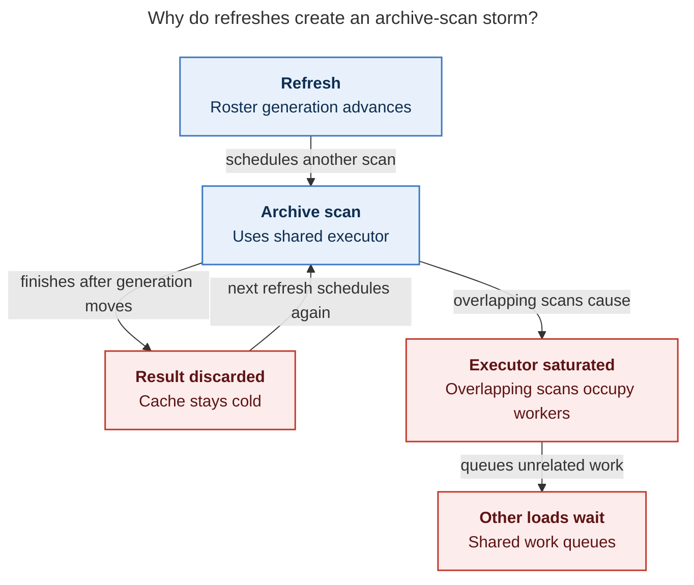
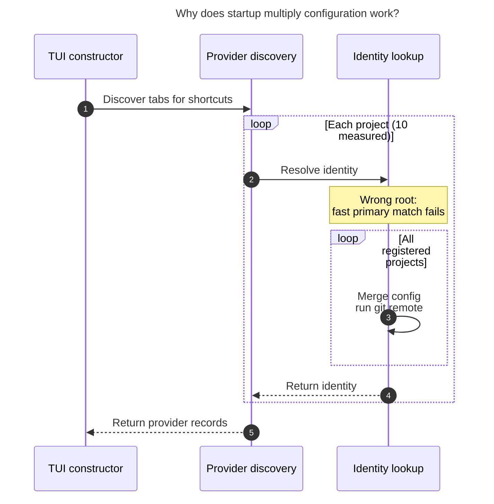
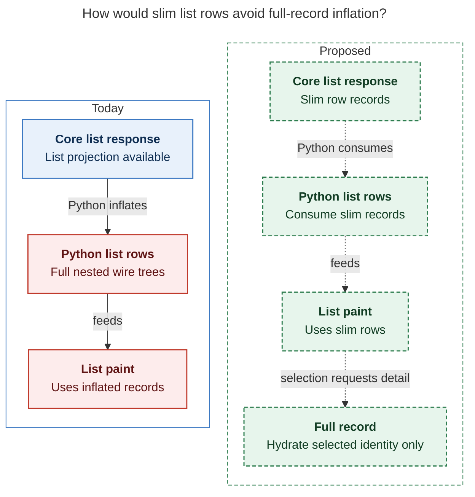

# Diagram proposals: SASE TUI Slowdown: Three Stacked Causes and a Staged Recovery Plan

Proposals for the swarm linker, not a report. Each diagram restates only what the source
report says.

```yaml
source: research:202611/tui_hijack_storm_trust_root_and_heap/tui_hijack_storm_trust_root_and_heap__final.md
producer: research.62.image
check: "mmdc 12.0.0 with the PDF-mirroring config rendered 3 of 3 Mermaid diagrams"
```

## archive-scan-storm

```yaml
anchor: |-
  Each refresh starts a new scan while old ones still run.
question: |-
  Why do archive scans keep piling up and delay unrelated loads?
illustrates: |-
  The roster-generation cache never converges, so refreshes overlap archive scans and queue other default-executor work.
caption: "Changing roster generations discard slow results; later refreshes keep launching scans, saturating the shared executor and delaying other loads."
review: "679.198x742 px, fit 96.1%; question, source and visual checks passed; 0 revisions"
```



## quadratic-trust-lookup

```yaml
anchor: |-
  defeats `_project_identity`'s fast primary match, so it scans **all** registered
question: |-
  Why does resolving each project's shortcuts multiply configuration work across every project?
illustrates: |-
  The wrong checkout root defeats the fast primary match, making each project trigger merges and git remotes across all registered projects.
caption: "A failed fast identity match turns each project's lookup into a scan of all projects, multiplying startup configuration work."
review: "785.5x743 px, fit 83.1%; question, source and visual checks passed; 1 sizing/source revision"
```



## slim-list-records

```yaml
anchor: |-
  nested `AgentArtifactRecordWire` trees (`_record_from_dict`) for list paint.
question: |-
  How would list records and full detail records differ after the proposed heap change?
illustrates: |-
  Python currently inflates full nested wire trees for list paint; the proposal consumes slim rows and hydrates full records only for the selected identity.
caption: "Proposed slim rows serve the list; only the selected identity gets a full record."
review: "616.266x673 px, fit 100.0%; question, source and visual checks passed; 1 visual revision to place Today before Proposed"
```


