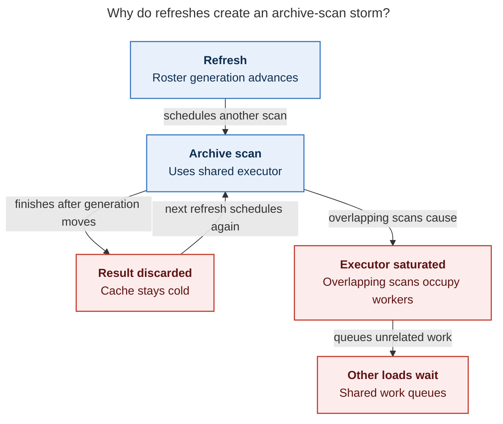
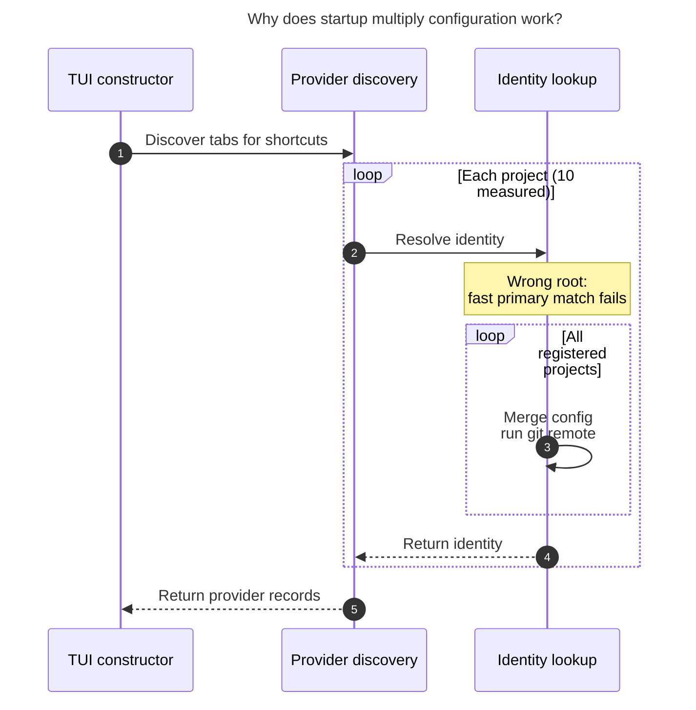
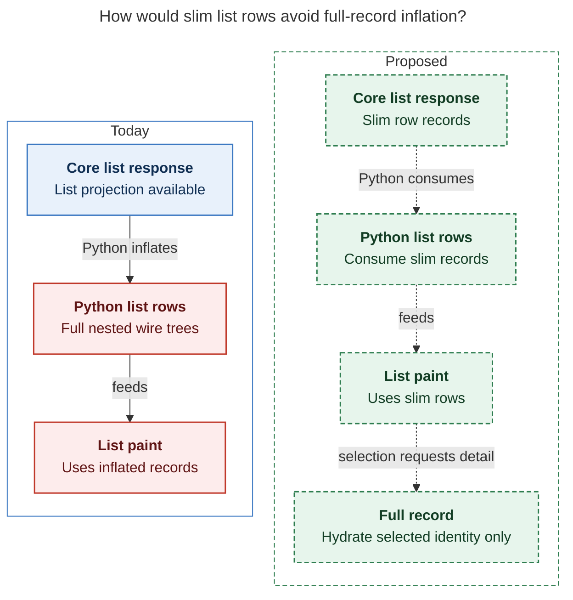

# SASE TUI Slowdown: Three Stacked Causes and a Staged Recovery Plan

> **Research query:** sase's TUI has slowed down quite a bit lately, including at startup. What is the best and safest way to optimize it and speed it up significantly, recommending extra instrumentation only if it is truly necessary to diagnose the TUI's performance, and ending with a recommended solution?

## Bottom line

The TUI did not slow down for one reason. Three separate problems are stacked, each
measured independently by multiple researchers, and each has a narrow fix. **No
rewrite, no new data model, and no new diagnostic instrumentation is needed** — the
existing telemetry (`tui_startup.jsonl`, `tui_stalls.jsonl`, `tui_agent_loads.jsonl`,
`tui_jk.jsonl`, `SASE_TUI_TRACE`, GC census, `tools/tui_freeze_report`, py-spy)
located every root cause below.

| # | Problem | Since | User-visible cost | Found by | Lead verification at HEAD |
|---|---|---|---|---|---|
| A | **[Hijack-decision storm](#the-hijack-decision-storm).** Every Agents footer/selection refresh schedules an unbounded background `find_named_agent` archive scan whose cache can never warm. | `d26b581253` (2026-11-16) | RSS 20–35 GB + up to 30 GB swap within minutes; 31/45 threads stuck; 26% of wall frozen; 50 s GC pauses; every other `to_thread` (incl. agent loads) queues behind it | cld, gem (py-spy + offline measurement); cdx and grk saw the 207k-wire census but attributed it less precisely | **Mechanism fully intact at `0731d06c5a`** (verified in source) |
| B | **[Trust/config root defect](#the-trust-root-defect) → O(projects²) construction.** `AceApp.__init__` resolves provider tabs for keybindings; a checkout-root discovery bug defeats the fast identity path, causing ~121 full config merges + ~100 `git remote` subprocesses | `021cd73021`/`ea4121387b` (2026-11-12) | `app_construct_seconds` 0.7–1.0 s → 5.2–6.3 s (every startup ~4.5 s slower); same path costs ~6 s on cold agent-identity discovery | cdx, cld, gem, mus (independent cProfiles agree; two independent patch experiments: 6.9 s → 1.9 s) | **Defect intact at HEAD**: the canonical-layout fallback in `_checkout_root_for_local_path` is unreachable |
| C | **[Chronic heap + per-load recompute](#chronic-heap-and-per-load-recompute).** Fat wire graphs, full-log in-memory caches, and uncached per-agent config/alias lookups grew with the archive; gen-2 GC pauses of ~3 s; warm 131–145-row loads take 2–5 s (pre-storm) | Gradual, Aug→Nov | 95% of ≥1.5 s hitches overlap full GC; `agents_ready` drifted ~5 s → ~11.6 s; j/k p95 ~400–500 ms vs 16 ms target | all five | Index facts verified; one grk claim **corrected** ([below](#lead-verification)) |

**Recommended solution (summary):** land fixes in order **A (hotfix today) → B
(memoization now, root-ownership repair with trust-key compat as a coordinated
follow-up) → C1 (loader memos) → startup deferrals → C2 (heap diet) → interaction
polish**, each gated by the existing telemetry. Projected effect of A+B+C1 alone:
wall time from `sase tui` to a usable Agents list returns from ~14 s to ~6–7 s, and
the acute memory/freeze catastrophe disappears. Details in
[the recommended solution](#recommended-solution).

## Lead verification

*What I independently confirmed or corrected.*

1. **The storm is still live at HEAD.** The two hijack commits after `8254254e2f`
   (`73718c77e1`, `0731d06c5a`) did not change the TUI decision cache.
   At `0731d06c5a`:
   - `_apply_agent_footer_update` (`_display_detail_footer.py:173-175`) calls
     `_schedule_hijack_decision(current_agent)` unconditionally — no
     `cheap_hijack_ingress_available` gate.
   - The cache key is `(identity, roster_generation)` and
     `_finish_hijack_decision` **drops the result** when the generation has moved
     (`_hijack_decision_cache.py`). Any compute slower than the refresh interval is
     never stored, so the cache never warms.
   - Work goes to the shared default executor via `asyncio.to_thread`, unbounded.
   - `find_named_agent` (`_lookup_named.py:102,214`) still runs a full
     `scan_agent_artifacts` (no index) and, on a miss, `rglob`s the dismissed
     bundles — **65,875 JSON files confirmed by direct count**.
   - The `deps` finder hook on `resolve_and_decide` exists
     (`_hijack_decision.py:143-150`), so the [row-local fix](#storm-hotfix) is
     available without touching the archive scanners.
2. **The trust-root defect is still live at HEAD.** In
   `local_trust_enforcement.py`, `_checkout_root_for_local_path` probes
   `local_path.parent` (`<repo>/sase`) and `discover_project_root` accepts any
   directory containing `sase.yml` as a root, so it returns `<repo>/sase`; the
   explicit canonical-layout grandparent fallback only runs when discovery returns
   `None` and is therefore dead code. This also produces a **live correctness bug**:
   acknowledgments and enforcement compute different trust keys, which is why every
   `sase` command in this very session printed
   `Local commands … were skipped (no-acknowledgment)` despite prior allows (cld
   §3.3; reproduced by cdx).
3. **Correction to grk's index-marker finding.** grk reported 17,604
   `status='running'` rows with `has_running_marker=0` and proposed making the live
   predicate marker-true. Direct SQLite queries today show the sharper fact:
   **`has_running_marker` is 0 for all 23,133 rows in the index** — the column is
   never populated at all (12,474 rows are currently `status='running' AND
   has_done_marker=0`). Flipping the Agents live predicate to require
   `has_running_marker=1` **would empty the inbox today**. The right repair is
   grk's other half: terminalize stale "running" rows in Rust index maintenance
   using a real witness (done marker on disk, PID liveness), and only adopt a
   marker-true predicate after the writer actually populates markers. Note the
   live roster is ~131 rows despite 12.5k stale "running" rows, so other filters
   already bound the Tier-1 roster; the stale rows mostly cost revalidate churn,
   index bloat, and any surface that queries running rows.
4. **Current live state.** The TUI was restarted again: PID 3156472, ~13 min
   uptime, RSS 2.8 GB and climbing; host swap back down to 7 GB (from 36–44 GB
   during the storm windows). Any build at or after `d26b581253` will storm again —
   the hotfix is urgent, and the running process is exposed right now.
5. **Coordination point confirmed.** The Agent Hijack epic `sase-1t2` is
   IN_PROGRESS (created 2026-11-15). The hotfix touches the same surfaces as its
   latch phases; coordinate there but do not let the hotfix wait for the epic.

## The hijack-decision storm

**Problem A** — acute, hotfix first.

### Storm mechanism

*cld + gem, converging evidence.* Every footer refresh, cursor move, selection
change, and roster delta calls `_schedule_hijack_decision`. The compute path is
`compute_hijack_decision → resolve_and_decide → resolve_hijack_subject →
find_named_agent`, which:

- runs an **unindexed** `scan_agent_artifacts` over every project's artifacts
  (measured standalone: 15.4–38 s, ~23.1k `AgentArtifactRecordWire`, +2.2 GB RSS
  per call), and
- on a miss, falls back to `json.load` over **65,875 dismissed bundles (591 MB)**.

Because the cache key embeds the global roster generation (bumped by every refresh)
and finished results are discarded once the generation moves, the cache never
converges. Each refresh starts a new scan while old ones still run. py-spy showed
**31 of 45 threads** in this stack across three samples; the default executor
(32 workers on this host) saturates, so **every other `asyncio.to_thread` user
queues behind it** — explaining 14–23 s "full loads" that took 2.1 s at startup in
the same process. [The archive-scan-storm diagram](#figure-archive-scan-storm) traces
the loop that keeps the roster-generation cache cold while overlapping scans fill the
shared executor and unrelated loads queue.

_Changing roster generations discard slow results; later refreshes keep launching scans, saturating the shared executor and delaying other loads._

Nine concurrent scans × ~23.1k wires = **207,963**, matching the live census's
207,837 `AgentArtifactRecordWire` almost exactly. This resolves the cross-report
disagreement: the acute 20–35 GB RSS is storm-held scan snapshots, not (as grk
inferred) nine retained copies of the inbox decode; grk's heap concerns are real but
belong to the *chronic* baseline ([problem C](#chronic-heap-and-per-load-recompute)).

### Storm hotfix

Hotfix-sized and TUI-local; cld's design, corroborated by gem.

1. Gate scheduling on `cheap_hijack_ingress_available(agent)` (the check already
   exists; it is consulted only after scheduling today).
2. Key the cache on stable row identity plus a small decision-relevant fingerprint
   (status, pid, workspace_num, artifacts_dir, `hijack_*` fields) — **not** the
   roster generation. Single-flight per row; store finished results if the row is
   still present even when the generation moved.
3. Bound concurrency to one dedicated worker with latest-wins semantics; never the
   default executor.
4. Pass a row-local `deps` finder into `resolve_and_decide` so the TUI resolves
   from the in-memory roster in O(1) and **never calls `find_named_agent`**. Keep
   the archive scan for the CLI's `--explain` path only.
5. Follow-up outside the TUI: back `find_named_agent` / `find_agent_session*` with
   indexed SQLite queries and give dismissed bundles an index instead of the
   65,875-file rglob (any CLI caller pays 17–38 s today).

**Verify:** py-spy shows ≤1 hijack thread; heartbeat RSS returns to the ~4 GB
pre-storm baseline; hitches within 30 s of a keypress return to the pre-restart
rate. Regression test: N refreshes against a slow fake decider leave at most one
decision in flight and never touch the default executor.

**Interim mitigation** until it lands: quit the TUI when not in use, or pin the
global install to `082f2bc705` (last steady build) — a human-only global-install
change that must go through a gate.

**Durable lesson** (for the `tui_perf` memory, via `/sase_memory_write`): off the
event loop is not off the default executor. Selection-driven computes must be
single-flight per row, keyed on stable identity, bounded to a dedicated worker, and
never O(archive).

## The trust-root defect

**Problem B** — the trust/config root defect makes construction O(projects²).

### Trust-root mechanism

*Four independent confirmations.* `AceApp.__init__ → init_late_startup_state →
build_app_bindings → resolve_artifacts_subtabs → load_project_provider_records`
synchronously resolves every project's merged config to generate numbered Artifacts
shortcuts. For each of the 10 projects, the wrong checkout root (`<repo>/sase`
instead of `<repo>`) defeats `_project_identity`'s fast primary match, so it scans **all** registered
projects, merging each one's config (Rust `axe_config_compose`) and shelling out to
`git remote` — ~121 merges and ~100 subprocesses inside the constructor.
[The quadratic-trust-lookup diagram](#figure-quadratic-trust-lookup) shows the
nesting: each project's failed fast identity match runs config merges and
`git remote` across every registered project.

_A failed fast identity match turns each project's lookup into a scan of all projects, multiplying startup configuration work._

Both cdx and cld independently patched the root in-process: construction fell from
**6.9 s to 1.9 s** (cdx: 121 → 21 merges). The same path burns ~6 s in cold
`AgentIdentitySnapshot.current()` during the agents `provider` load stage, so a
keybinding-only deferral would just move the cost (cdx's trap #2).

The telemetry change-point is exact: `671ff5bde0` (11-12 10:05 UTC) constructed in
1.03 s; `ea4121387b` (11-12 10:33 UTC) in 6.21 s, with the local-command trust
commits (`021cd73021`, `ea4121387b`) in between.

### Trust fix order

Resolving the cld-vs-cdx disagreement: the reports disagree only on sequencing, and
both halves should land:

1. **Now — semantics-preserving memoization (cld B1 + mus):** memoize the
   per-primary registry-membership scan inside `_project_identity`, keyed on
   registry `mtime_ns` + project-records token; memoize
   `_lower_macros_and_workflows` per config token; and (mus's structural find)
   reorder `load_merged_config` so the token-keyed merged-cache check runs
   **before** `local_config_snapshot()` (today a ~0.4 s YAML read + full trust
   evaluation runs even on cache hits). Zero trust-semantics change. Estimated
   construct: ~6.9 s → ~2.3 s. Test: count `merge_config_sources` calls during
   `AceApp()` with N fake projects and assert O(N), not a flaky time limit.
2. **Coordinated follow-up — root-ownership correctness (cdx stage 1 / cld B2):**
   fix `_checkout_root_for_local_path` (and the CLI's `_requested_checkout`, which
   shares `discover_project_root`) so enforcement and `sase config trust allow`
   compute the **same** identity, with a compatibility read of acknowledgments
   recorded under the old `checkout:v1:<repo>/sase` keys. This is a real
   correctness bug (workspace checkouts never inherit trust acks today — observed
   live), but changing identity keys silently invalidates prior acknowledgments,
   so it belongs with the trust owners (epic `sase-1sb`) and must not be bundled
   into the perf memo. Cover primaries, numbered workspaces, unregistered
   checkouts, symlinks, a repo literally named `sase`, and canonical/legacy
   ambiguity (cdx's test list). Shared identity/config behavior that changes
   belongs in `sase_core` per the Rust-core boundary, with the revision pin moved.

**Verify:** `app_construct_seconds` p50 drops from ~5.2 s to ≤2.5 s (memo) and
~1 s (root fix) in `tui_startup.jsonl`; cold `provider` substage in
`tui_agent_loads.jsonl` drops from ~6 s to <1 s.

## Chronic heap and per-load recompute

**Problem C** — the "it kept getting slower" trend.

Pre-storm steady state was already degraded: 3–5.6 GB RSS, 18–21M allocated blocks,
gen-2 GC p50 ~3.1 s, 95% of ≥1.5 s hitches overlapping a full collection (cld's
5.5 h window; grk's overnight "3 s hitch metronome"). The watchdog's blamed stacks
(clan runtime aggregation, CSS matching) are mostly **GC trip points, not the
cost** — do not optimize render paths first.

### C1 loader memos

Small, safe, continuous payoff.

Independent profiles (cld, mus, gem) of the same loader found repeated per-agent
recompute dominating the `decode` stage (which is enrichment, not JSON parsing —
cdx):

- `load_project_alias_map` resolved ~303–322× per load (~14k project records
  re-parsed); pure function of project records — memoize per load/token.
  ~44% of decode.
- `configured_held_claim_ttl_days()` → full `load_merged_config()` per retention
  agent (7 × 0.42 s per load) — hoist to once per load; fixed structurally by the
  [trust-path cache reorder](#trust-fix-order) as well.
- `enrich_agent_from_meta_wire` runs ~3× per agent; dedupe per unique agent and
  memoize `load_agent_workspace_retention` / `get_artifacts_dir` per batch.
- Instruction-bundle file lists (~268 calls/load) — compute lazily for the detail
  panel.

Predicted warm full load: ~5 s → ~1 s; background full loads cross the 2 s
slow-load threshold 354–1,381×/day, so this pays continuously, not just at startup.

### C2 heap diet

Medium; census-guided; the durable fix for long sessions.

Merge of grk's slim-inbox epic, gem's cache inventory, and cdx's retention
principles:

- **Slim list rows end-to-end.** sase-core already exposes
  `record_shape="list"` / `agents_list_projection`, but Python still inflates full
  nested `AgentArtifactRecordWire` trees (`_record_from_dict`) for list paint.
  Return/consume a slim DTO (identity, status, markers, names, timestamps,
  tribe/clan scalars); hydrate the full record only for the selected identity;
  drop wire snapshots after `Agent` construction. Core + binding + pin move in one
  change set.
- **Cap the snapshot cache at one live generation** (currently 8 fat copies).
- **Bound the full-log module caches** gem inventoried: `artifacts/index.jsonl`
  (46.9k `ArtifactFile`, ×2 in census), `artifact_reads.jsonl` (27k),
  `memory_reads.jsonl` (23k), `agent_bead_touches.json` (16k), stranded-report
  issue parses (8.5k) — replace whole-file Python materialization with targeted
  indexed/streamed queries (Rust-side where shared).
- **Terminalize stale index rows** in Rust maintenance (off the TUI, coalesced),
  per [the lead's index-marker correction](#lead-verification) — and only then
  consider a marker-true live predicate.
- **GC policy follows the heap, not the reverse.** Do not disable GC, raise
  thresholds further, or freeze harder while the graph is large (freeze pins
  leaks). Re-run the GC census **after** A lands (the only existing census was
  taken mid-storm and overstates wire records); this is exactly the open question
  of in-progress phase `sase-1sl.4`. cdx's caution stands: the census proves a
  large surviving graph, not a specific owner — identify owners (full-history
  reconciliation, pending-worker snapshots, catalogs, duplicate roster/detail
  representations) before invasive redesign.

[The slim-list-records diagram](#figure-slim-list-records) contrasts today's path,
where Python inflates full nested wire trees for list paint, with the proposed one
that hydrates a full record only for the selected identity.

_Proposed slim rows serve the list; only the selected identity gets a full record._

**Targets:** idle RSS < 1.5–2 GB after 30 min; `AgentArtifactRecordWire` survivors
O(visible rows); gen-2 pause p95 ≤ 0.5–1 s; allocated blocks < 8M; hitch share of
wall < 0.5%.

## Startup follow-ups

*After B lands.*

- **Defer provider-tab discovery past first paint** (all five recommend). Build
  fixed-tab bindings synchronously; publish provider descriptors as one coherent
  generation consumed by keymaps, Artifacts composition, help, command catalog,
  and navigation (cdx's traps: `ArtifactsView.__init__` also resolves subtabs even
  hidden; early digit shortcuts must resolve against the same generation; an empty
  cache entry must not read as authoritative discovery). B's
  [root fix](#trust-fix-order) removes most of the cost first, so this becomes
  protection against project-count growth rather than the main win.
- **Lazy-import the heavy action closure.** ~1.4 s of the ~2.1 s module import is
  `actions.agents._core` pulling `gate_turn` / `notification_gates` /
  `macro.models` eagerly (gem, cld, mus agree; import-budget phase `sase-1qn.2`
  exists). Fourth-order next to A/B; do it within the existing budget ratchet.
- **Move startup `monitor_reconcile` off the critical path** — 11–15 s with
  `settled: 0` (mus), 11.7 s on the GIL during startup decode (grk). Skip when the
  roster signature shows nothing to settle; defer past `visible_ready`; if a scan
  is needed, make it a bounded Rust index query.
- **Defer AXE full snapshots until the tab is visited** — startup currently runs
  `include_full_snapshots=True` across 63 chops (~1,349 file reads, ~4.1 s; gem).
  Separately, idle `axe.collect` ticks cost 2–3 s CPU with zero file opens (mus):
  cache `load_axe_config` and skip orchestrator probes on token-stable ticks.

Startup telemetry caution (cdx): the JSONL fields use different anchors
(legacy init stamp vs `on_mount`); do not sum them. Real wall from typing
`sase tui` to a usable Agents list is ~14 s today vs ~7 s in mid-October (cld).

## Interaction-latency pass

*Last; re-measure after the heap shrinks.*

grk's framing governs: **a 16 ms key-to-paint budget cannot be won on a 4–35 GB
process.** After A/B/C land, re-measure with `SASE_TUI_PERF=1` and then:

- Detail-header lanes (`build_detail_header_summary`, p50 0.5–1.25 s, p95 up to
  18.6 s): resolve `artifact_reads` / `memory_reads` / `agent_page_url` /
  `skill_uses` off the pump with per-agent mtime-keyed caches; paint chrome
  immediately, fill lanes as they land; skip unchanged content via stable content
  identity before building/hashing a large renderable (cdx).
- `,j` (p95 ~1.5 s) must stay on highlight + debounced detail, not a full refresh.
- `aggregate_clan_runtime` on timer ticks: compute only changed/visible durations
  or batch in Rust; preserve interval-union semantics (cdx).
- Delta-load `prep` copies the whole agent graph for 2–8 changed rows
  (`copy_agent_graph`, 2.3–2.9 s; gem): targeted per-row copy-on-write.
- `bead_confirmation_warmup` (141–161 s under contention; gem): bound to
  visible/WAITING rows, lazy stranded sweeps.
- Close `sase-uv.1` (static accent/icon tables so the j/k keypath cannot fork git).

## Recommended solution

**Surgical, staged fixes on the measured hot paths — explicitly not a
re-architecture, not a Ratatui/Rust rewrite, not more worker threads, not GC
tuning, and not archive deletion** (all five reports independently rejected these;
prior research 202605–202610 already rejected most of them once).

| Stage | Change | Expected effect | Verify with |
|---|---|---|---|
| **1 (today)** | [Hijack-storm hotfix](#storm-hotfix): cheap-gate, identity-fingerprint cache key, single-flight, dedicated bounded worker, row-local `deps` finder | RSS back to ~4 GB baseline; executor free; 50 s pauses gone; loads stop queueing | py-spy, memory heartbeat, `tui_stalls.jsonl` |
| **2 (this week)** | Trust-path memoization + merged-cache reorder ([trust fix step 1](#trust-fix-order)); file root-ownership fix with compat keys to trust owners ([trust fix step 2](#trust-fix-order)) | `app_construct` ~5.2 s → ≤2.5 s (→ ~1 s with root fix); cold provider stage ~6 s → <1 s | `tui_startup.jsonl`, O(N) merge-count test |
| **3** | Loader memos [C1](#c1-loader-memos): alias map, TTL hoist, enrichment dedupe, lazy bundle lists | Warm full load ~5 s → ~1 s; `agents_ready` ~11.6 s → ~5–6 s | `tui_agent_loads.jsonl` substages, tiering bench + oracle |
| **4** | [Startup deferrals](#startup-follow-ups): provider discovery post-paint as one generation; lazy imports; monitor_reconcile and AXE snapshots off the critical path | process→on_mount < 3 s (p95); `axe_ready` −3–4 s; resilience to project growth | `tui_startup.jsonl`, `SASE_TUI_TRACE` spans |
| **5** | Heap diet [C2](#c2-heap-diet) with `sase-1sl.4`: slim list DTO (sase-core + TUI), one-generation snapshot cache, bounded log caches, stale-row terminalization; **post-storm census first** | Idle RSS < 1.5–2 GB; gen-2 p95 ≤ 0.5–1 s; long sessions stop degrading | fresh GC census at 10 min/2 h, freeze report soak |
| **6** | [Interaction pass](#interaction-latency-pass) | j/k p95 toward 16 ms; detail selection < 100 ms | `tui_jk.jsonl`, trace lanes |

Projected outcome once stages 1–3 land: `sase tui` to a usable Agents list returns
from ~14 s to roughly **6–7 s**, and the acute memory/freeze catastrophe
disappears; stage 5 is what makes long sessions stay fast.

### Instrumentation

**One guardrail only.** No new diagnostic infra — existing telemetry attributed
everything here. Add a **default-executor saturation gauge** (busy workers, queue
depth, oldest queued age) to the existing `tui_memory_heartbeat`: problem A ran for
an hour with nothing in the logs naming it, and this one dict per heartbeat would
have named it in minutes (cld, gem independently). Trace-only substage spans are a
contingency *only if* `prep`/`decode` still exceed ~200 ms after stages 1–3.
Operational hygiene now: **unset `SASE_TUI_GC_CENSUS` on the live TUI** (the census
itself is an 11.5 s UI-thread walk of 8.1M objects), extend `tui_stalls.jsonl`
retention (~6 h today lost the Nov 11 spike), and rotate the stale 585 MB
`tui_trace.jsonl`.

### Safety constraints for the implementer

Keep the `tui_perf` contract (pump-free tasks, last-request-wins, nav gates,
incremental `patch_row`, no disk on keystroke, no O(archive) before ready); shared
backend behavior (slim DTO, index maintenance, identity resolution changes) goes to
`sase-core` with the revision pin moved; A/B measurements belong on a quiet host via
the existing benches, not wall-clock deltas on a loaded box; match the tested
Textual/core environment to the real TUI (cdx found a workspace-venv/installed
mismatch); global reinstall and the interim pin are human-only gate decisions;
coordinate with in-flight epics `sase-1t2` (hijack — confirmed IN_PROGRESS),
`sase-1sb` (trust), `sase-1sl.4` (leak attribution), `sase-1qn.2` (import budget);
and re-measure between stages — several costs (decode 2 s → 22 s, delta prep, 141 s
warmups) are storm- or heap-amplified and must be re-attributed after stages 1–2.

### Next step

No task beads were filed by the swarm (cld deferred to the lead; the findings are
this report, and the work items should be created once from whichever plan is
adopted). The stage-1 hotfix should be planned immediately: the currently running
TUI is on a storm-capable build.

## How this report was produced

**Consolidated report.** Lead researcher synthesis of five independent swarm reports
(`__cdx`, `__cld`, `__grk`, `__mus`, `__gem`, siblings in this directory) plus the
lead's own verification pass. Date: 2026-11-16. Host: athena (64 CPUs, 62 GB RAM).
Lead verification ran against workspace checkout `0731d06c5a` (master HEAD, two
commits past the `8254254e2f` snapshot most researchers inspected).

## Appendix: report-by-report contribution map

| Report | Distinct contributions | Consolidation notes |
|---|---|---|
| `__cld` | py-spy storm attribution; before/after stall windows; trust change-point and B1/B2 fix split; alias-map memo (C1); executor-saturation gauge; trust-key correctness flag | Adopted nearly whole; its fix order anchors [the recommended solution](#recommended-solution) |
| `__gem` | Storm arithmetic (9 × 23.1k = census); full-log cache inventory; AXE snapshot deferral; import breakdown; delta-prep `copy_agent_graph`; bead-warmup storms; `gc.freeze` timing critique | Adopted; its RSS floor estimates treated as aspirational, not gates |
| `__cdx` | Ownership-defect root-cause repro + 68% constructor experiment; anchor semantics of startup telemetry; owner-discovery shares the trust path (deferral trap); census-proves-graph-not-owner caution; staged acceptance criteria | Adopted; its "fix ownership first" merged with cld's memo-first into [the two-step trust fix order](#trust-fix-order) |
| `__grk` | Chronic-heap framing (slim DTO, one-generation cache, marker-true liveness, decode death-spiral 2 s → 22 s); "16 ms is unwinnable on a huge heap"; census-env and trace-file hygiene; prior-research guardrails | Adopted for [C2](#c2-heap-diet) and the [interaction pass](#interaction-latency-pass); its acute-RSS attribution superseded by the storm evidence; its live-predicate flip corrected ([lead verification](#lead-verification), item 3) |
| `__mus` | `local_config_snapshot`-before-cache structural defect; TTL-config per-agent recompute; `monitor_reconcile` settles-nothing; idle `axe.collect` CPU with zero file opens; detail-header lane plan | Adopted for [trust fix step 1](#trust-fix-order), [problem C](#chronic-heap-and-per-load-recompute), [startup follow-ups](#startup-follow-ups), and the [interaction pass](#interaction-latency-pass) |
