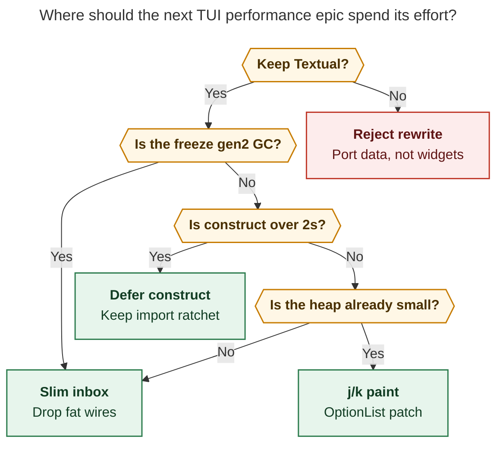
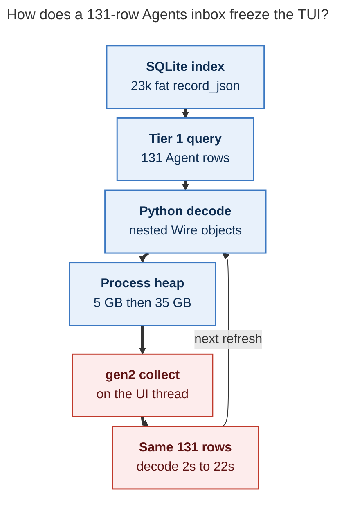

# Shrink the Agents inbox heap; do not add more TUI machinery

- **Researcher:** grk (`research.62.grk`)
- **Date:** 2026-11-16
- **Question:** The TUI has slowed down quite a bit lately, including startup. What is the best and safest way to speed it up? Extra instrumentation only if truly necessary.
- **Inspected:** `tui.md` / `tui_perf.md`; live `sase tui` PID 2180945 (global 0.19.0, rev `8254254e`); `~/.sase/logs/tui_stalls.jsonl` plus rotation; `tui_jk.jsonl`; `tui_startup.jsonl`; `tui_agent_loads.jsonl`; tail of 585 MB `tui_trace.jsonl`; `~/.sase/agent_artifact_index.sqlite`; TUI startup/refresh/GC/loader code; sase-core list-projection query; prior research `202610/tui_freeze_gc_heap_bloat`, `202610/tui_slowdown_index_lock_fallback_scans`, `202605/rust_tui_plugin_migration`. Independent of the other four swarm reports.

## Recommended solution

Ship **one TUI-plus-core epic whose job is to stop retaining archive-scale Python objects**, then re-measure j/k and startup with the instrumentation that already exists. Do not add a new logger, a new daemon, a Ratatui rewrite, or more Python workers.

Three mechanical rules:

1. **Live inbox rows are marker-true.** The index currently stores 17,604 `status='running'` rows with `has_running_marker=0`. Active SQL still selects `has_done_marker = 0`. Repair those rows in Rust maintenance, off the TUI. The Agents list query must use the same live predicate the loader already uses for *priority* (`has_running_marker`, `has_waiting_marker`, pending question, non-terminal workflow).
2. **Python never holds the list as fat `AgentArtifactRecordWire` graphs.** sase-core already exposes `record_shape="list"` and `agents_list_projection=True`. The Python conversion still builds nested metas, session turns, monitors, and paths. Return a slim list DTO; hydrate a full record only for the selected identity; drop the wire snapshot after `Agent` is built. Cap the snapshot cache at **one live generation**, not eight fat copies.
3. **GC policy and j/k paint are follow-ups.** After the heap is small, the idle-GC policy already in `gc_policy.py` can meet the October targets. A 16 ms key-to-paint budget cannot be won on a 4–35 GB process. Do not raise `threshold2`, run `gc.get_objects()` on the UI thread, or collect on a worker as the product fix.

Startup is a **separate, smaller follow-up**: process→mount is ~6.3 s (`app_construct_seconds` ~5.2 s). First paint after mount is 0.22 s. Keep the first-party import-budget ratchet. Profile construct with the existing startup clocks before composing hidden tabs later.

**No extra production instrumentation.** Unset `SASE_TUI_GC_CENSUS` on the live TUI (it just spent 11.5 s on the UI thread walking 8.1 million objects). After the heap epic, take one short `SASE_TUI_TRACE=1` session, then rotate the stale 585 MB `tui_trace.jsonl`.

---

## Verdict

The TUI is slow because the **process heap is huge and gen2 GC runs on the UI thread**, and because **decode of a 131-row inbox gets slower as that heap grows**. Startup feels slow because **AceApp construct takes five seconds** before Textual ever paints. The archive scan, axe collect, and j/k model mutation are not the live freeze.

The live session is already past the October GC epic's failure mode: overnight it was a 3–4 s hitch metronome at ~4 GB RSS; after the 11:04 UTC restart it became a 50 s freeze on a 35 GB working set. Host swap amplifies that. The TUI is the largest RSS process on the box.

This is the same class of bug the June–October research corpus already named (inbox vs archive, fat `record_json`, GIL-held decode, GC on any thread). The 0.19.0 tree already has the *control-plane* fixes (pump-free ticks, lock-busy cache, idle GC policy, list projection flags). The *data* still arrives as a fat Python graph.

**Caption.** Keep Textual. If the freeze is gen2 GC — and on the live session it is — slim the inbox. Defer construct and chase j/k paint only after the heap is small. Rendered 608×934 px; fit 95.6%.

---

## 1. What the live session actually shows

Captured 2026-11-16 ~11:24–11:35 UTC on athena. The running TUI is the **global install** (`/home/bryan/.local/bin/sase tui`), sase **0.19.0**, source revision `8254254e2f61726db20f2313ce4f8afb9b7e4300` (master as of this morning). It already contains the busy-index-lock cache (`b585d3b`) and the Agents-tick trim (`b09d069`). Restarting onto this checkout is not the missing fix.

Host: 64 CPUs, load 12–15, CPU idle 72–81%, **43.9 Gi swap in use**, paging in. Memory-bound, not CPU-bound.

### Process

| Signal | Live PID 2180945 (~21–27 min up) |
| --- | --- |
| RSS + swap | **18 GB + 30 GB ≈ 48 GB footprint** (peak RSS 35 GB at 5.4 min) |
| CPU | 1.2–1.35 cores |
| Threads | 45 |
| Major faults | 370k in 21 min |
| Env | `SASE_TUI_PERF=1`, `SASE_TUI_GC_CENSUS=1`, **TRACE unset** |
| Rank | Largest RSS process on the box |

Overnight PID 88182 (12.5 h): RSS **4.2 GB**, hitch p50 3.3 s / p95 4.0 s, almost stall-free. After the 10:54–11:04 restart cascade, RSS went **5.2 GB → 35 GB in 5.4 minutes**, then the kernel pushed ~30 GB to swap.

### Stall watchdog (today only; files rotate)

Combined coverage is ~6 hours today, not a week.

| Event | Last 55 min (current file) | Overnight rotation |
| --- | ---: | ---: |
| `tui_hitch` | **65 (70/h)**, p50 3.47 s, p95 11.8 s, max 48.5 s | 192, p50 3.3 s, p95 4.0 s |
| `tui_stall` | **14 (15/h)** | 1 |
| recovered max | **51.5 s** with `gc_overlap_s=50.7` | 7.6 s |
| tab | **agents 90/90** | **agents 192/192** |
| idle key age ≥30 s | 51/90 | last_action `h` ×189 |

The 48.5 s stall's matching `tui_gc_pause` is a **gen2 backstop of 50.6 s** on MainThread, 1.2 million objects collected, **285,088 major faults**. That is swap-amplified GC, not an await stuck in SQLite.

Main-thread leaves on stall-like rows: `gc.collect()` / GC census walking 8.1M objects, `rust_aggregate` / `aggregate_clan_runtime`, Textual CSS/reactive, a few `path.stat()` / `is_dir()` hits. Pump stalls show `asyncio.to_thread` notification reads plus worker `json.load` / `scandir` while the pump is in CSS.

### GC census (harmful on this process)

One `tui_gc_census` at 11:06 UTC, **`census_duration_s=11.453`**, `survivor_count=8,125,371`:

| Type | Count |
| --- | ---: |
| `builtins.list` | 3,961,252 |
| `builtins.dict` | 2,362,039 |
| `pathlib.PosixPath` | 402,220 |
| `AgentArtifactRecordWire` | **207,837** |
| `AgentMetaWire` | 207,522 |
| `ArtifactFile` | 93,824 |
| `AgentSessionTurnWire` | 87,111 |
| `textual.cache.FIFOCache` | 63,108 |

The inbox loaded **131 `Agent` rows**. The process retained **~1,600 wire records per visible agent**, or about **nine copies of the 23,265-row index**. `SASE_TUI_GC_CENSUS=1` is opt-in diagnostics; on CPython 3.14 it still walks survivors **on the UI thread**. It is not a product feature and it made this session worse.

### Key-to-paint

16 ms p95 target from `tui_perf.md`. Dated `tui_jk.jsonl` is thin for the last week (n=7 live samples); the all-time file is still the right order of magnitude.

| Tab | n | p50 ms | p95 ms | vs 16 ms |
| --- | ---: | ---: | ---: | --- |
| agents | 2576 | 19.7 | **501** | 31× |
| command_line | 437 | 29.4 | 148 | 9× |
| artifacts | 119 | 50.3 | 79 | 5× |
| axe | 38 | 9.1 | **14.1** | meets target |

`,j`/`,J` p95 **1.57 s**. Live-session paints: `prompt_space` 157–191 ms, `,u` 214 ms. Model time on `next`/`prev` is sub-millisecond; **paint and GC** miss the budget. Axe-tab paint is already fine.

### Startup clocks (not the 50 s freeze)

Live PID 2180945, initial tab `agents`, Tier 1:

| Stamp | Seconds |
| --- | ---: |
| interpreter → CLI import | 0.20 |
| AceApp import | 1.68 |
| **app construct** | **5.22** |
| compose | 0.009 |
| process start → on_mount | **6.25** |
| on_mount → first paint | **0.22** |
| visible_ready | 5.36 |
| agents_ready | 11.62 |
| axe_ready | 13.43 |

Last-7d p95 `agents_ready` is **41 s** when `index_row_count ≈ 18,935`. Today's starts report `index_row_count=300` and ~12 s agents-ready. The 50 s event is **ten minutes after start**, during backstop GC.

### Loader substages: the death spiral

`tui_agent_loads.jsonl` for PID 2180945 (14 slow loads, **all `complete_history=false`, all Tier 1**, 131–143 agents):

| Time UTC | source | decode s | disk s |
| --- | --- | ---: | ---: |
| 11:04:07 | startup | **2.14** | 3.91 |
| 11:04:19 | monitor_reconcile | — | **11.70** (settle pass) |
| 11:04:31 | roster_completion_retry | **6.88** | 7.63 |
| 11:04:51 | auto_refresh | **16.82** | 17.53 |
| 11:05:15 | tier1_index_revalidate | **22.29** | 23.38 |
| 11:06:26 | launch | 14.75 | 15.95 |

The Rust index read stays 0.24–0.70 s. **Python decode of the same 131-row inbox goes 2 s → 22 s as RSS climbs.** That is GC and paging, not a bigger query.

**Caption.** Tier 1 still decodes fat nested wires into a multi-gigabyte heap, so gen2 GC on the UI thread turns the same 131-row decode from 2 s into 22 s. Rendered 465×702 px; fit 100%.

### The index the TUI is sitting on

`~/.sase/agent_artifact_index.sqlite` is **375 MB**. `record_json` is **231 MB** of that (avg 9.9 KB, max 681 KB).

| Table / slice | Rows |
| --- | ---: |
| `agent_artifacts` | 23,265 |
| `dismissed_agents` | 88,790 |
| `status='running'` | **17,604** |
| running with `has_running_marker=1` | **0** |
| running with `has_done_marker=1` | 4 |
| `status='waiting'` | 931 |
| `status='completed'` | 3,772 |

sase-core's **priority** SQL already prefers real markers. The **active WHERE** still treats `has_done_marker = 0` as live. Those 17,604 marker-less "running" rows are the June 2026 R1 bug in costume: stopped without `done.json` looks active. The list projection then keeps 131 `Agent` objects, but the Python side still inflates nested wire graphs and paths.

---

## 2. The architecture is already the right one

`tui_perf.md` is still the contract. The 0.19.0 tree follows it on the control plane:

- First paint is `on_mount` → `call_after_refresh(_start_post_mount_background_loads)`. No archive scan in `on_mount`.
- Visible surface only until `visible_ready` (45 s fallback still exists).
- Tier 1: `TIER1_ACTIVE_LIMIT=1000`, `TIER1_VISIBLE_COMPLETED_LIMIT=2000`, source-scan cap 200. Query sets `agents_list_projection=True` and `record_shape="list"`.
- Auto-refresh is a thin sync timer that spawns a pump-free task. Broad Agents loads are tab-gated; exact artifact-delta stays live off-tab. Axe idle collect is header-only (`file_opens=0` in the trace tail).
- After first load, `_load_agents_async` passes `allow_lock_busy_source_scan=False`. Busy lock serves cache or keeps the roster (`b585d3b`).
- Incremental `patch_row` exists; full OptionList rebuild is the fallback.
- Idle GC policy: one `gc.freeze()` after startup, raised `threshold2`, idle/backstop collects, duty-cycle delay.
- Instrumentation: stall watchdog, `tui_startup.jsonl`, `tui_jk.jsonl`, `tui_trace.jsonl`, `tui_agent_loads.jsonl`, `tools/tui_freeze_report`, import-budget ratchet, load-tiering bench, idle-host recipe in `docs/contribute/perf-runbook.md`.

What still violates the *spirit* of the inbox contract:

- Python decode of `record_json` into full `AgentArtifactRecordWire` trees for list paint (`agent_scan_wire_conversion._record_from_dict`).
- `ARTIFACT_SNAPSHOT_CACHE` keeps **8** snapshots. Eight fat copies of nested wires is an 8× multiplier on an already-large graph.
- `DirectAgentsDataProvider.load_agents` still **defaults** `allow_lock_busy_source_scan=True`. The TUI loader overrides it after first load; other callers may not.
- `monitor_reconcile` is pump-free (`asyncio.to_thread(reconcile_dead_supervisors)`) and still **11.7 s on the GIL** during startup, which starves the overlapping decode.
- Historical trace tail (not this session; TRACE is off): `widget.prompt_panel.build_detail_header_summary` p95 **10.5 s**, `agents.bead_confirmation_warmup` max **161 s**, `axe.collect` p50 ~2 s with `file_opens=0`. Header-summary per-lane TTL (sase-l6.3) is in tree; the 10.5 s p95 is why heap-first still matters.
- Open keypath: `bench_tui_jk_keypath.py` still expects a git-fork on provider-discovery cache miss (sase-uv.1). Off-loop forks are allowed; loop-thread forks are not.

---

## 3. What prior research still says

Valid today:

- **j/k model is not the bottleneck.** Paint, GIL, GC, and detail settle are (`202606/tui_performance_log_research`, every later note).
- **Agents is an inbox, never an archive scan** (`202605/agents_tab_full_refresh_elimination`, `202610/tui_slowdown_index_lock_fallback_scans`).
- **`to_thread` is not off the GIL.** Extra Python workers make stalls worse (`202608/ace_refresh_loop_and_link_rail_regression`).
- **Moving more work to workers cannot fix GC** (`202610/tui_freeze_gc_heap_bloat`). Restart is an 18-minute bandage.
- **Do not rewrite the TUI in Ratatui** (`202605/rust_tui_plugin_migration`). Port *data* into sase-core.
- **Do not wrap chrome in procs** (`202609/unread_ack_reliability_and_tui_responsiveness`).
- **Do not add logging inside hitches.** Watchdog stack dumps and `gc.callbacks` I/O extend freezes.
- **Lock-busy must not source-scan.** Landed in 0.19.0 for the TUI loader's post-first-load path; keep the default False.

Historical (do not re-solve):

- Tools-panel mtime walks, unconditional startup Tier 2, kill-path notification I/O as the top item, "move all loading to Rust" as the first patch.

October's GC epic (`sase-1f3` / `tui_gc_fixed_capture`) **installed the idle policy and failed acceptance**. October 30 then showed a load regression (stranded collector → lock busy → source scan) that made GC look broken. That scan fallback is fixed in this binary. The live session still fails the GC targets **without** a source scan: 131-row Tier 1 decode plus retained wires is enough.

---

## 4. Alternatives and why they are unsafe

| Approach | Why it loses |
| --- | --- |
| Rewrite the TUI in Ratatui / a Rust widget tree | Plugin discovery, Textual CSS, visual snapshots, and every mixin are the product. 202605 already rejected this as a perf plan. Port list DTOs, not widgets. |
| Add more `SASE_TUI_*` JSONL / spans on j/k | The freeze is already named (`tui_gc_pause`, decode substages, census types). New always-on loggers contend for the GIL. TRACE file is already 585 MB and stale. |
| Wrap refreshes, acks, or decode in durable procs | ~1 s floor, Procs-tab spam, `reload_on_complete` rebuilds. Rule 3 is for launch/kill/Patch, not paint. |
| More Python worker threads | GIL + gen2 STW on *any* thread. The 50 s pause can land on `asyncio_16` or MainThread; both freeze input. |
| Disable GC / collect on a worker / raise `threshold2` further | Rejected in `tui_slowdown_index_lock_fallback_scans`. The policy is already raised to 10,000. The heap is the input. |
| `gc.freeze()` harder while the leak remains | Freeze pins the leaked graph forever. Freeze after the working set is small. |
| Delete artifacts / shrink the archive as a "fix" | 202608 `ace_startup_critical_path` already forbade this. Retention is a separate ops epic. |
| Just restart more often | Overnight 4 GB was already a 3 s hitch metronome. Restart today *caused* the 35 GB blow-up. |
| Chase 16 ms j/k paint first | OptionList work is real, and `,j` is a pig, but compositor time is dominated by walking a huge DOM/heap. Measure paint after RSS is bounded. |
| Extra always-on census | `SASE_TUI_GC_CENSUS=1` is an 11.5 s UI-thread hitch on this host. Keep it opt-in, off by default, and never on MainThread if it stays. |

---

## 5. The epic, in landing order

Work the sase-core list DTO and the Python drop-wires path **in the same change set**. A binding that sase calls also needs `sase-core-revision.txt` moved past the core commit.

### P0 — live predicate + slim list (the epic)

**sase-core**

- Active inbox SQL matches marker-true liveness. `status='running' AND has_running_marker=0` is not live. Terminalize those rows in index maintenance (off TUI, coalesced, last-request-wins). Do not LIKE-scan `record_json` on the apply path (the June 2026 freeze).
- List query returns a **slim row** (identity, status, markers, names, timestamps, tribe/clan scalars). No nested session turns, no `ArtifactFile` lists, no 10 KB `record_json` blob. Full shape stays for `hydrate(selected_id)` and for CLI scanners.
- Keep `agents_list_projection` skip-before-JSON. Prove with a core test that a 23k-row index with 17k marker-less "running" rows returns ≤ the active/completed caps of *slim* rows.

**sase TUI**

- Convert slim rows → `Agent` without going through `_record_from_dict` for the list.
- After apply, drop the `AgentArtifactScanWire` / wire list. `ARTIFACT_SNAPSHOT_CACHE` holds one generation of slim rows (or the load-state metadata only).
- Default `allow_lock_busy_source_scan=False` in `DirectAgentsDataProvider` and `query_artifact_index_for_loader`. First paint already has a 200-row bounded fallback when there is no cache; do not widen it.
- `monitor_reconcile` must not be on the startup-ready critical path and must not decode the archive. If dead-supervisor settle needs a scan, it is a Rust index query with a live-PID predicate, bounded, cached.

**Acceptance (athena, this archive, Agents tab, no GC census):**

| Signal | Gate |
| --- | --- |
| Idle RSS after 30 min | **< 1.5 GB** (today 4 GB overnight, 18–35 GB post-restart) |
| `AgentArtifactRecordWire` survivors | **O(visible rows)**, not O(index) × copies |
| 131-row decode substage | **p95 < 200 ms** (today 2–22 s) |
| Idle gen2 `tui_gc_pause` p95 | **≤ 0.5 s** (October target; today 3.3–50 s) |
| Hitch share of wall | **< 0.5%** |
| `tui_hitch` / 30 min idle | **~0** (idle-host diet) |
| Source scans on ordinary refresh | **0** |

Use existing files: `tui_stalls.jsonl`, `tui_agent_loads.jsonl`, `tui_startup.jsonl`, one bounded TRACE session, `just bench-agent-load-tiering`. `tools/tui_freeze_report` for the before/after join. Do not add a new JSONL.

### P1 — startup construct (follow-up, after P0)

`app_construct_seconds` ~5.2 s is the process→mount cliff. First paint after mount is already 0.22 s. Hidden tabs are still **composed** before paint (`_app_layout.py`). Measure with `sase tui --profile` and `tui_startup.jsonl` *after* P0 (construct on a 5 GB heap is not the same work). Candidates: compose the visible tab only; keep dismissed-index sync and prompt-catalog warm where they already are (post-visible-ready). Do not raise the import-budget cap.

Gate: process→on_mount p95 < 3 s on this host, agents_ready p95 < 8 s with the current ~300-row window (today 11.6 s, dominated by decode + monitor reconcile).

### P2 — j/k paint and residue (follow-up, after the heap is small)

- Re-run `SASE_TUI_PERF=1` j/k. Target p95 < 16 ms on Agents, command_line, artifacts. Axe already meets it.
- `,j` must stay on the highlight + debounced-detail path (202609 unread report). Historical `,j` p95 1.57 s is a full-refresh smell.
- Close sase-uv.1: static accent/icon tables so the keypath cannot fork git.
- Header-summary lanes stay off the pump; if TRACE still shows multi-second `build_detail_header_summary`, that is a P2 bug, not a reason to reopen P0.
- Optional: move GC survivor census off the UI thread or delete it from the live default env.

---

## 6. Extra instrumentation

**Not necessary to diagnose this.** The stall watchdog, loader substages, startup clocks, JK log, and one census already name the freeze.

Ops only (no code):

1. Unset `SASE_TUI_GC_CENSUS` on the live TUI. Restart once after P0, not as a habit.
2. After P0, one 10-minute `SASE_TUI_TRACE=1` session. Confirm `refresh.auto_tick` reloads no surfaces when idle and `axe.collect` `file_opens=0`. Then turn TRACE off. Rotate/delete `~/.sase/perf/tui_trace.jsonl` (585 MB, last written yesterday, not this session).
3. Keep `SASE_TUI_PERF=1` until Agents p95 is under 16 ms; it is cheap compared to TRACE.

Add a new span only if py-spy attributes time to a **named** path with no `tui_trace` today. Do not span the j/k highlight path.

---

## 7. Safety constraints for whoever implements this

- `tui_perf.md` rules 1–2, 5–11, 14–15 stay. Pump-free tasks, last-request-wins, nav-gate, incremental `patch_row`, no disk on keystroke, no O(archive) before the startup stopwatch ends.
- Shared list-row behavior belongs in **sase-core** (Rust core backend boundary). Python glue converts slim DTOs and paints. Do not reimplement SQL in the TUI.
- No feature flag for the live-predicate fix; marker-less "running" is a correctness bug on the default Agents tab. Slim DTO is additive (`record_shape=list` already exists); do not break full-shape CLI scanners.
- Do not delete user artifacts. Index maintenance terminalizes *status*, it does not unlink directories.
- Visual snapshots: `just fix-tui-screenshots` only if Agents row chrome changes; `just check` does not run PNG goldens.
- Global install is human-only. The live TUI will keep the imported 0.19.0 snapshot until a human restarts it onto the landed revision (`stale_running_code.py`).

---

## Recommended solution

Make the Agents inbox a **slim, marker-true, O(visible) Python graph**, in sase-core plus the TUI loader, measured with the JSONL that already exists.

Do that before touching j/k paint, startup widget composition, GC thresholds, or a rewrite. The live 50 s freeze is gen2 GC on a heap the inbox should never have built; the live 12 s "startup" is 5 s construct plus a 2–22 s decode of 131 fat rows. Both shrink when the wires go away.
