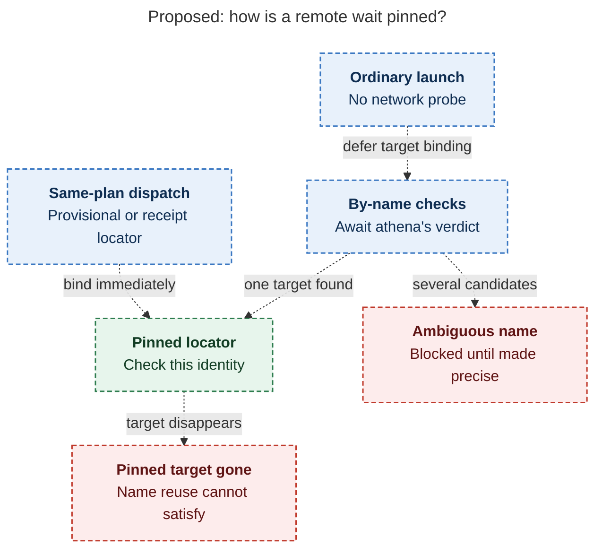
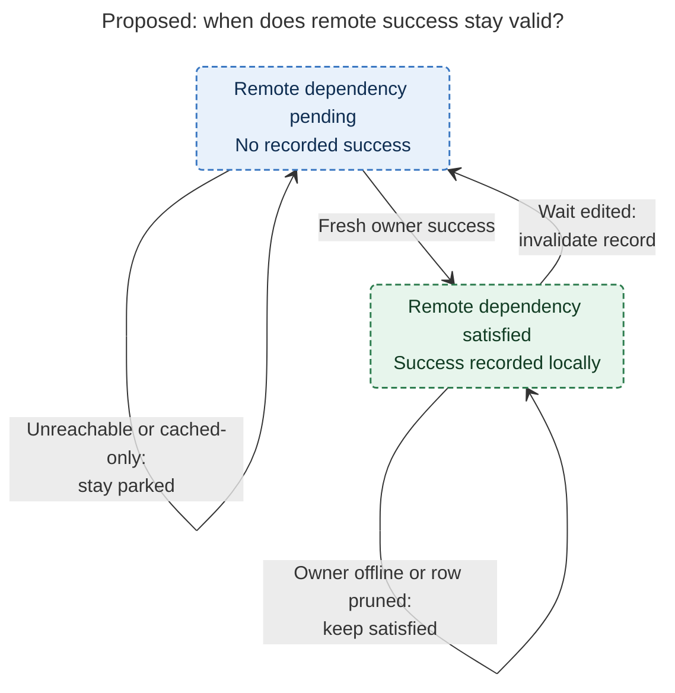

# Diagram proposals: Waiting on Agents That Run on Other Machines

Proposals for the swarm linker, not a report. Each diagram restates only what the source
report says.

```yaml
source: research:202611/waiting_on_remote_machine_agents/waiting_on_remote_machine_agents__final.md
producer: research.3l.image
check: "mmdc 12.0.0 with the PDF-mirroring config rendered 2 of 2 Mermaid diagrams; Puppeteer --no-sandbox; PNGs visually reviewed"
```

## remote-target-pinning

```yaml
anchor: |-
  target returns its logical locator, and apollo pins it.
question: |-
  When does a remote wait stop following a name and start following one identity?
illustrates: |-
  Apollo pins the target on athena's first verdict that finds it, or immediately from a same-plan dispatch locator, and blocks on ambiguity or disappearance instead of following a reused name.
caption: A remote wait pins its target from either the first unambiguous owner verdict or a same-plan dispatch locator; name reuse never substitutes another target.
review: "602.797x742 px, fit 100.0%; question, visual and source checks passed; 0 revisions; two alternative binding paths, with ambiguity and disappearance scoped explicitly"
```



## recorded-remote-success

```yaml
anchor: |-
  a resolved remote dependency stays resolved even if athena later goes offline or
question: |-
  What happens to recorded remote success after an outage or a wait edit?
illustrates: |-
  A resolved remote dependency stays resolved through an owner outage or row pruning, while any edit to the wait invalidates its recorded verdict.
caption: Recorded remote success survives outages and pruning; editing the wait invalidates it. Other dependencies must still be satisfied.
review: "460.172x494 px, fit 100.0%; question, visual and source checks passed; 0 revisions; this lifecycle covers one remote dependency, not the complete release barrier"
```


