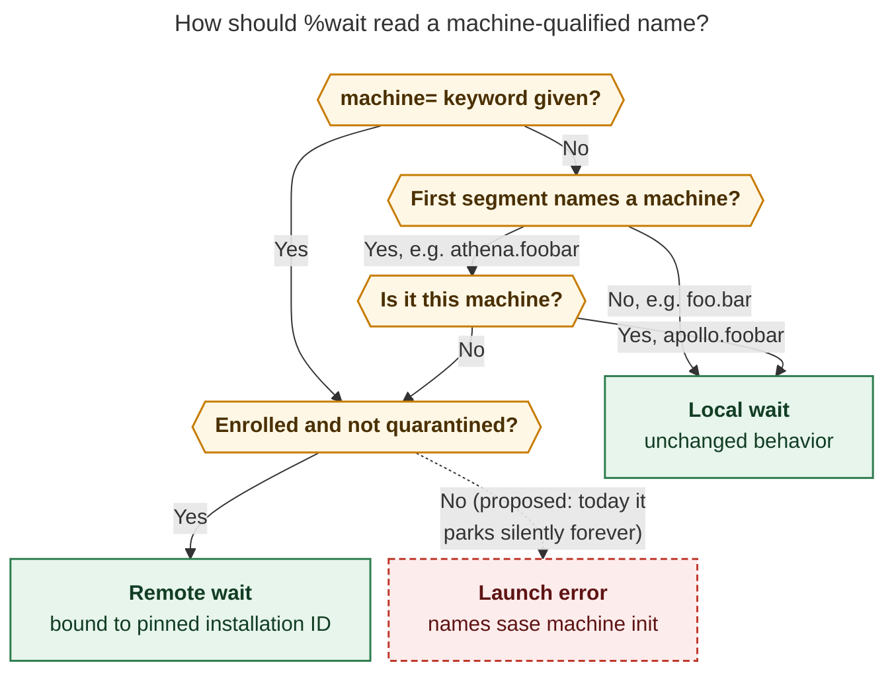
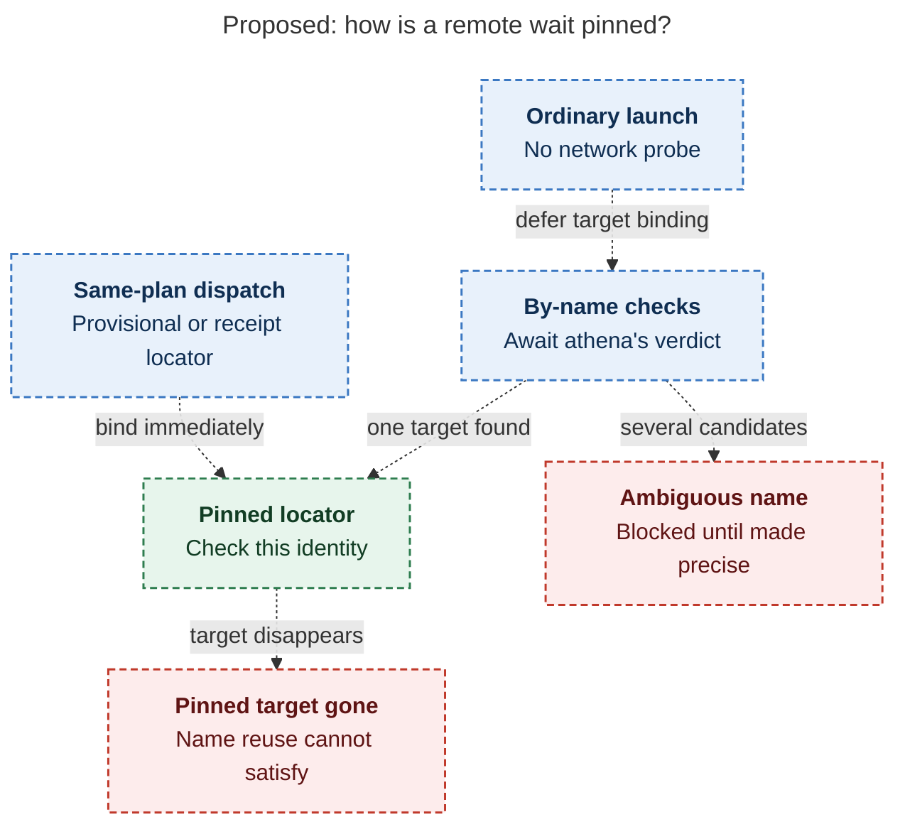
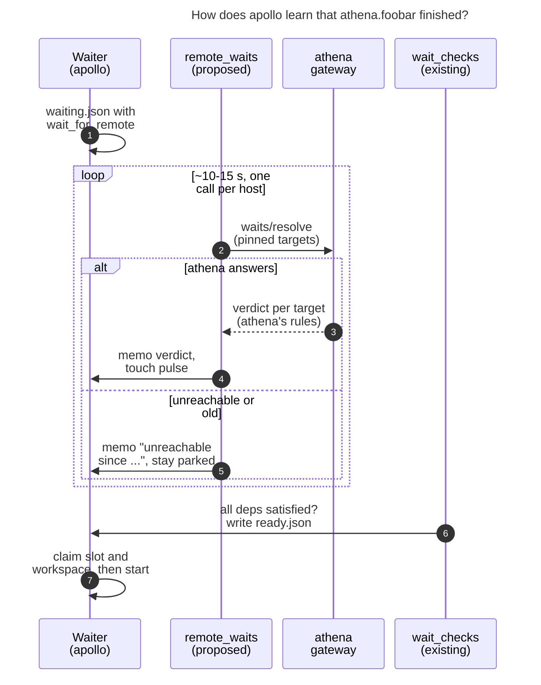
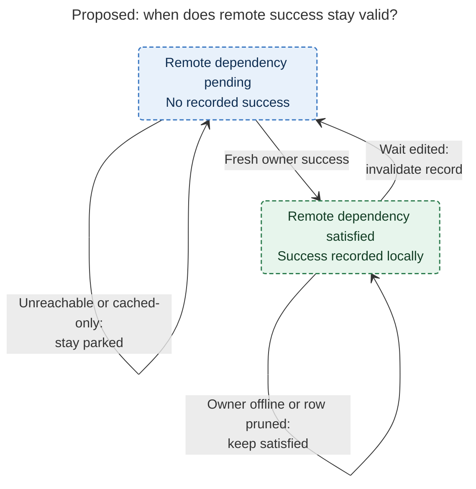

# Waiting on Agents That Run on Other Machines (`%wait:athena.foobar`)

> **Research query:** Given sase's existing but partly broken remote-machine support, what is the best way to let an agent launched on this machine (apollo) wait for a sase agent running on a remote machine that apollo has configured (the requester believes `sase machine init` does this), for example `%wait:athena.foobar` waiting for an agent named `foobar` on athena to complete? Is this a good idea, would a different approach be better, and which clearly called-out requirement adjustments are justified, ending in a recommended solution?

## Bottom line

**Build it.** A local agent waiting on a remote agent is the natural next step after
remote launch (`%dispatch`) and remote visibility (fleet rows in the Agents tab). Most
of the transport already exists: `sase machine init` enrollment, an authenticated
gateway on every machine, and a federation worker that can target one host by
installation ID. The hard part is not the network. It is keeping **one meaning of
"done"** across machines and **failing closed** when a machine cannot be reached.

The two questions that split the five reports both have clear answers once the code is
checked:

1. **Athena must decide whether foobar is done. Apollo must not infer it from athena's
   fleet rows.** Three reports (grk, mus, gem) proposed releasing the waiter when
   athena's fleet row for foobar reads Done or "completed". That would be a correctness
   bug. A fleet row does not carry the agent's outcome, and the core projection buckets
   every finished record as **Done** unless it carries an error or a `failed*` outcome.
   A **killed** agent has neither, so it shows as Done. Both killed `done.json` files on
   apollo fit this shape. A controller-side rule would also have to re-create session
   hand-off, epic-follow, and hijack semantics that the local resolver took many fixes to
   get right. So athena should answer the question with [its own existing wait resolver](#athena-decides-done)
   (the approach cdx and cld proposed).
2. **Keep your dotted spelling. `athena.` is already a reserved machine namespace.** Three
   reports (grk, mus, gem) rejected `%wait:athena.foobar` because they thought it could
   name a local agent. It cannot: on apollo, `foreign_agent_owner_root("athena.foobar")`
   returns `athena`, and launch validation refuses to create any local agent or clan
   under that prefix. The dotted form is the house identity model. It needs [rules](#machine-qualified-syntax) for
   aliases that differ from machine names or contain dots, and a canonical
   `%wait(foobar, machine=athena)` keyword form. It does not need to be dropped.

**Two prerequisites, both verified today:**

- **Apollo has no enrolled machines.** `sase machine list` prints "No remote machines
  are configured." Nothing remote can work until athena is enrolled with
  `sase machine init`.
- **`%wait:athena.foobar` currently parks forever without any notification.** The
  binder treats it as an ordinary not-yet-launched name (`kind='unresolved'`). No local
  agent can ever have that name, and the "can never self-resolve" alert only fires for a
  dependency that ended unsuccessfully. So nothing ever releases or flags the waiter.
  Turning this into a launch error is [the first thing to ship](#phases).

**Recommended solution, in brief** (details in [the recommended solution](#recommended-solution)):

- **Grammar.** `%wait:athena.foobar` and `%wait(foobar, machine=athena)` resolve
  `athena` through enrollment to a pinned installation ID.
- **Owner verdicts.** A new capability-gated route,
  `POST /api/fleet/v1/waits/resolve`, is answered on athena by its existing wait
  resolver through the gateway's existing Python bridge.
- **Polling.** A new apollo scheduler job, `remote_waits`, makes one batched call per
  host every 10–15 seconds and records each verdict in the waiter's `waiting.json`.
- **Release.** The existing filesystem-only `wait_checks` job releases the waiter only
  when every local and remote dependency is satisfied.
- **Failure handling.** A failed target parks the waiter with the existing blocker
  alert. An unreachable machine [never releases the waiter](#unreachable-machines-and-timeouts): it shows how stale the last
  answer is and notifies you after a threshold.

## Critique of the plan

### Is this a good idea

**Yes.** The motivating workflows are real:

- a heavy build or refactor on athena gates a review, publish, or notify agent on apollo;
- several remote researchers gate a synthesis agent;
- a Mac-only task gates an apollo follow-up.

Without this feature, users either watch rows by hand or write sleep loops over
`sase machine agent`. Those loops have no identity pinning, no blocker alerts, and no
WAITING row. A first-class wait also composes with what already exists: `%queue`, `time=`
floors, the Wait modal, scripted `sase agent wait`, and remote retry. A later successful
retry of a failed remote foobar releases the parked waiter, exactly as it would locally.

### The real costs

The requirements should state these costs up front:

1. **Availability coupling.** Apollo's progress now depends on athena's gateway,
   credentials, retained completion records, and network path. That is acceptable only
   if every stall explains itself (see [unreachable machines and timeouts](#unreachable-machines-and-timeouts)).
2. **A wait gives ordering, not outputs** (cdx, gem). When foobar finishes on athena, its
   commits may not be pushed and its artifacts live under athena's `~/.sase`. A remote
   wait must not copy worktrees, pull branches, or import chats. A dependent agent that
   needs foobar's output should name the published revision or artifact, and foobar
   should use a publishing rollover (`#commit`, `#pr`).
3. **Direction is part of the contract.** Apollo can wait on athena only if apollo has
   enrolled athena. Athena waiting on apollo needs the reverse enrollment.
4. **Distributed cycles** (apollo A waits on athena B while B waits on A) will deadlock,
   as local cycles do. Report direct reciprocal cycles when both owners expose the
   evidence. Do not promise global cycle detection.

### Cheaper alternatives

**Cheaper alternatives already cover some cases.** Choose them when they fit:

- **Bead waits already cross machines.** `%wait(bead=<id>)` resolves against bead state
  that the beads sidecar syncs over git (`mark_bead_wait_sync_hint`). If foobar's real
  job is "close bead X", wait on the bead. Expect minutes of latency, and both machines
  must share the project.
- **Run the follow-up on the owner.** `%dispatch:athena %wait:foobar ...` would need no
  distributed wait, because the target processes the remaining directives locally. It
  is blocked only by the conservative V1 ban in `src/sase/macro/_directive_scan.py`.
  Lifting the ban for owner-local waits is a separate, much cheaper feature (cld option
  G, grk feature A). It is worth its own small epic, but it does not satisfy this
  request.
- **`%proc` plus a polling CLI** makes a good stopgap and test harness, but it is not the
  product.

### Would I take a different approach

**Not a different architecture.** I would make three changes of emphasis:

- **Treat this as a change to wait evaluation, not a syntax extension** (mus). Asking
  "what does `%wait` mean when its target is owned by another machine?" forces the
  decisions about done-ness, staleness, pinning, and failure that "accept a dotted name"
  hides.
- **Ship the fail-fast error first**, because today's silent park is a live trap.
- **Let athena decide**, not apollo, for the reasons in [Athena decides done](#athena-decides-done).

### Claims that should not drive design

Two claims in the reports should not drive design:

- **"Parked waiters exhaust workspaces and runner slots"** (gem). They do not; see [re-verified claim 7](#what-i-re-verified).
- **"Release on the owner's recorded `completed` from the feed"** (mus). The feed does
  not serve the outcome, and `completed` is only one of four success outcomes ([re-verified claims 5 and
  6](#what-i-re-verified)).

## How the five reports line up

| Question | cdx | cld | grk | mus | gem | Resolution |
| --- | --- | --- | --- | --- | --- | --- |
| Who decides "done"? | Athena, through a new shared Rust predicate | Athena, through its existing Python resolver via the gateway bridge | Apollo, from the session's fleet status bucket | Apollo, from the fleet catalog or detail outcome | Apollo `wait_checks`, from catalog or batch rows | **Athena** ([reasoning](#athena-decides-done)). Fleet rows show a killed agent as Done. |
| Dotted `athena.foobar`? | Shorthand, with guards | Keep: it is the reserved machine hood | Reject: dots mean hoods | Reject | Reject; prefer `/` or `:` | **Keep, with rules** ([reasoning](#machine-qualified-syntax)) |
| `machine=` keyword | Canonical | Yes | Only form | Only form | Primary form | **Canonical form** |
| Launch-time binding | Bounded network call to athena is required | Network-free; pin on first verdict | Catalog lookup at arm time | Pin at launch | Not specified | **Network-free launch; pin on first verdict** ([reasoning](#launch-binding-and-target-pinning)) |
| Unreachable machine | Stay pending; optional deadline | Never release; notify after a threshold | Fail closed | Park, plus a mandatory TTL (2 h default, 12 h cap) | Mandatory timeout (about 4 h) | **Never release; notify; no default timeout** ([reasoning](#unreachable-machines-and-timeouts)) |
| Epic-follow default | Preserve | Preserved by the owner resolver | Not in v1; `for_epic=false` only | Error in v1 | Not addressed | **Preserve, through athena** ([reasoning](#epic-follow)) |
| `target=turn` in v1 | Yes | Defer | Yes | Yes | Yes | **Defer** ([reasoning](#turn-targeted-waits)) |
| Polling location | Separate refresh job | Separate `remote_waits` job | Federation follows plus a pulse | Existing poll loop | Inside `wait_checks` | **Separate job; `wait_checks` stays off the network** ([reasoning](#where-polling-lives-and-how-fast)) |
| Gateway change | Yes | Yes (additive, capability-gated) | No | No | Minor | **Yes, additive** |

All five agree on these points:

- Keep the current ban on combining `%dispatch` with `%wait`.
- Never infer success from uncertainty.
- Pin the target machine's installation ID, not its alias.
- Defer push events and remote tribes or hoods.
- Ship CLI parity (`sase agent wait`).

## Resolving the disagreements

### Athena decides done

The deciding fact is [re-verified claim 5](#what-i-re-verified). Fleet rows are a display projection. They cannot tell
"completed" from "killed", so any controller-side rule over `status_bucket`, `lifecycle`,
or `status` would release a waiter after its producer was killed. Adding an `outcome`
field would close that particular hole, but not the larger one. Local "done" also means:

- the **newest** run of that name;
- the session's members, including a successor that appears *after* the wait was armed;
- following resolved hijack successors;
- following epics that the target launched (the default for named waits).

The [`11q.w0` incident](../../202610/11q_w0_early_wait_release.md) shows how subtle
this is. During a gate hand-off there was an 18-second window in which a session looked
finished but was not. The local resolver now re-checks membership after reading
completion markers to close that window (`_confirmation.py`). A controller reading
snapshots of a remote feed would reopen that window, and widen it.

**Choosing between cdx and cld on how athena evaluates.** cdx wants the predicate
extracted into `sase_core` first, so the Rust gateway and local waits share it. cld wants
the gateway to call athena's **existing** Python resolver through the bridge it already
has. I recommend cld's approach for v1:

- It adds no new semantics and no second predicate. The same code that releases local
  waits answers remote ones.
- It avoids putting a port of about 5,500 lines on the critical path ([re-verified claim 11](#what-i-re-verified)).
- It respects the [Rust core boundary](#method-and-sources) for everything new. The wire types,
  route, capability, federation operation, and machine-qualified reference parsing all
  live in sase-core. The Python side is a thin bridge adapter over existing code.
- The cost is that each poll spawns a Python process on athena. cld's mitigation keeps
  this cheap: cache the verdict set by the owner's fleet store cursor, so an unchanged
  store does not spawn Python at all.

File the Rust port of the resolver as a follow-up. Two machines now depend on the same
semantics, which satisfies the core-boundary litmus test, so the port has a concrete
justification.

Asking athena a live, stateless question does not revive the deleted agents-sync import
leg (decision `agents-sync-publish-only`). Mirroring remote completions to disk, or
creating local proxy or shadow agents, would revive it. All five reports reject those
designs.

### Machine-qualified syntax

**Keep the dotted form and add `machine=`.**

grk's case against dots was that `%wait:athena.foobar` "already looks up a *local*
agent named `athena.foobar`" and that a local hood named `athena` could be silently
retargeted. For a machine that sase already knows, neither is true ([re-verified claims 1 and 3](#what-i-re-verified)).
What is true is that the dotted form needs rules:

- **Aliases and machine names can differ.** The reserved roots are owner machine names
  (`kellys_mbp`). `%dispatch` uses enrollment aliases (`mac`). They match for athena but
  not for the Mac.
- **Aliases may contain `.` and `-`.** See `validate_machine_alias`. Machine names must
  match `^[a-z_]+$`.

The rules (merged from cld and cdx):

1. **Remote by prefix.** A reference is remote when its first segment is a known
   foreign owner root that maps to exactly one enrollment, or an enrolled alias that is
   hood-safe (`^[a-z_]+$`). `apollo.foobar` on apollo stays local and normalizes to
   `foobar`, as it does today.
2. **Reserve enrolled aliases.** Enrolling an alias reserves it as an owner root, so a
   local clan named `mac` can never collide with the machine `mac`. If a local clan
   already uses the name, refuse at enrollment or require the keyword form.
3. **Canonical keyword form.** `%wait(foobar, machine=athena)` is canonical. Use it for
   any alias that is not hood-safe, and as the form that `format_wait_spec`,
   completions, and generated prompts emit.
4. **Decide once, at launch.** Resolve the reference when the waiter is launched and
   persist the result. Never reinterpret a pending wait because an alias was enrolled
   later.
5. **Fail loudly.** A known but unenrolled or quarantined machine is a launch error that
   names `sase machine init` (or `repair`).

Slash and colon variants (`athena/foobar`, gem) would add a second sugar for no gain.

*Figure 1. A reference is remote only when it names another machine that apollo has
enrolled. Names under the local machine and ordinary dotted names stay local. A known
but unenrolled machine becomes a launch error instead of today's silent permanent park.
The dashed path is proposed.*

### Launch binding and target pinning

**No network at launch; pin the target on the first verdict.**

cdx requires a successful, bounded call to athena before a remote wait is accepted. cld
keeps launch network-free. I side with cld, for three reasons:

- The Launch Target picker and the `%tab` + `%dispatch` preflight already avoid network
  probes at launch.
- A remote machine may legitimately be asleep when you queue follow-up work.
- Names are permanent IDs on the owner ([re-verified claim 13](#what-i-re-verified)), so a by-name reference is
  well-defined until someone deliberately wipes it with `%id:!`.

Launch therefore checks only local data:

- the alias is enrolled and not quarantined;
- the cached hello capabilities do not show `wait.resolve.v1` as missing (an unknown
  capability warns and proceeds, as the `%tab` preflight does);
- every v1 restriction in the [adjusted requirements](#adjusted-requirements) holds.

Then adopt cdx's identity discipline. The first verdict from athena that finds the
target returns its logical locator, and apollo pins it. Later checks use the locator,
not the name. If the pinned target disappears, for example because it was wiped and its
name reused, the verdict is `gone` and the waiter stays blocked. A later run that
happens to reuse the name never satisfies it. If athena finds several candidates for one
name, for example across projects, it returns `ambiguous` with the candidates and the
waiter is blocked until the reference is made precise. [The target-pinning diagram](#figure-remote-target-pinning) shows the two proposed pinning paths, athena's first verdict or a same-plan dispatch locator, and how ambiguity or disappearance blocks instead of following a reused name.

_A remote wait pins its target from either the first unambiguous owner verdict or a same-plan dispatch locator; name reuse never substitutes another target._

There is one important exception (cld A7). When the same launch plan dispatches the
target (`%dispatch:athena %id:foobar`) and a later segment waits on `athena.foobar`, bind
to the dispatch's provisional or receipt locator immediately.

### Unreachable machines and timeouts

**Never release; no default timeout.**

mus and gem want a mandatory TTL. Their analogy is the `%hold` TTL, but it points the
wrong way. Holds fail open because a hold is a courtesy (decision
`hold-pull-fail-open`). A wait is a correctness barrier. Releasing it early is the
harmful failure, and a 2–4 h default would also break legitimate overnight builds. The
other risk mus raises, a waiter stranded forever without anyone noticing, is real.
Visibility solves it better than a release does:

- While athena is unreachable, the WAITING row shows something like "athena unreachable
  since 14:02 · last verdict: RUNNING".
- One deduplicated notification fires after a configurable threshold (cld suggests
  30 minutes). It names the machine, the last good observation, and the recovery
  command.
- A quarantined or removed alias is a terminal blocker with `sase machine repair`
  guidance.
- `unwait` still works as the manual escape hatch.

If you later want an elapsed deadline, add `timeout=` to **all** waits, local and
remote, so the grammar stays symmetric. When it expires, the waiter should become a
terminal blocker, never a release. `%wait(time=...)` already means a minimum delay, not
a timeout.

### Epic-follow

**Preserve the default by evaluating on athena.**

grk and mus banned `for_epic=true` in v1 because a controller reading fleet rows cannot
follow epics. With athena evaluating the wait, the default comes for free: athena's
resolver already follows the epics that foobar launched, against athena's own bead and
epic state. Silently weakening the default (named waits follow launched epics, per
`docs/reference/macros/directive-launch.md`) would surprise planners. Keep the default
and keep `for_epic=false` as the opt-out. One rule follows: evidence of the epic that is
being followed stays qualified by owner and project inside the remote record. It is
never copied into apollo's local `wait_for_beads`.

### Turn-targeted waits

**Defer `target=turn`.**

Locally, `target=turn` binds the session's *current* turn at the moment the wait is
created. With [network-free launch](#launch-binding-and-target-pinning), the first contact with athena can come minutes
or hours later, by which time the current turn may have changed. That would silently
change the meaning. Defer `target=turn` until there is a bind call that captures the
owner's current turn as of the waiter's launch time. Until then, reject it with a named
diagnostic.

### Where polling lives and how fast

- **Not inside `wait_checks`** (gem). That job has a 2-minute timeout and serves every
  local waiter. A hung remote host must not delay local releases. Keep `wait_checks`
  filesystem-only and let it count a remote dependency as satisfied only through a
  recorded verdict.
- **A separate `remote_waits` job** in the `agent_waits` chop (cld and cdx). Every 10–15
  seconds, it groups live remote dependencies by installation ID and makes one batched
  call per host. It deduplicates identical targets and uses the worker's 5 s deadline,
  capped exponential backoff with jitter, and no retries across layers. It must use a
  non-cached federation operation ([re-verified claim 12](#what-i-re-verified)). It records verdicts through
  `write_waiting_marker`, which touches the pulse ([re-verified claim 8](#what-i-re-verified)). If there are no remote
  dependencies, it makes no network calls.
- **Runner fallback.** The runner's 60-second fallback reads the recorded verdict.
  Optionally it can call the resolver itself at a slow cadence (5 minutes or more), so a
  dead scheduler cannot strand remote waiters. This mirrors the local design.
- **Latency.** October's measurements found that runner-slot admission after release
  had a median of about 45–50 s
  ([wait wake-up research](../../202610/wait_wakeup_jobs_vs_service_procs/wait_wakeup_jobs_vs_service_procs__final.md)).
  That was measured on athena in October and may have changed since. Even so, a 10–15 s
  poll is not the dominant cost. Push events can come later as a *wake-up hint* that
  triggers a check, never as the source of truth.

## Adjusted requirements

Each item adjusts or sharpens the original request. They are listed so you can accept
or veto each one individually.

1. **R1 · The qualifier is an enrolled machine, resolved to a pinned installation ID.**
   `athena` in `athena.foobar` means the enrollment that `sase machine init` created, not
   a hostname. Owner machine names and hood-safe aliases are both accepted when they map
   to exactly one enrollment.
2. **R2 · Add a canonical keyword form.** `%wait(foobar, machine=athena)` sits alongside
   the dotted sugar and is required for aliases that are not hood-safe.
3. **R3 · "Complete" means exactly what it means for a local `%wait`, and athena
   decides it.** That is success of the newest run, with session and clan aggregation,
   hijack following, and epic-follow by default. A failed, killed, or stopped foobar
   parks the waiter and raises the existing blocker alert. It is not "reached any
   terminal state."
4. **R4 · An unreachable or version-skewed machine never releases a waiter.** It is shown
   with how stale the last verdict is and notified after a threshold. There is no
   default timeout.
5. **R5 · Launch stays network-free.** The target identity is pinned on the first
   successful verdict, or immediately for a target dispatched in the same swarm. A later
   run that reuses the name does not satisfy a pinned wait.
6. **R6 · v1 supports named agents, sessions, and clans with the default session
   target.** These are explicit errors in v1: `target=turn`, `hood=`, `@tribe`, `proc=`,
   `unit=`, and `bead=` combined with `machine=` in the same occurrence (bead waits
   already work through sync).
7. **R7 · Keep the `%dispatch` + `%wait` ban.** Remote-qualified waits inside dispatched
   prompts are rejected. Lifting the ban for owner-local waits is a separate feature.
8. **R8 · A remote wait gives ordering only.** It never transfers outputs.
9. **R9 · CLI parity.** `sase agent wait athena.foobar` (or `--machine athena`) uses the
   same resolver as `%wait`. It is the easiest end-to-end test and lets monitors span
   machines.
10. **R10 · Fail fast now.** Until the feature lands, a wait on a foreign-root name is a
    launch error, not a silent permanent park.

## Recommended solution

Implement remote waits as **owner-answered, controller-pulled, recorded
dependencies**.

*Figure 2. The only new network hop is a batched call that athena answers using its own
wait rules. Release still goes through the existing filesystem-only `wait_checks` job,
so local and remote dependencies share one barrier. The `remote_waits` and
`wait_checks` jobs both run on apollo; "memo" means the verdict is recorded in the
waiter's `waiting.json`.*

### Components

**sase-core (Rust):**

- **Wire types** in `fleet_contract/waits.rs`.
  - Request: `targets: [{name, target, for_epic, pinned_logical_key?}]`.
  - Each result carries a verdict: `resolved | waiting | failed | missing | ambiguous |
    gone`.
  - Each result also carries `outcome`, `blocking_label`, `logical_locator`, and the
    owner's `settled_at_unix`. The response carries the store `cursor` and `freshness`.
  - No paths are returned, and secret-looking input is rejected, as the catalog does.
- **Route.** `POST /api/fleet/v1/waits/resolve` under the existing fleet read scope.
  Never require launch or stop permission just to wait. Register it in `router.rs` and
  `contract.rs` and regenerate the fleet contract snapshot.
- **Capability.** Advertise the host capability `wait.resolve.v1` in hello. An old
  gateway returns "upgrade required" rather than falling back to name polling.
- **Federation worker.** Add a `wait_resolve` operation that targets an installation ID,
  like `catalog_hosts`. It is uncached, or validated by cursor, and **never served from
  the backoff cache** for a release decision.
- **Parser.** Machine-qualified reference parsing next to `parse_wait_target`, plus a
  `WaitTargetWire` remote variant, so typed launch plans treat a remote reference as
  structurally remote. This must happen before plan resolution can match it against a
  sibling launch unit (cdx).

**sase, owner side (athena):**

- A `sase mobile agent-bridge wait-status` subcommand that builds athena's
  `WaitDependencyIndex` and calls the same resolution and terminal-blocker
  classification that local waits use. It adds no new predicate.
- Gateway-side caching of the verdict set by store cursor.

**sase, controller side (apollo):**

- **Directive and wait-spec grammar** (`machine=`, the dotted rules from [machine-qualified syntax](#machine-qualified-syntax)), launch
  validation, and the fail-fast diagnostics family (`wait-machine-*`).
- **`waiting.json`** gets a `wait_for_remote` entry:
  `{alias, installation_id, name, target, for_epic, pinned_logical_key, dispatch_operation_key}`.
  Teach every release path about it: runner `has_dependencies`, startup, `_load_live_waiter`,
  the fallback, wait edits, and refresh or relaunch restoration. Version the marker so
  an unknown dependency kind can never release.
- **Recorded verdicts** go into `resolved_deps` as
  `{"remote": {installation_id, logical_key, outcome, settled_at_unix}}`. Once recorded,
  a resolved remote dependency stays resolved even if athena later goes offline or
  prunes the row. Any edit to the wait invalidates the record.
- **The `remote_waits` job and its config defaults** in `src/sase/default_config.yml`.
- **Presentation and docs:**
  - the blocked-on text names `athena.foobar` with its machine chip and how fresh the
    verdict is;
  - the existing red "can never self-resolve" notification names the machine and points
    to remote retry (`R`);
  - update `directive-launch.md` and `remote-dispatch.md`, and the `macros.md` and
    `dispatch.md` memory notes through the memory-write procedure.
- Never compare apollo's clock with athena's timestamps.

[The recorded-success diagram](#figure-recorded-remote-success) traces one remote dependency's lifecycle: a recorded success survives an owner outage or row pruning, while any edit to the wait invalidates it.

_Recorded remote success survives outages and pruning; editing the wait invalidates it. Other dependencies must still be satisfied._

### Verdict handling

| Athena's verdict or observation | Waiter behavior |
| --- | --- |
| `resolved` from a fresh, non-cached answer | Record the verdict; release once every other dependency is satisfied |
| `waiting` (running, queued, asking, or a hand-off still in progress) | Stay parked; show the remote status |
| `failed` (failed, killed, stopped, epic launch failed) | Stay parked; red blocker alert naming `athena.foobar`; a later successful remote retry still releases |
| `missing` (no such name on athena yet) | Stay parked, like a local by-name wait; show "no agent named foobar on athena yet" |
| `ambiguous` or `gone` | Stay blocked; notification asks for an exact reference or a re-bind |
| Unreachable, unauthorized, unsupported, or cached-only | Stay parked; show "unreachable since …" and the last verdict; notify after a threshold; **never release** |
| Alias quarantined or removed | Terminal blocker with `sase machine repair` or `init` guidance |
| Manual override | Existing `unwait` |

### Phases

1. **Phase 0, now (small, about a day):**
   - Enroll athena from apollo (`sase machine bootstrap` on athena, then
     `sase machine init -B` on apollo).
   - Make waits on foreign-root names fail fast with "remote waits are not supported
     yet".
   - Fix the host filtering and paging in `sase machine agent` lookups ([re-verified claim 14](#what-i-re-verified)): use
     `catalog_hosts` for the alias's installation ID and page until there is an exact
     match.
2. **Phase 1, sase-core (medium):** wire types, route, capability, federation
   operation, and the parser and `WaitTargetWire` variant, with contract-snapshot and
   binding tests. Moving sase's `sase-core-revision.txt` pin is part of the landing.
3. **Phase 2, owner side (small to medium):** the bridge `wait-status` subcommand and
   cursor caching. Test it against a local gateway with synthetic session lifecycles,
   including the gate-hand-off window.
4. **Phase 3, controller side (medium to large; most of the work):** grammar, marker
   field, every release path, the `remote_waits` job, notifications, and TUI text. Land
   it behind a feature flag (see the `sase_flags` memory note) until a live
   apollo-to-athena acceptance run passes.
5. **Phase 4 (medium):** `sase agent wait athena.foobar` / `--machine`, and binding
   same-swarm dispatch targets to their locators.
6. **Later, driven by evidence:**
   - fleet-event wake-up hints;
   - `target=turn`, using an owner bind call;
   - remote hoods, tribes, and clans;
   - lifting `%dispatch` + `%wait` for owner-local waits (a separate epic);
   - reverse-direction enrollment;
   - an optional `timeout=` for all waits;
   - the Rust port of the wait resolver.

### Acceptance tests

Merged from cdx and grk.

- A remote **killed** or **stopped** foobar does **not** release the waiter. This is the
  regression for the fleet-bucket trap.
- Success, failure, a malformed marker, and a missing target each map to exactly one
  verdict. Only success releases.
- During a gate answer, monitor completion, or successor launch, a session wait stays
  pending through the hand-off window.
- When a planner launches an epic, the default wait includes the epic's closure.
  `for_epic=false` releases at the agent boundary instead.
- Reusing a name after `%id:!`, renaming or reassigning an alias, or reinstalling the
  owner either keeps the original binding or blocks with a re-bind explanation.
- `apollo.foobar` stays local, `foo.bar` stays local, and an alias containing a dot
  requires `machine=`.
- A stale or cached feed, a gateway restart, or expired credentials never release a
  waiter. In a partial batch, healthy targets still make progress.
- foobar completes while apollo is offline and is then dismissed or ages out of the
  presentation window. The waiter is still released.
- Apollo crashes before or after recording a verdict, or before writing `ready.json`. On
  restart there is no duplicate release and no unsafe bypass.
- Mixed local and remote dependencies plus `time=` compose correctly. An
  already-recorded remote success survives a later outage.
- Many waiters share one target and one host hangs. Calls are deduplicated and bounded,
  and local waits are unaffected.
- `wait_checks` fires from the pulse without any local artifact change, with the TUI
  closed.
- An old gateway or an old marker schema gets explicit "unsupported" behavior. An absent
  field is never treated as success.

## Confidence and open questions

**High confidence:**

- fleet rows cannot decide release (code plus on-disk markers);
- `athena.` is reserved (live probe);
- the current permanent park (live probe);
- apollo has no enrollment;
- parked waiters hold no workspace or slot;
- the pulse and false-release traps.

**Medium confidence:**

- the cost of the bridge approach per poll (I did not measure a Python spawn on athena);
- the exact poll interval. The admission-latency figures are from October.

**Not verified:**

- any live apollo-to-athena exchange, since nothing is enrolled;
- whether athena's retained completion evidence covers every dismissed or pruned case
  that the owner resolver needs (cdx flags retention as a release blocker if it does
  not).

**Decisions for you:**

1. In the dotted form, accept both owner machine names (`kellys_mbp.x`) and hood-safe
   aliases (`mac.x`)? I recommend both, mapped through one enrollment, with an error on
   conflict.
2. Is a [10–15 s poll](#where-polling-lives-and-how-fast) acceptable, or do you want event wake-ups in v1? I recommend
   polling first.
3. Do you want athena-waits-on-apollo soon? If so, plan two-way enrollment into the
   rollout.
4. Do you want the [cheaper](#cheaper-alternatives) `%dispatch:athena %wait:foobar` (owner-local) epic first? It
   covers "the follow-up can run anywhere" with no distributed wait.

## What I re-verified

| # | Claim | Verdict | Evidence |
| --- | --- | --- | --- |
| 1 | `athena.` is a reserved machine prefix | **Confirmed** (cld); premise of grk, mus, and gem refuted | Live probe on apollo returned known roots `('bbugyi200.apollo', 'bbugyi200.athena', 'bbugyi200.kellys_mbp', 'apollo', 'athena', 'kellys_mbp')`. `athena.foobar → athena`, `kellys_mbp.x → kellys_mbp`, `foo.bar → None`, `research.3l.cdx → None`, `mac.foobar → None`. `src/sase/agent/launch_validation.py` refuses local names under a foreign root. |
| 2 | Those roots come from the name registry and agents sidecar, not from enrollment | **Confirmed**, and a new detail | `sibling_machines` is only `('apollo',)`. `athena` is known only through `~/.sase/agent_name_registry.json` and/or agents-sidecar history (`_discover_known_owner_roots` in `src/sase/core/agent_identity_facade.py`). Enrollment aliases (`mac`) are not reserved. |
| 3 | `%wait:athena.foobar` today parks forever | **Confirmed** (cld) | `bind_wait_target('athena.foobar')` on the installed sase returns `kind='unresolved', scope='name'`. There is no foreign-root check anywhere in wait binding or resolution. |
| 4 | Apollo has no enrolled machines | **Confirmed** (cld) | `sase machine list` prints "No remote machines are configured." |
| 5 | Fleet rows can decide release | **Refuted**: a killed agent reads as Done | `ResolvedAgentSummaryWire` has `status`, `status_bucket`, and `lifecycle`, but no `outcome` (sase-core `fleet_contract/resolution.rs`). `OwnerPresentationFactsWire` has no outcome either. `lifecycle_for_record` (`fleet_contract/projection.rs`) returns `Terminal`, and so bucket `Done`, for any done marker without an error, a `failed*` outcome, or a `FAILED*` status label. Both killed `done.json` files on apollo have `outcome: "killed"`, no error, and no status label. |
| 6 | Named waits release only on `completed` (mus) | **Refuted** | `WAIT_SUCCESS_OUTCOMES = {completed, noop, epic_approved, plan_committed}`; `FAILURE_OUTCOMES` includes `killed`, `stopped`, and `epic_launch_failed` (`src/sase/core/dismissed_agent_completion.py`). |
| 7 | A parked waiter holds a workspace and a runner slot (gem) | **Refuted** | `_admit_and_launch` in `src/sase/axe/run_agent_runner.py` claims the runner slot after the dependency wait and before any "real workspace claim". A parked waiter costs a process with its idle memory released (`release_idle_memory()`). |
| 8 | Remote completion will not wake `wait_checks` (cdx, grk) | **Confirmed, with a fix already available** | `wait_checks` re-scans only when `projects/*/artifacts/.ace_refresh_pulse` changes, or after the 120 s `max_quiet` backstop (`src/sase/default_config.yml`, `agent_waits`). However, `write_waiting_marker` touches that pulse (`src/sase/axe/run_agent_wait_markers.py`). A poller that records verdicts through it therefore wakes `wait_checks` on its next 2 s tick. |
| 9 | Adding a new dependency kind can cause a false release (cdx) | **Confirmed** | The runner computes `has_dependencies` from a fixed list of fields (`src/sase/axe/run_agent_wait.py`). `_load_live_waiter` returns `None` for a marker whose known lists are all empty (`src/sase/scripts/_chop_wait_checks_run.py`). Each release path must learn the new kind explicitly. |
| 10 | The gateway can ask athena's Python code | **Confirmed** (cld) | `sase_gateway` has an `agent_bridge_command` that runs `sase mobile agent-bridge ...` (`crates/sase_gateway/src/server.rs`, `src/sase/main/parser_mobile.py`). |
| 11 | Porting the wait predicate to Rust first is small (implied by cdx) | **Refuted on size** | `src/sase/core/wait_dependency_resolution/` is about 5,500 lines of Python across 22 modules. Only the target vocabulary and parts of epic-follow are in Rust. |
| 12 | The federation worker can serve cached data on failure (cdx) | **Confirmed** | `remote_hosts.rs` returns `cached_or_error(...)` during backoff and after transport errors, with a `cached` flag. A release decision must reject cached answers. |
| 13 | Names are permanent IDs (cld) | **Confirmed** | `docs/reference/macros/directive-launch.md`: a normal `%id:<name>` cannot reuse a name with existing state. Reuse requires `%id:!<name>`, which wipes the previous owner. |
| 14 | `sase machine agent stop/retry/fork` does not filter by host (cld) | **Confirmed** | `_lookup_snapshots` in `src/sase/ops/commands/machine.py` calls the all-host `catalog_sync` (substring `query`, `limit: 100`, no paging). It then labels every matching row from every host with this alias and installation pin. |
| 15 | `machine=` is new and additive | **Confirmed** | The supported `%wait` keys are `agent, bead, for_epic, hood, proc, target, time, unit`. Unknown keys already raise an error (`src/sase/macro/_directive_collect_main.py`). |

## Method and sources

Consolidated report by the lead researcher, 2026-11-07. It merges five independent reports
([cdx](waiting_on_remote_machine_agents__cdx.md),
[cld](waiting_on_remote_machine_agents__cld.md),
[grk](waiting_on_remote_machine_agents__grk.md),
[mus](waiting_on_remote_machine_agents__mus.md),
[gem](waiting_on_remote_machine_agents__gem.md)) with my own re-verification. I checked
sase `master` at `0ba9cfc9f1`, the linked sase-core checkout at `317ea6a1` (v0.44.0),
and the installed sase 0.18.1 / sase-core-rs 0.44.0 on apollo. I ran only read-only
probes and changed no product code.

- **Researcher reports (this directory):**
  [cdx](waiting_on_remote_machine_agents__cdx.md),
  [cld](waiting_on_remote_machine_agents__cld.md),
  [grk](waiting_on_remote_machine_agents__grk.md),
  [mus](waiting_on_remote_machine_agents__mus.md),
  [gem](waiting_on_remote_machine_agents__gem.md).
- **Prior research:**
  [11q.w0 early wait release](../../202610/11q_w0_early_wait_release.md);
  [wait wake-up jobs vs service procs](../../202610/wait_wakeup_jobs_vs_service_procs/wait_wakeup_jobs_vs_service_procs__final.md).
- **sase (`0ba9cfc9f1`):**
  - identity and names: `src/sase/core/agent_identity_facade.py`,
    `src/sase/agent/launch_validation.py`;
  - wait binding and grammar: `src/sase/agent/wait_target_binding.py`,
    `src/sase/macro/_directive_collect_main.py`, `src/sase/macro/_directive_scan.py`;
  - runner barrier: `src/sase/axe/run_agent_wait.py`,
    `src/sase/axe/run_agent_wait_markers.py`, `src/sase/axe/run_agent_runner.py`;
  - release: `src/sase/scripts/_chop_wait_checks_run.py`,
    `src/sase/core/dismissed_agent_completion.py`,
    `src/sase/core/wait_dependency_resolution/`;
  - machines: `src/sase/ops/commands/machine.py`, `src/sase/main/parser_mobile.py`;
  - config: `src/sase/default_config.yml` (`agent_waits`);
  - docs: `docs/reference/macros/directive-launch.md`,
    `docs/reference/automation/scheduler-default-routines.md`.
- **sase-core (`317ea6a1`):** `crates/sase_core/src/fleet_contract/{projection,resolution}.rs`,
  `crates/sase_core/src/fleet_owner_facts.rs`, `crates/sase_gateway/src/server.rs`,
  `crates/sase_gateway/src/routes/router.rs`,
  `crates/sase_gateway/src/federation_worker/imp/remote_hosts.rs`.
- **Memory and decisions:**
  - memory notes `dispatch.md`, `macros.md`, and `rust_core_backend_boundary`;
  - decisions `agents-sync-publish-only`, `hold-pull-fail-open`, `rust-core-required`,
    and `single-turn-agents`.
- **Live read-only probes on apollo, 2026-11-07:**
  - `sase machine list`;
  - `foreign_agent_owner_root` and `bind_wait_target` on the installed sase 0.18.1;
  - a survey of `done.json` outcome, error, and status-label shapes across the 1,773
    local markers.
